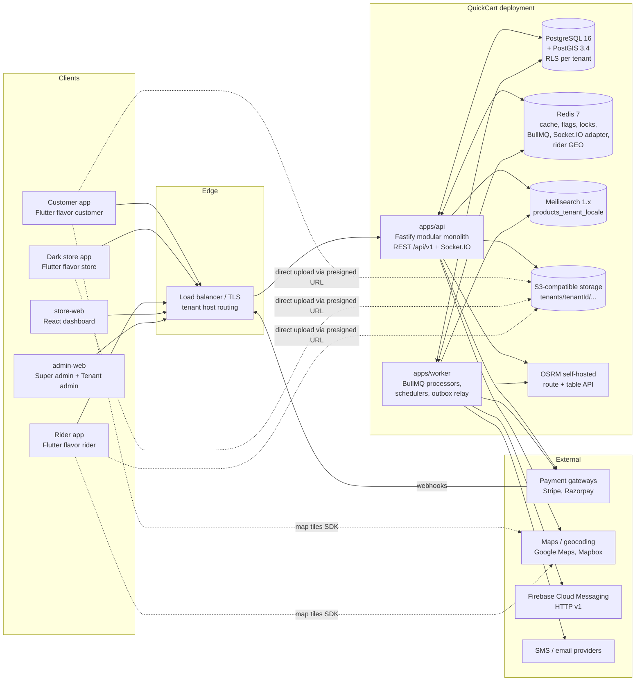

# 01 — Multi-app ecosystem and architecture

**Pillar 1 of the QuickCart blueprint.**
**Status:** blueprint. Nothing described here is implemented or tested. Where this document says "the API does X", read it as "the API is designed to do X".
**Governing file:** `00-CONTRACT.md`. Stack, table names, order statuses, flag keys and API conventions come from there and are not redefined here.

Related documents:

| Topic | Where it is specified in depth |
|---|---|
| Table DDL, constraints, RLS policies, partitions | `02-DATA-SCHEMAS.md` |
| Flag engine, `settings` keys, tax engine, currency and FX, i18n | `03-CONFIG-FLAGS-TAX.md` |
| Design tokens, component library, motion (map animation tokens) | `04-DESIGN-SYSTEM.md` |
| Source tree, module layers, adapter interfaces, code samples | `05-CODE-STRUCTURE.md` |
| Installer, Docker/Helm, environment schema, index list | `06-INSTALLER-DEPLOYMENT.md` |

Conventions used in this document:

- **Decision** marks an architectural decision that code must follow.
- **Example value** marks a default that lives in `settings` (scope global, country, tenant or store; see `03-CONFIG-FLAGS-TAX.md`). Example values are configuration, never constants in code. Setting keys shown here are written as `settings:<key>`.
- Flag keys are written as `flag:<key>`. Keys from contract section 5 are used as-is; keys this document adds are listed in section 13 and must be registered in `feature_definitions`.

---

## Table of contents

1. Architecture at a glance
2. System context
3. Runtime topology and process roles
4. Customer app
5. Dark store app (Flutter `store` flavor) and Store web dashboard (`store-web`)
6. Rider app
7. Super Admin and Tenant Admin (`admin-web`)
8. Core end-to-end flows
9. Concurrency and consistency
10. Realtime design
11. Non-functional targets
12. Security model
13. Flag and setting keys introduced by this document
14. Existing prototype in this repository → target

---

## 1. Architecture at a glance

| Decision | Statement |
|---|---|
| D1 Modular monolith | One deployable API (`apps/api`) built from bounded-context modules (catalog, inventory, orders, dispatch, ...). Modules communicate through their public `index.ts` and through domain events. Extraction to a separate service is possible per module later because the boundaries are enforced in CI (see `05-CODE-STRUCTURE.md`, dependency rules). |
| D2 Separate worker process | `apps/worker` runs the same module code but only job processors (BullMQ consumers, schedulers, outbox relay). HTTP and WebSocket traffic never runs long jobs. |
| D3 PostgreSQL is the source of truth | Stock, orders, payments and ledgers live only in PostgreSQL 16 + PostGIS. Redis, Meilisearch and Socket.IO state are derived and can be rebuilt. |
| D4 Shared database, RLS isolation | Every tenant table has `tenant_id`; every transaction runs `SET LOCAL app.tenant_id`; RLS policies reject rows of other tenants. |
| D5 Transactional outbox | A state change and its event are written in one transaction (`outbox_events`). The worker relays events to BullMQ queues and Redis pub/sub. No "write DB then publish" dual writes. |
| D6 Reservation-based stock | Stock is held by `stock_reservations` with a TTL at checkout, committed on successful payment and consumed at packing. Availability = `on_hand - reserved`. |
| D7 Server-driven UI for home | Home screens are composed from `home_layouts` / `layout_sections` resolved per tenant, store and segment; apps render section types, they do not hardcode screens. |
| D8 Adapters for every vendor | Payments, maps, routing, push, SMS, email, storage and search sit behind interfaces with tenant-scoped credentials. |
| D9 Three Flutter flavors, two web apps | `apps/mobile` builds `customer`, `store` and `rider`; `apps/admin-web` serves super admin and tenant admin; `apps/store-web` serves dark-store managers. |

---

## 2. System context

### 2.1 Context diagram (Mermaid)



### 2.2 Context diagram (ASCII, for plain-text readers)

```
 +--------------+  +--------------+  +-----------+  +-----------+  +-------------+
 | Customer app |  | Store app    |  | Rider app |  | store-web |  | admin-web   |
 | (Flutter)    |  | (Flutter)    |  | (Flutter) |  | (React)   |  | (React)     |
 +------+-------+  +------+-------+  +-----+-----+  +-----+-----+  +------+------+
        |  HTTPS REST /api/v1 + WSS Socket.IO (rooms t:{tenantId}:...)   |
        +-----------------+---------------+---------------+--------------+
                          |   Load balancer / TLS / host -> tenant
                 +--------v-------------------------------------+
                 |  apps/api  (Fastify 5, modular monolith)     |
                 |  identity tenancy catalog search inventory   |
                 |  stores cart checkout orders fulfillment     |
                 |  dispatch delivery payments wallet ...       |
                 +--+-------+--------+--------+--------+--------+
                    |       |        |        |        |
          +---------v-+ +---v----+ +-v------+ +v-----+ +v------------------+
          | PostgreSQL| | Redis 7| |Meili-  | | S3   | | OSRM (route,table)|
          | + PostGIS | | BullMQ | |search  | |      | +-------------------+
          +-----^-----+ +---^----+ +--^-----+ +------+
                |           |         |
                 +--------- apps/worker ---------+--> FCM (push)
                 | outbox relay, expiry, index,  |--> SMS / email
                 | dispatch, settlements, reports|--> Payment gateways
                 +-------------------------------+     (capture, refund)
   Payment gateways --webhooks--> /api/v1/payments/webhooks/{provider}/{tenantSlug}
```

### 2.3 External dependency matrix

| Dependency | Used by | Purpose | Adapter interface (`05-CODE-STRUCTURE.md`) | Failure mode |
|---|---|---|---|---|
| PostgreSQL + PostGIS | api, worker | Source of truth, geofences | Drizzle (direct) | Hard dependency; API returns 503 |
| Redis | api, worker | Cache, flags, rate limits, locks, queues, rider GEO, Socket.IO adapter | `ioredis` client in `core/` | Degraded: flags fall back to in-process last-known snapshot; realtime falls back to polling |
| Meilisearch | api (query), worker (index) | Product search | `SearchIndex` | Fallback to PostgreSQL trigram search on `products` (slower, no typo tolerance) |
| S3-compatible | api (presign), worker | Media, proof-of-delivery photos | `StorageProvider` | Uploads queued on device; reads served from CDN cache |
| OSRM | api, worker | ETA, distance matrix, route optimization | `RoutingProvider` | Fallback to haversine distance x `settings:routing.fallback_speed_kmh` |
| Google Maps / Mapbox | apps (tiles), api (geocoding) | Tiles, autocomplete, reverse geocoding | `MapsProvider` | Secondary provider per tenant config |
| Stripe / Razorpay | api, worker | Payment intents, capture, refund | `PaymentGateway` | Checkout shows alternate methods; reconciliation job resolves unknown states |
| FCM | worker | Push notifications | `PushSender` | Retries with backoff; in-app inbox (`notifications`) remains the record |
| SMS / email | worker | OTP, receipts | `SmsProvider`, `EmailProvider` | Secondary provider per tenant |

---

## 3. Runtime topology and process roles

| Process | Entry | Scales by | Holds state? | Notes |
|---|---|---|---|---|
| `api` | `apps/api/src/main.ts` | CPU, request rate | No (stateless) | Serves REST and Socket.IO. Sticky sessions not required because Socket.IO uses the Redis adapter and WebSocket transport only. |
| `worker` | `apps/worker/src/main.ts` | Queue depth per queue | No | Runs BullMQ processors; schedulers guarded by Redis locks (one active scheduler). |
| `postgres` | managed or container | Vertical + read replica | Yes | Reporting queries go to the replica. |
| `redis` | managed or container | Vertical; cluster optional | Derived | AOF on for BullMQ durability. |
| `meilisearch` | container | Vertical; one instance per region | Derived | Rebuilt from PostgreSQL by the `search-reindex` job. |
| `osrm` | container per region map | Vertical | Derived (map extract) | One OSRM dataset per operating region (country or metro). |

BullMQ queues (owned by the worker, names are decisions):

| Queue | Producer | Consumer job | Concurrency guidance (example value) |
|---|---|---|---|
| `outbox-relay` | scheduler (every 250 ms) | Moves `outbox_events` to domain queues and Redis pub/sub | 1 per partition (`hashtext(aggregate_id) % 8`) |
| `reservation-expiry` | delayed job at reservation creation | Releases expired `stock_reservations` | 20 |
| `search-index` | inventory, catalog events | Partial document updates in Meilisearch, debounced per variant | 10 |
| `fulfillment` | `order.placed` | Auto-accept rules, pick task creation | 20 |
| `dispatch` | `order.packed`, offer timeouts | Candidate scoring, offers, cascade, batching | 10 per region |
| `tracking` | rider pings | ETA recomputation, history flush to `rider_location_pings` | 20 |
| `payments` | order events, webhooks | Capture, void, refund, reconciliation | 10 |
| `notifications` | domain events | Template render, quiet hours, FCM/SMS/email send | 50 |
| `settlements` | daily schedule | Commission computation, `settlements`, `payouts` | 2 |
| `reports` | schedule, admin request | Materialized view refresh, exports to S3 | 2 |
| `audit-verify` | nightly schedule | Hash-chain verification of `audit_logs` | 1 |

---

## 4. Customer app

### 4.1 Purpose, users, roles

| Item | Value |
|---|---|
| Purpose | Discover, search, order and track groceries and essentials delivered from the nearest dark store in minutes. |
| Platform | Flutter flavor `customer` (`lib/main_customer.dart`), Android and iOS, white-labeled per tenant. |
| Users | Guests (browse only), registered customers. |
| Roles | `customer` (tenant-scoped). Guests use an anonymous session limited to catalog, search and serviceability. |
| Auth | Phone OTP (primary), email magic link or social sign-in per tenant config. JWT access + rotating refresh (section 12). |

### 4.2 Complete feature list

| # | Feature | Gating flag | Notes |
|---|---|---|---|
| C1 | Onboarding, location permission, address pick on map, saved addresses (`user_addresses`) | — | Reverse geocoding through `MapsProvider` |
| C2 | Geo-fenced store discovery and serviceability check | — | Section 4.4 |
| C3 | Dynamic home layout (server-driven) | `flag:home.recommendations` gates personalized `product_carousel` sources | Section 4.5 |
| C4 | Category tree browsing (`categories.path` ltree), product listing with filters (brand, dietary tags, price band) | — | Store-scoped availability |
| C5 | Ultra-fast search with typo tolerance, synonyms, instant results, recent and trending | `flag:search.typo_tolerance` | Section 4.3 |
| C6 | Product detail: media, variants, nutrition, age-restriction badge | `flag:catalog.age_restricted_items` | Age gate at checkout and at delivery (ID check by rider) |
| C7 | Smart cart: live stock check, quantity limits, substitution preference per line | `flag:cart.substitutions` | Section 4.6 |
| C8 | Coupons and promotions, free-delivery threshold progress bar | — | `coupons`, `promotions` |
| C9 | Delivery fee, small-cart fee, surge fee, tip | `flag:checkout.tipping` | Fees from pricing module, tax from tax module |
| C10 | Scheduled delivery slots (`delivery_slots`) | `flag:checkout.scheduled_orders` | |
| C11 | Store pickup | `flag:checkout.store_pickup` | Skips dispatch; status goes `packed → delivered` directly at counter handover (pickup OTP verified by the packer); see transition table 9.5 |
| C12 | Secure checkout: cards (tokenized by gateway), UPI, wallets, COD | `flag:payments.stripe`, `flag:payments.razorpay`, `flag:checkout.cod`, `flag:checkout.wallet` | Section 4.7 |
| C13 | Wallet balance, top-up, cashback, refunds to wallet | `flag:checkout.wallet` | Section 4.8 |
| C14 | Live order tracking with animated rider marker and ETA | — | Section 4.9 |
| C15 | Substitution approval prompts with countdown | `flag:cart.substitutions` | Flow 8.2 step 6 |
| C16 | Order history, reorder, invoices (PDF from S3), rate order and rider | — | |
| C17 | Push notifications with deep links, in-app inbox, notification preferences | — | Section 4.10 |
| C18 | Referral program | `flag:referral.program` | Rewards credited through wallet ledger |
| C19 | In-app support chat | `flag:support.in_app_chat` | Order-scoped conversation |
| C20 | Language and currency display per tenant/country | — | `03-CONFIG-FLAGS-TAX.md` |
| C21 | Account: profile, devices, delete account (data erasure request) | — | PII erasure job |

### 4.3 Ultra-fast search

**Decisions**

| Aspect | Decision |
|---|---|
| Index layout | One Meilisearch index per tenant and locale: `products_<tenantSlug>_<locale>` (contract). Example: `products_freshmart_en`, `products_freshmart_ar`. |
| Document granularity | One document per **sellable variant** (`product_variants.id`), with product-level fields denormalized. |
| Store-scoped availability | Field `available_store_ids: string[]` (filterable). A variant is listed for a store when `inventory_items.is_active = true` and `on_hand - reserved > settings:search.hide_below_available` (example value 0). Every query carries `filter = available_store_ids = "<storeId>"`. |
| Price | Store prices (`store_prices`) are **not** stored per store in the document. Results are enriched after the search from Redis hash `t:{tenantId}:store:{storeId}:prices` (variant id → `amount_minor`), loaded from `store_prices`. Field `list_price_minor` (tenant list price) is sortable and used for "sort by price"; the displayed price is always the store price. |
| Searchable attributes (ranked) | `name`, `brand_name`, `synonyms_inline`, `category_names`, `tags`, `description_short` |
| Filterable attributes | `available_store_ids`, `category_ids`, `brand_id`, `dietary_tags`, `is_age_restricted`, `is_deal` |
| Sortable attributes | `list_price_minor`, `popularity_score`, `created_at` |
| Ranking rules | `words, typo, proximity, attribute, sort, exactness, popularity_score:desc` |
| Typo tolerance | Index setting `typoTolerance.enabled` is synced from `flag:search.typo_tolerance` resolved at **tenant** scope (Meilisearch applies it per index, so store and segment overrides of this flag are ignored). `minWordSizeForTypos` example values: one typo from 4 characters, two from 8. Brand names listed in `settings:search.typo_disabled_words` are exact-match only. |
| Synonyms | Per tenant and locale, edited in admin-web (Catalog > Search > Synonyms), pushed with `updateSynonyms`. Region packs (`packages/region-packs`) seed common ones (example: `curd ↔ yogurt ↔ dahi`, `coriander ↔ cilantro`). |
| Instant results | Client debounces keystrokes (example value 120 ms), cancels in-flight requests, requests `limit=8` with `attributesToHighlight=name`. The API proxies Meilisearch (the client never holds a Meilisearch key). |
| Recent searches | Stored on device (last 10) and in Redis list `t:{tenantId}:user:{userId}:recent_searches` (capped at 20, TTL 90 days) for cross-device use. |
| Trending | Each executed search with at least one result increments Redis sorted set `t:{tenantId}:search:trending:{storeId}:{yyyyMMddHH}`. The trending endpoint unions the last 24 hourly sets with linear decay weights (`ZUNIONSTORE ... WEIGHTS`) and caches the top 10 for 5 minutes. Terms on a tenant blocklist are excluded. |
| Zero-result handling | Logs the query to `t:{tenantId}:search:zero_results` for merchandisers; client shows suggestions from trending and the category grid. |

**Search request path (target p95 under 80 ms server time, see section 11)**

1. `GET /api/v1/search?q=mlik&storeId=...&limit=8` with tenant from Host / `X-Tenant`.
2. API resolves locale (`Accept-Language` constrained to tenant-enabled locales) → index name.
3. API queries Meilisearch with `filter: available_store_ids = "<storeId>" AND is_age_restricted = false` (the second clause only when the age-restricted flag is off).
4. API enriches hits with store price and quick `available` count from Redis hash `t:{tenantId}:store:{storeId}:avail` (written by the inventory projector; approximate, display-only).
5. Response is returned; the trending counter increment is fire-and-forget.

**Index freshness.** Inventory events (`inventory.availability_changed`, emitted only when a variant crosses the visibility threshold for a store) are debounced per variant for `settings:search.index_debounce_ms` (example 1000 ms). The `search-index` job then reads the authoritative list of stores where the variant is visible and issues a partial `updateDocuments` with the full `available_store_ids` array. Price changes update only the Redis price hash; catalog edits trigger full document upserts. A nightly `search-reindex` rebuilds each index into a shadow index and swaps (`swapIndexes`).

### 4.4 Geo-fenced store discovery and serviceability

**Model.** `store_service_areas` holds one or more polygons (`geometry(MultiPolygon, 4326)`, column referred to here as `boundary`; exact DDL in `02-DATA-SCHEMAS.md`) per `dark_stores` row, with `priority` (lower wins), `is_active`, optional `min_order_minor`, `delivery_fee_rule` reference and `max_eta_minutes`.

**Serviceability API**

`GET /api/v1/serviceability?lat=25.2854&lng=51.5310` (example coordinates)

Response:

```json
{
  "serviceable": true,
  "store": { "id": "0192f1e0-...", "name": "Doha West", "timezone": "Asia/Qatar" },
  "serviceAreaId": "0192f1e2-...",
  "etaMinutes": 14,
  "isOpen": true,
  "nextOpenAt": null,
  "deliveryMode": "instant",
  "alternatives": [{ "storeId": "0192f1e5-...", "etaMinutes": 22 }]
}
```

**Query (executed inside the tenant transaction, RLS active)**

```sql
SELECT sa.id            AS service_area_id,
       ds.id            AS store_id,
       sa.priority,
       ST_Distance(ds.location::geography,
                   ST_SetSRID(ST_MakePoint($1, $2), 4326)::geography) AS distance_m
FROM store_service_areas sa
JOIN dark_stores ds ON ds.id = sa.store_id
WHERE sa.is_active
  AND ds.status = 'active'
  AND ds.deleted_at IS NULL
  AND ST_Contains(sa.boundary, ST_SetSRID(ST_MakePoint($1, $2), 4326))
ORDER BY sa.priority ASC, distance_m ASC
LIMIT 5;
```

`$1` is longitude and `$2` latitude (PostGIS point order). A GiST index on `store_service_areas.boundary` is required (listed in `06-INSTALLER-DEPLOYMENT.md`). `ST_Contains` excludes points exactly on the boundary; the implementation may use `ST_Covers` if boundary points must be served — this is a tenant-visible behavior choice recorded in `settings:geo.include_boundary` (example value false).

**Selection, overlap and fallback rules (decision)**

| Order | Rule |
|---|---|
| 1 | Candidate set = active areas containing the point, of stores with `status = 'active'`. |
| 2 | Remove stores closed now per `store_hours` in the store's `timezone`, unless the customer chose a scheduled slot and `flag:checkout.scheduled_orders` is on. |
| 3 | Remove stores in **throttle** state: open orders in queue > `settings:store.max_queue_depth` (example 40) or manually paused by the store manager. |
| 4 | Among remaining candidates pick lowest `priority`; tie-break by OSRM duration from store to point (cached), then by current queue depth. |
| 5 | If none remain but candidates existed (closed or throttled): `serviceable = false`, `reason = store_closed` or `store_busy`, `nextOpenAt` from `store_hours`, scheduled slots offered when enabled. |
| 6 | If no polygon contains the point: `serviceable = false`, `reason = out_of_area`; the app offers address change and an optional "notify me" waitlist. |

**Caching.** Results are cached in Redis by geohash precision 7 (about 150 m cells): `t:{tenantId}:svc:{geohash7}` with TTL `settings:geo.serviceability_cache_ttl_s` (example 300). Store open/close, throttle and polygon edits publish `stores.serviceability_changed`, which deletes the tenant's `svc:*` keys through a key-set index (not `KEYS`).

**Store binding.** The selected `store_id` is bound to the cart. If the address changes and resolves to a different store, the cart is re-priced and re-validated against the new store; unavailable lines are flagged, not silently removed.

### 4.5 Dynamic home layouts

`home_layouts` rows define a layout per scope (`tenant`, `store`, `segment`), platform (`android`, `ios`, `web`, `all`), locale (nullable = all), `status` (`draft | published | archived`), `version`, `valid_from`, `valid_to`. `layout_sections` holds ordered sections with `type`, `position`, `config jsonb`, and `visibility jsonb` (segments, app version range, time window).

**Resolution (decision).** The most specific published, currently valid layout wins: segment → store → tenant. Within the chosen layout, sections whose `visibility` excludes the user are dropped. The API returns a **hydrated** layout: data-bearing sections are filled with store-scoped data so the client renders without further calls. The hydrated payload is cached per `(tenant, layout version, store, segment, locale)` for `settings:home.cache_ttl_s` (example 60 s); stock-sensitive sections are re-filtered against the Redis availability hash on every request.

| Section type | `config` fields (validated by Zod in the content module) | Hydration | Notes |
|---|---|---|---|
| `banner_carousel` | `bannerIds[]`, `autoPlayMs`, `aspectRatio` | Resolves `banners` (image URL, deep link, valid window) | Deep links use the app link scheme (section 4.10) |
| `category_grid` | `categoryIds[]` or `rootCategoryId`, `columns`, `maxItems` | Category names, icons; hides categories with zero available items in the store | |
| `product_carousel` | `source` (`manual`, `category`, `collection`, `bestsellers`, `recommended`, `buy_again`), `ids[]`, `limit` | Store-available variants with store prices | `recommended` requires `flag:home.recommendations` |
| `collection` | `collectionId`, `layout` (`grid` or `list`), `limit` | As `product_carousel` | Collections are curated product sets in the catalog module |
| `deal_strip` | `promotionIds[]`, `countdown` | Active `promotions` with end time | Countdown uses server time offset |
| `brand_row` | `brandIds[]` | `brands` logos | |
| `custom_html` | `html`, `heightDp` | Sanitized on save with an allowlist (no `script`, no inline event handlers, `https` images only) | Rendered in a sandboxed web view with JavaScript disabled |
| `spacer` | `heightDp`, `colorToken` | None | `colorToken` refers to `04-DESIGN-SYSTEM.md` tokens |

Unknown section types are skipped by older app versions (forward compatibility); the API also filters by `visibility.minAppVersion`.

### 4.6 Smart cart with substitutes

**Cart behavior**

| Concern | Decision |
|---|---|
| Ownership | `carts` per user per tenant per store (one active cart). Guest carts live on device and are merged at login. |
| Stock check on add | Soft check against Redis availability hash; no reservation on add-to-cart. Quantity is capped at `min(available, product max per order)`. |
| Reservation | Stock is reserved only when checkout starts (section 9.1). |
| Price changes | Cart lines store the price seen; the checkout quote re-prices and returns `price_changed` warnings before payment. |
| Substitution preference | `cart_items.substitution_preference` = `none | best_match | specific`. `specific` requires `cart_items.substitute_variant_id`. Default per tenant `settings:cart.default_substitution_preference` (example `best_match`). Hidden entirely when `flag:cart.substitutions` is off. |

**Substitute scoring.** `product_substitutes` rows (variant → substitute variant, `source` = `manual | rule | learned`, `rank`, `score`) are curated by merchandisers and extended by a nightly job. At pick time the fulfillment module ranks candidates in the same store:

```
score = 0.40 * same_category_leaf
      + 0.20 * same_brand
      + 0.15 * size_similarity          (1 - |size_a - size_b| / max(size_a, size_b))
      + 0.15 * price_proximity          (1 - min(|p_a - p_b| / p_a, 1))
      + 0.10 * acceptance_rate          (historical accept rate of this pair, Laplace-smoothed)
Hard filters: available >= requested qty in this store; same dietary tags (veg, halal, gluten_free...);
              same age restriction class; unit price <= original * (1 + settings:cart.max_sub_price_uplift)
```

Weights are example values stored in `settings:cart.substitute_weights`. `manual` substitutes with rank 1 are always offered first if they pass hard filters.

**Customer price protection (decision).** The customer is never charged more for a substitute than the original line unless they explicitly approved the higher price in the approval prompt. Payments use authorization at checkout and capture of the final amount after packing (section 4.7), so lower final totals need no refund.

### 4.7 Secure checkout

| Step | Mechanism |
|---|---|
| Quote | `POST /api/v1/checkout/quote` returns lines, fees, discounts, tax lines (tax engine, `03-CONFIG-FLAGS-TAX.md`), total as `{ amount_minor, currency }`, and a `quoteId` (Redis, TTL `settings:checkout.quote_ttl_s`, example 300). |
| Idempotency | `POST /api/v1/orders` requires `Idempotency-Key` (UUID from the client, generated once per checkout attempt). The key is stored with the request hash and the response in Redis (`t:{tenantId}:idem:{userId}:{key}`, TTL 24 h) **and** enforced by a unique index on `orders (tenant_id, customer_id, idempotency_key)`. Same key + same body → stored response; same key + different body → `409 common.idempotency_key_reused`. |
| Stock | Reservation with TTL in the same transaction that creates the order in `pending_payment` (section 9.1). |
| Payment intent | `payments` row in `requires_action`/`pending`, then `PaymentGateway.createPaymentIntent` with the gateway idempotency key `pay_{paymentId}`. Capture mode is **manual** (authorize now, capture final amount after packing) where the method supports it; methods without separate capture (some UPI flows, wallets) use automatic capture and refund differences. |
| 3-D Secure / SCA | Handled by the gateway SDK on the device (Stripe PaymentSheet, Razorpay Checkout). The API never sees card numbers (PCI DSS SAQ-A scope). The gateway's `requires_action` state is surfaced to the app, which completes the challenge. |
| Saved cards | Tokenized cards exist only at the gateway (Stripe Customer + PaymentMethod, Razorpay tokens). QuickCart stores the gateway customer id and display metadata (brand, last4, expiry) only. |
| Confirmation | The authoritative signal is the **verified webhook** (`/api/v1/payments/webhooks/{provider}/{tenantSlug}`), not the client callback. The client callback triggers a fast status poll (`GET /api/v1/payments/{id}`) that reads the gateway synchronously if the webhook has not arrived within 3 s. |
| Wallet and split tender | Wallet debit happens first inside the order transaction (ledger hold); remainder goes to the gateway. |
| COD | `flag:checkout.cod`; limits per tenant (`settings:checkout.cod_max_minor`) and per user risk score. Order moves directly to `placed`. |
| Fraud and abuse | Velocity limits per user/device/card fingerprint; first-order COD limits; coupon abuse detection by device id. |

### 4.8 Wallet (double-entry ledger)

**Decision:** wallets are not balances that are edited; every money movement is a balanced journal in `ledger_entries`.

| Concept | Implementation |
|---|---|
| Accounts | `wallet_accounts` with `owner_type` (`customer`, `rider`, `store`, `tenant`, `platform`, `system`), `account_type` (examples: `customer_wallet`, `customer_wallet_hold`, `gateway_clearing`, `rider_earnings`, `rider_cash_in_hand`, `store_payable`, `tenant_revenue`, `platform_commission`, `tax_payable`, `promotions_expense`), `currency`. |
| Journal | A journal (`journal_id uuid`) is a set of `ledger_entries` rows with `direction` (`debit`/`credit`) and `amount_minor > 0`; sum of debits = sum of credits per currency. Enforced by a deferred constraint trigger at commit (`02-DATA-SCHEMAS.md`). |
| Immutability | `ledger_entries` has no UPDATE or DELETE grants for the application role. Corrections are reversing journals. |
| Balances | `wallet_accounts.balance_minor` is a cached projection updated in the same transaction as the journal; customer wallet accounts have `CHECK (balance_minor >= 0)`. A nightly job recomputes balances from entries and alerts on drift. |
| Typical journals | Top-up: debit `gateway_clearing`, credit `customer_wallet`. Order payment from wallet: debit `customer_wallet`, credit `customer_wallet_hold`; on delivery: debit `customer_wallet_hold`, credit `store_payable`/`tenant_revenue`/`tax_payable`. Refund to wallet: debit `tenant_revenue` (and `tax_payable`), credit `customer_wallet`. Cashback: debit `promotions_expense`, credit `customer_wallet`. |
| Expiry | Promotional credits carry `expires_at` on a separate sub-account (`customer_promo_wallet`); an expiry job posts reversing journals. |

### 4.9 Live tracking with animated maps

| Stage | Behavior |
|---|---|
| Rider device sampling | Foreground service; sample every `settings:tracking.ping_interval_moving_s` (example 4 s) when speed > 1 m/s, every 15 s when stationary; distance filter 10 m; accuracy below 50 m discarded. |
| Upload | Socket.IO event `rider.location` (or `POST /api/v1/rider/locations` batch when the socket is down) with `lat, lng, accuracy, speed, heading, recordedAt`. |
| Server throttling | Accept at most one ping per rider per `settings:tracking.min_server_interval_ms` (example 2500 ms); drop out-of-order pings by `recordedAt`; reject jumps implying speed > 50 m/s (GPS spoof/glitch). |
| Hot storage | `GEOADD t:{tenantId}:riders:geo` and hash `t:{tenantId}:rider:{riderId}:loc`. History appended to a Redis stream and flushed by the `tracking` job every 30 s into `rider_location_pings` (partitioned by day, retention `settings:tracking.history_retention_days`). |
| Fan-out | For each active delivery of the rider, emit `order.rider_location` to room `t:{tenantId}:order:{orderId}` at most every 3 s. |
| ETA | Recomputed by OSRM `route` from current position through remaining stops: every 30 s, or immediately when the rider deviates more than 150 m from the last polyline, or on status change. Emitted as `order.eta_updated` with `etaAt` and `polyline` (encoded). Displayed ETA is smoothed: it may decrease freely but increases only when the new value exceeds the old by more than 60 s, avoiding jitter. |
| Client animation | The customer app interpolates the marker between consecutive positions over the ping interval (linear in projected coordinates, 60 fps), rotates the marker toward `heading` with shortest-angle easing, and snaps to the route polyline when within 25 m. Durations and easing curves come from `04-DESIGN-SYSTEM.md` motion tokens. |
| Status `arriving` | Set automatically when the rider is within `settings:delivery.arriving_radius_m` (example 300 m) of the drop or ETA < 2 min; triggers a push. |
| Privacy | Customers see the rider position only between `picked_up` and `delivered`; before that they see store progress. Rider exact location is never exposed after delivery. |

### 4.10 Push notifications

| Concern | Decision |
|---|---|
| Templates | `notification_templates` keyed by `(tenant_id, event_key, channel, locale)` with platform defaults (tenant_id null in a platform template set copied at tenant creation). Body uses ICU MessageFormat with typed variables (`{orderNumber}`, `{etaMinutes, number}`). Example event keys: `order.placed`, `order.packed`, `order.picked_up`, `order.arriving`, `order.delivered`, `order.substitution_requested`, `order.cancelled`, `refund.processed`, `wallet.credited`, `promo.campaign`. |
| Categories | `transactional` (order lifecycle, OTP, security) and `marketing`. |
| Quiet hours | Marketing messages are deferred, never dropped, when the recipient's local time (from address or device time zone) is inside `settings:notifications.quiet_hours` (example `22:00-08:00`). Transactional messages bypass quiet hours. User-level opt-outs per category are honored; marketing requires consent where the country pack requires it. |
| Frequency caps | Marketing: `settings:notifications.marketing_daily_cap` (example 2) per user. |
| Delivery | `devices` holds FCM tokens per user and app flavor. The worker sends through `PushSender` (FCM HTTP v1, per-tenant service account from `tenant_secrets`), removes tokens on `UNREGISTERED`, and writes each attempt to `notifications`. |
| Deep links | Every push carries `link`: app scheme `{tenantScheme}://orders/{orderId}` and universal/app link `https://{tenantDomain}/o/{orderId}`. Supported routes: `orders/{id}`, `orders/{id}/substitutions`, `products/{variantId}`, `collections/{id}`, `categories/{id}`, `wallet`, `promotions/{id}`. go_router maps them; unknown routes open home. |
| In-app inbox | The `notifications` table is the inbox; push is a delivery channel for it. |

### 4.11 Key screens

Splash/tenant bootstrap → Onboarding and location → Address picker (map) → Home (dynamic) → Category listing → Search (instant, recent, trending) → Product detail → Cart (substitution preferences, coupons, bill details) → Checkout (address, slot, tip, payment method) → Payment (gateway sheet, 3DS) → Order confirmation → Live tracking (map, timeline, rider contact masked) → Substitution approval sheet → Order detail / invoice → Order history → Wallet → Profile, addresses, notification preferences → Support chat → Referral.

### 4.12 Realtime channels used

| Room | Events received | Events sent |
|---|---|---|
| `t:{tenantId}:order:{orderId}` (joined while an order is active and owned by the user) | `order.status_changed`, `order.eta_updated`, `order.rider_location`, `order.substitution_requested`, `order.substitution_resolved`, `order.payment_updated` | `order.substitution_response` (also available as REST) |

### 4.13 Offline behavior

| Area | Behavior |
|---|---|
| Home, categories | Last hydrated layout and category tree cached on device (stale-while-revalidate). Prices and availability shown with an "updating" indicator until refreshed. |
| Search | Requires network; recent searches available offline. |
| Cart | Persisted locally (Drift/SQLite) and synced when online; conflicts resolved server-side on checkout quote. |
| Checkout | Disabled offline. The `Idempotency-Key` is persisted before the call so a retry after a network drop cannot create a second order. |
| Tracking | Socket reconnect with exponential backoff; while disconnected, poll `GET /api/v1/orders/{id}/tracking` every 15 s. |

---

## 5. Dark store app and Store web dashboard

### 5.1 Purpose, users, roles

| Item | Store app (Flutter flavor `store`) | Store web dashboard (`apps/store-web`) |
|---|---|---|
| Purpose | Floor operations on handheld scanners and phones: picking, packing, stock receipt, quick toggles. | Shift-level control: live order queue with SLA timers, inventory management, staff, reports, settlements. |
| Users | Pickers, packers, store managers. | Store managers, area managers, tenant operations. |
| Roles | `picker`, `packer`, `store_manager` | `store_manager`, `area_manager`, `tenant_admin` (read across stores) |
| Scope | User is bound to one or more stores via `user_roles.store_id`; JWT carries `store_ids`. | Same. |

### 5.2 Complete feature list

| # | Feature | App | Gating flag / setting |
|---|---|---|---|
| S1 | Live order queue with SLA timers (accept, pick, pack) and color states | Both | `settings:store.sla_*` |
| S2 | Auto-accept rules and manual accept/reject with reason | Both | `flag:orders.auto_accept` (added, section 13) |
| S3 | Pick list generation ordered by aisle/bin, barcode scan to confirm | Store app | — |
| S4 | Batch picking (multiple orders per trolley, tote assignment) | Store app | `flag:fulfillment.batch_picking` (added) |
| S5 | Substitution flow during picking with customer approval and timeout | Store app | `flag:cart.substitutions` |
| S6 | Packing: bag count, cold-chain bag flag, label print, pack confirmation | Store app | — |
| S7 | Handoff to rider: scan order QR / rider QR, bag count confirmation | Store app | — |
| S8 | Real-time inventory view per SKU (`on_hand`, `reserved`, `available`) | Both | — |
| S9 | Quick in-stock / out-of-stock toggle (`inventory_items.is_active`) | Both | — |
| S10 | Stock receipt (GRN), adjustments, damage/expiry write-off, cycle counts | Both | Write-offs above `settings:inventory.adjustment_approval_minor` need manager approval |
| S11 | Low-stock thresholds per SKU and alerts | Both | — |
| S12 | Store open/pause/close, throttle (max queue depth) | store-web | — |
| S13 | Staff roster, picker productivity (items per hour), pick accuracy | store-web | — |
| S14 | Rider waiting area: riders assigned, arriving, at store | Both | — |
| S15 | Settlements view: daily order totals, commissions, adjustments, payouts | store-web | Section 5.9 |
| S16 | Reports: sales by category/hour, fill rate, substitution rate, SLA breaches | store-web | — |
| S17 | Printer and scanner configuration (label templates) | Store app | — |

### 5.3 Real-time inventory sync

**Data model** (DDL in `02-DATA-SCHEMAS.md`):

| Table | Role |
|---|---|
| `inventory_items` | One row per `(tenant_id, store_id, variant_id)` with `on_hand`, `reserved`, `low_stock_threshold`, `is_active`, plus `bin_code` and `pick_sequence` for pick-path ordering. Check constraints: `on_hand >= 0`, `reserved >= 0`, `reserved <= on_hand`. |
| `inventory_movements` | Append-only ledger of physical stock changes: `movement_type` (`receipt`, `sale`, `adjustment`, `damage`, `expiry`, `return`, `transfer_in`, `transfer_out`, `cycle_count`), signed `quantity`, `reference_type`/`reference_id`, `actor_id`, `reason`. `on_hand` always equals the sum of movements; verified nightly. |
| `stock_reservations` | Holds against `reserved`: `cart_id`, `order_id` (null until the order exists), `variant_id`, `store_id`, `quantity`, `status`, `expires_at`. |

**Reservation lifecycle (decision)**

```
             reserve (checkout start)
  (none) ───────────────────────────────▶ active ──── TTL passes / payment failed / cancelled ───▶ released | expired
                                             │
                     payment succeeded / COD │ commit: expires_at = null, order_id set
                                             ▼
                                         committed ──── order cancelled before packing ────▶ released
                                             │
                    item picked and packed   │ consume: on_hand -= q, reserved -= q,
                                             ▼          inventory_movements(sale, -q)
                                          consumed
```

| Transition | `inventory_items` effect | Movement row |
|---|---|---|
| reserve | `reserved += q` only if `on_hand - reserved >= q` | none (reservations are not physical movements) |
| release / expire | `reserved -= q` | none |
| commit | none (only the reservation row changes) | none |
| consume (packed) | `on_hand -= q_picked`, `reserved -= q_reserved` | `sale`, `-q_picked` |
| substitution | release original reservation; reserve substitute (conditional update) | `sale` for substitute at pack |

**Propagation path**

1. A change to `inventory_items` happens in a transaction together with an `outbox_events` row (`inventory.stock_changed` with store, variant, new `on_hand`, `reserved`, `available`).
2. The outbox relay publishes to Redis channel `t:{tenantId}:store:{storeId}:inventory` and to the `search-index` queue when visibility crossed the threshold (`inventory.availability_changed`).
3. API nodes subscribed to the channel emit `inventory.updated` to Socket.IO room `t:{tenantId}:store:{storeId}`; store-web and store app update rows in place (TanStack Query cache patch / Riverpod state).
4. The inventory projector updates Redis hash `t:{tenantId}:store:{storeId}:avail` used by cart soft checks and search enrichment.
5. The search indexer updates `available_store_ids` (section 4.3).

End-to-end target from commit to dashboard update: p95 under 1 s; to search visibility: p95 under 3 s (section 11).

### 5.4 Low-stock thresholds and alerts

- `inventory_items.low_stock_threshold` is set per SKU per store; default from `settings:inventory.default_low_stock_threshold` (example 5) or computed nightly as `ceil(avg_daily_sales_14d * settings:inventory.cover_days)` when `settings:inventory.auto_threshold` is true.
- When an update makes `available <= low_stock_threshold` (crossing downward), the inventory module emits `inventory.low_stock`. Crossing back above `threshold + hysteresis` emits `inventory.low_stock_cleared`. Hysteresis (example 2 units) prevents alert storms.
- Alerts: store-web banner and list, push to `store_manager`, optional email digest; duplicates suppressed for `settings:inventory.alert_cooldown_s`.
- Out-of-stock: `available <= settings:search.hide_below_available` hides the variant in search and listing for that store (flow 8.4).

### 5.5 Quick in/out-of-stock toggles

`PATCH /api/v1/stores/{storeId}/inventory/{variantId}` with `{ "isActive": false, "reason": "damaged_batch" }`. Toggling off sets `is_active = false` (stock is not changed), writes `audit_logs`, emits `inventory.availability_changed`. Active reservations remain valid: orders already placed are still fulfilled unless the manager also chooses "cancel affected lines", which triggers the substitution flow for those orders. Bulk toggles by category are supported for incidents (for example, a freezer failure).

### 5.6 Order queue and SLA timers

| Timer | Starts at | Example target (`settings`) | Breach action |
|---|---|---|---|
| Accept | `placed` | `store.sla_accept_s` = 30 | Auto-accept if enabled; else escalate to manager, then auto-reject after `store.sla_accept_hard_s` = 120 with full refund |
| Pick | `accepted` | `store.sla_pick_s` = 180 | Highlight amber at 75 %, red at 100 %; reassign picker option |
| Pack | picking complete | `store.sla_pack_s` = 60 | Same |
| Rider wait | `packed` | `dispatch.sla_assign_s` = 60 | Dispatch widens radius; manager alert |

Timers are computed client-side from server timestamps (`order_events.created_at`) plus a server time offset obtained at login; the queue is ordered by promised delivery time, then placement time. The queue is backed by room `t:{tenantId}:store:{storeId}` events `store.order_queued`, `store.order_updated`, `store.order_removed`.

### 5.7 Pick list generation, picking and packing

1. `pick_tasks` are created when the order is accepted: one task per order (or per batch when batch picking is on), with lines `(order_item_id, variant_id, quantity, bin_code, pick_sequence)`.
2. Lines are sorted by `pick_sequence` (a store-specific walking order derived from the aisle/bin layout and maintained in store-web under Store > Layout). Frozen and chilled items are sorted last to protect the cold chain; heavy items first (`product_variants.handling_class`).
3. The picker scans each item barcode (GTIN on `product_variants.barcode`); a mismatch blocks the line. Weighted items capture actual weight and price.
4. Shortage on a line: picker marks quantity found; the substitution flow (8.2 step 6) starts.
5. When all lines are resolved, the task completes and the order enters packing. The packer confirms bag count, cold bag, prints the label (order number, bag n/m, QR with order id and handoff code).
6. Pack confirmation moves the order to `packed` and consumes reservations (section 5.3).

### 5.8 Handoff

The rider scans the order label QR (or the packer scans the rider's app QR). The API verifies that the rider is the assigned rider for the order (or batch) and that the bag count matches, then transitions `assigned → picked_up` and writes `order_events`. Mismatches open an exception visible to the manager.

### 5.9 Settlements view

Read-only for store managers, built on `settlements` and `ledger_entries`: per day and per payout period, gross order value, refunds, substitutions delta, commissions (`commission_rules`), tax collected, COD cash collected and deposited, adjustments, net payable, payout status (`payouts`). Export to CSV via the `reports` queue. Disputes are raised as tickets to tenant finance.

### 5.10 Key screens

Store app: Login (store selection) → Queue → Pick task (scan, quantity, substitute picker) → Substitution status (waiting for customer, countdown) → Pack → Handoff scanner → Inventory search and toggle → Stock receipt → Cycle count.

store-web: Live queue board (kanban by status with SLA timers) → Order detail → Inventory table (filters: low stock, out of stock, inactive) → SKU detail (movements ledger) → Receipts and adjustments → Low-stock alerts → Store status and throttle → Staff and roster → Rider area → Reports → Settlements.

### 5.11 Realtime channels

| Room | Events |
|---|---|
| `t:{tenantId}:store:{storeId}` | `store.order_queued`, `store.order_updated`, `store.order_removed`, `inventory.updated`, `inventory.low_stock`, `order.substitution_resolved`, `dispatch.rider_assigned`, `dispatch.rider_arriving_store`, `store.status_changed` |

### 5.12 Offline behavior

| Area | Behavior |
|---|---|
| Picking | Scans and line confirmations are queued locally with per-action idempotency keys for up to `settings:store.offline_queue_max_s` (example 120 s). The server is authoritative: replayed actions that conflict (order cancelled meanwhile) are rejected and shown to the picker. |
| Packing and handoff | Require network (they move order status and stock). |
| Inventory toggles | Require network; the UI does not show optimistic success. |
| store-web | Shows a disconnected banner and refetches all queries on reconnect. |

---

## 6. Rider app

### 6.1 Purpose, users, roles

| Item | Value |
|---|---|
| Purpose | Accept delivery offers, navigate store → customer, prove delivery, track earnings and cash. |
| Platform | Flutter flavor `rider` (`lib/main_rider.dart`), Android first (foreground location service), iOS supported. |
| Users / roles | `rider` (employee or contractor per tenant), `fleet_manager` (web, in admin-web). |
| Onboarding | KYC documents to S3 (`tenants/{tenantId}/riders/{riderId}/kyc/...`), vehicle type, approval by fleet manager. |

### 6.2 Complete feature list

| # | Feature | Gating flag / setting |
|---|---|---|
| R1 | Shifts: book shift slots, check in at store geofence, breaks, check out (`rider_shifts`) | — |
| R2 | Online/offline toggle within a shift | — |
| R3 | Background location tracking via foreground service | `settings:tracking.*` |
| R4 | Dispatch offers with countdown, accept/reject with reason | `flag:dispatch.auto_assign` (automatic offers vs. manual assignment by store) |
| R5 | Batched deliveries (2+ orders, one trip) | `flag:dispatch.batching` |
| R6 | Optimized stop order and in-app navigation (or hand-off to Google Maps / Waze) | — |
| R7 | Handoff at store: QR scan, bag count | — |
| R8 | Customer contact via masked call / in-app chat | `flag:support.in_app_chat` |
| R9 | Proof of delivery: OTP, signature, photo | `flag:delivery.otp_pod`, `flag:delivery.signature_pod`, `flag:delivery.photo_pod` |
| R10 | Age verification for restricted items | `flag:catalog.age_restricted_items` |
| R11 | Failed delivery flow (customer unreachable, wrong address) with return to store | — |
| R12 | COD collection and cash-in-hand limit; cash deposit at store | `flag:checkout.cod` |
| R13 | Earnings: per-trip, incentives, tips, daily/weekly statements | `flag:checkout.tipping` affects tips |
| R14 | Ratings, acceptance rate, performance view | — |
| R15 | SOS / incident report | — |

### 6.3 Dispatch

**Trigger.** The `dispatch` job starts when an order is `accepted` with an estimated pack completion time, so a rider can arrive as packing ends ("pre-dispatch"); offset `settings:dispatch.predispatch_lead_s` (example 120 s before predicted `packed`). With `flag:dispatch.auto_assign` off, the store manager assigns manually from store-web.

**Candidate set (hard filters).** Riders with an open `rider_shifts` row for the store's zone, online, not on break, current active deliveries < `settings:dispatch.max_active_per_rider`, within `settings:dispatch.search_radius_m` (example 3000 m) of the store using `GEOSEARCH` on `t:{tenantId}:riders:geo`, vehicle type compatible with order weight/volume, COD cash-in-hand below limit when the order is COD, no pending offer.

**Scoring formula (weights are example values in `settings:dispatch.weights`)**

```
d     = OSRM duration rider -> store (seconds), from the table API
load  = active deliveries of the rider (0..max_active)
score = 0.45 * (1 - min(d / D_MAX, 1))                 D_MAX = settings:dispatch.max_pickup_eta_s (e.g. 600)
      + 0.20 * (1 - load / max_active)
      + 0.15 * ((rating - 1) / 4)                      rating in [1, 5], 30-day rolling
      + 0.15 * acceptance_rate                         30-day rolling, in [0, 1]
      + 0.05 * min(idle_seconds / IDLE_CAP, 1)         fairness, IDLE_CAP e.g. 1800
Riders already heading to this store with a batchable order receive +0.10 when flag:dispatch.batching is on.
```

**Offer, timeout, cascade**

1. Insert `dispatch_offers` (`order_id` or `batch_id`, `rider_id`, `score`, `status = 'offered'`, `expires_at = now() + settings:dispatch.offer_timeout_s` (example 20 s)).
2. Emit `dispatch.offer` to room `t:{tenantId}:rider:{riderId}` plus a high-priority FCM data message (the app may be backgrounded).
3. Schedule a delayed `dispatch` job at `expires_at`.
4. Accept: `UPDATE dispatch_offers SET status = 'accepted' WHERE id = $1 AND status = 'offered' AND expires_at > now()` — the conditional update makes double-accept impossible. In the same transaction create/update `deliveries`, move order `packed → assigned` (or record the assignment while still `picking`/`packed`; the order enters `assigned` only once it is `packed`, see flow 8.2).
5. Reject or timeout: offer becomes `rejected`/`expired`; acceptance rate input updated; next candidate is offered. Sequential offers by default; `settings:dispatch.parallel_offers` (example 1) allows broadcasting to N riders at once with first-accept-wins.
6. After `settings:dispatch.max_attempts` (example 5) or when no candidate remains: widen radius by `settings:dispatch.radius_step_m` up to a maximum, then raise `dispatch.unassigned` alert to the store and fleet managers.

**Batching (when `flag:dispatch.batching` is on)**

| Constraint | Example value (`settings:dispatch.batch.*`) |
|---|---|
| Same store | required |
| Packing window: orders packed within | 90 s of each other |
| Max orders per batch | 2 (bikes), 3 (cars) |
| Max added time for the first customer | 4 min vs. direct route |
| Every order still meets its promised ETA | required |
| Max angular spread of drops from store | 60 degrees |
| Cold-chain and bulky orders | only if vehicle class allows |

**Route optimization.** For a batch of n drops (n small, typically 2–4):

1. Fetch an OSRM `table` (durations and distances) for `[store, drop_1..drop_n]`.
2. Build an initial route by nearest-neighbour from the store.
3. Improve with 2-opt; for n ≤ 4 also evaluate all permutations (n! ≤ 24) and take the minimum cost.
4. Cost = total duration + penalty for each drop whose arrival exceeds its promised time (`settings:dispatch.lateness_penalty_per_s`).
5. Reject the batch if any hard constraint fails; fall back to single-order dispatch.
6. Fetch an OSRM `route` for the chosen order to obtain the polyline for navigation and ETAs.

### 6.4 Proof of delivery

| Method | Flag | Mechanism |
|---|---|---|
| OTP | `flag:delivery.otp_pod` | A 4-digit code is generated at `picked_up`, stored hashed (HMAC with a per-tenant key) on `deliveries`, shown to the customer in the app. Rider enters it; 5 attempts max, then manager override with reason. |
| Signature | `flag:delivery.signature_pod` | Captured as SVG path data, rendered to PNG, uploaded to S3 `tenants/{tenantId}/pod/{deliveryId}/signature.png`. |
| Photo | `flag:delivery.photo_pod` | Camera only (gallery disabled), EXIF location and time checked against delivery location (within 200 m) and window. |

Multiple flags may be on; the tenant chooses the required combination per order type in `settings:delivery.pod_policy` (example: OTP for prepaid, OTP + photo for COD, photo for "leave at door"). Results are stored in `proofs_of_delivery`.

### 6.5 Earnings

Each delivered trip posts a journal to `rider_earnings` (base fee + distance component + batch bonus + surge + tip). COD collections post to `rider_cash_in_hand`; deposits at store clear it. The earnings screen reads balances and entries; weekly `payouts` are generated by the settlements module.

### 6.6 Key screens

Login and KYC → Shift calendar → Home (online toggle, map, current shift stats) → Incoming offer (full-screen with countdown) → Trip (stops list, navigation) → Store handoff scanner → Drop screen (call/chat, POD capture) → Failed delivery → Cash in hand → Earnings and statements → Profile, documents, vehicle.

### 6.7 Realtime channels

| Room | Events |
|---|---|
| `t:{tenantId}:rider:{riderId}` | `dispatch.offer`, `dispatch.offer_cancelled`, `delivery.updated` (order cancelled, address note changed), `shift.updated` |
| Emitted by rider | `rider.location` (throttled server-side), `rider.status` |

### 6.8 Offline behavior

| Area | Behavior |
|---|---|
| Location | Pings buffered on device (up to 30 min) and uploaded in batch with original `recordedAt`; the server stores them in history but does not fan out stale points. |
| POD photo/signature | Captured offline, uploaded later through presigned URL with retry; delivery completion is sent when connectivity returns. |
| OTP | Verification needs the server. When offline, the entered OTP is queued with the delivery-complete action; if the server later rejects it, the delivery moves to exception review instead of `delivered`. |
| Offers | Cannot be accepted offline; offers that expire while offline cascade normally. |

---

## 7. Super Admin and Tenant Admin (`admin-web`)

One React application with two shells selected by token audience: **Platform console** (`platform_users`, audience `platform`) and **Tenant console** (tenant `users` with admin roles, audience `tenant`).

### 7.1 Users and roles

| Console | Roles | Scope |
|---|---|---|
| Platform | `platform_owner`, `platform_admin`, `platform_finance`, `platform_support` (read-only impersonation with audit) | All tenants |
| Tenant | `tenant_owner`, `tenant_admin`, `catalog_manager`, `marketing_manager`, `finance_manager`, `support_agent`, `fleet_manager`, `area_manager` | One tenant (optionally limited to stores) |

### 7.2 Super admin features

| # | Feature | Notes |
|---|---|---|
| P1 | God's-eye dashboard | Section 7.3 |
| P2 | Tenant management: create (provisioning wizard), plan and limits, domains (`tenant_domains` with DNS verification), suspend/resume, data export, closure | Provisioning seeds roles, templates, region pack, default layout |
| P3 | Commission controls | `commission_rules`: scope (tenant, store, category), basis (`percent_of_gmv`, `fixed_per_order`, `tiered`), rate in basis points, min/max per order in minor units, `valid_from`/`valid_to`. Versioned: edits create a new row; settlements use the rule valid at order delivery time. |
| P4 | Tax engine configuration UI | Jurisdictions, categories, rules, rule versions (`tax_jurisdictions`, `tax_categories`, `tax_rules`, `tax_rule_versions`); test calculator. Engine semantics in `03-CONFIG-FLAGS-TAX.md`. |
| P5 | Global / country / tenant toggles | Feature flag console over `feature_flag_rules` with precedence preview (segment → store → tenant → country → global → default), kill switch (`force_off`), change reason required. |
| P6 | Countries, currencies, FX rates, languages, translation keys | Platform tables from the contract |
| P7 | Financial audit logs | Section 7.4 |
| P8 | Licensing and installation info | `licenses`, `installation` |
| P9 | Platform users, MFA enforcement, IP allowlists | |
| P10 | System health: queue depths, outbox lag, search index lag, gateway error rates | Prometheus-backed |

### 7.3 God's-eye dashboard metrics

| Metric | Definition | Source |
|---|---|---|
| Live orders | Orders in non-terminal statuses, by status | Redis counters maintained by order events |
| Orders per minute | Placed per minute, rolling 15 min, per tenant/country | Redis time-series buckets |
| GMV today | Sum of `orders.total_minor` delivered today, converted to reporting currency with `fx_rates` of the day | Read replica |
| Average delivery time | `delivered_at - placed_at`, p50/p90 | `order_events` |
| SLA breach rate | Share of orders breaching accept/pick/pack/delivery SLAs | `order_events` |
| Fill rate | Items delivered as ordered / items ordered | `order_items`, `order_substitutions` |
| Substitution acceptance | Accepted / proposed | `order_substitutions` |
| Payment success rate | Succeeded / attempted, per gateway and method | `payments` |
| Active riders, utilization | Online riders, share with an active delivery | Redis |
| Store health | Stores open, paused, throttled | `dark_stores`, Redis |
| Commission earned | Platform commission journals | `ledger_entries` |
| Map | Stores and live rider density heatmap (aggregated, no personal data) | Redis GEO aggregates |

Platform-wide metrics read across tenants through a dedicated reporting role (section 12.3), never through tenant sessions.

### 7.4 Financial audit logs (hash-chained)

- `audit_logs` is append-only (no UPDATE/DELETE grants). Every row stores `chain_id` (`platform` or the tenant id), `seq` (gap-free per chain), `actor_type`, `actor_id`, `action` (e.g. `commission_rule.created`, `refund.issued`, `payout.approved`, `flag.changed`, `tax_rule.published`), `target_type`, `target_id`, `before jsonb`, `after jsonb`, `ip`, `user_agent`, `occurred_at`, `prev_hash`, `hash`.
- `hash = SHA-256(prev_hash || canonical_json(row without hash))` where canonical JSON has sorted keys and no insignificant whitespace.
- Writes per chain are serialized with `pg_advisory_xact_lock(hashtext('audit:' || chain_id))` inside the business transaction, so the audit row commits atomically with the change.
- The nightly `audit-verify` job recomputes each chain and alerts on mismatch; the daily head hash per chain is written to an object-locked S3 bucket (WORM) as an external anchor.
- admin-web shows the log with filters and a "verify range" action.

### 7.5 Tenant admin features

| # | Feature |
|---|---|
| T1 | Branding (logo, colors mapped to tokens from `04-DESIGN-SYSTEM.md`, app names), domains |
| T2 | Stores: create dark stores, draw service-area polygons on a map, hours, holidays, throttle limits |
| T3 | Catalog: brands, categories, products, variants, media, substitutes, bulk import (CSV) |
| T4 | Pricing: `store_prices`, price lists, scheduled price changes |
| T5 | Promotions and coupons, campaign scheduling, budget caps |
| T6 | Home layouts editor with live preview per store/segment, banners |
| T7 | Search: synonyms, typo-disabled words, boosting, zero-result report |
| T8 | Orders: search, detail, timeline (`order_events`), cancel, refund (with permission and reason) |
| T9 | Customers: profiles (PII masked by default), wallet adjustments (dual approval above threshold) |
| T10 | Riders and fleet: onboarding approval, shifts planning, performance |
| T11 | Notifications: templates per locale, campaigns |
| T12 | Settings and flags allowed at tenant scope |
| T13 | Payment and provider credentials (write-only fields, stored in `tenant_secrets`) |
| T14 | Finance: settlements, payouts, reconciliation reports, tax reports |
| T15 | Staff and roles (custom roles from the permission catalog) |
| T16 | Tenant audit log view (tenant chain) |

### 7.6 Realtime and offline

admin-web subscribes to `t:{tenantId}:ops` (tenant console) and `platform:ops` (platform console) for dashboard counters (both rooms are additions to the contract; section 13). It is online-only.

---

## 8. Core end-to-end flows

Numbered steps are normative. "TX" marks a single database transaction with `SET LOCAL app.tenant_id`. Every order status change writes `order_events` and `outbox_events` in that transaction (contract section 4).

### 8.1 Flow (a): browse → cart → checkout → payment → stock reservation → order placed

```mermaid
sequenceDiagram
  autonumber
  participant C as Customer app
  participant A as API
  participant DB as PostgreSQL
  participant R as Redis
  participant G as Payment gateway
  participant W as Worker
  C->>A: GET /serviceability?lat&lng
  A->>DB: ST_Contains on store_service_areas
  A-->>C: storeId, etaMinutes
  C->>A: GET /home, /search (storeId)
  C->>A: PUT /carts/current/items
  A->>R: soft availability check
  C->>A: POST /checkout/quote
  A-->>C: quoteId, totals, tax lines
  C->>A: POST /orders (Idempotency-Key, quoteId, paymentMethod)
  A->>DB: TX: reserve stock, insert order pending_payment, payment, outbox
  A->>G: createPaymentIntent (manual capture, idem key pay_paymentId)
  A-->>C: orderId, clientSecret / gateway order
  C->>G: confirm payment (3DS if required)
  G->>A: webhook payment authorized
  A->>DB: TX: payment authorized, order placed, reservations committed, outbox
  W->>C: push order.placed; socket order.status_changed
```

1. App resolves the store via serviceability (4.4) and binds it to the cart.
2. App browses home (4.5), categories and search (4.3), all filtered by `storeId`.
3. Add to cart: `PUT /api/v1/carts/current/items` validates the variant is sold in the store and caps quantity by the Redis availability hash (soft check, no reservation).
4. Quote: `POST /api/v1/checkout/quote` re-prices from `store_prices`, applies promotions and coupon, computes delivery/small-cart/surge fees, tax lines (`order_tax_lines` preview), tip; stores the quote in Redis.
5. Place order: `POST /api/v1/orders` with `Idempotency-Key`, `quoteId`, address id, payment method, optional slot.
6. Idempotency check (4.7). Rate limit per user (section 12.5).
7. TX begins:
   1. Re-validate the quote (not expired; cart hash unchanged).
   2. Net against any `active` reservations already held by this cart: the app may pre-hold stock when the checkout screen opens (`POST /api/v1/stores/{storeId}/inventory/reservations`), and re-entry into checkout must not double-reserve. Previous holds are marked `released` and only the per-variant difference touches `inventory_items` (`ReserveStockForCart`, `05-CODE-STRUCTURE.md`).
   3. Reserve stock for every line with the conditional update (section 9.1), lines sorted by `variant_id` to avoid lock-order deadlocks. Any shortage aborts the TX with `409 inventory.insufficient_stock` listing the short lines. The inventory use case joins the order transaction (ambient transaction, `05-CODE-STRUCTURE.md` section 4.6) rather than opening its own.
   4. Insert `orders` (`status = 'pending_payment'`, totals, currency, `idempotency_key`), `order_items`, `order_tax_lines`, coupon redemption hold.
   5. Insert `stock_reservations` (`status = 'active'`, `expires_at = now() + settings:inventory.reservation_ttl_s`, example 600 s, `order_id` set).
   6. Wallet portion: journal `customer_wallet → customer_wallet_hold`.
   7. Insert `payments` (`status = 'pending'`, `amount_minor` = remainder, provider).
   8. Insert `order_events` (`pending_payment`) and `outbox_events` (`order.created`, `inventory.stock_reserved`).
8. TX commits. The worker schedules `reservation-expiry` at `expires_at`.
9. API calls `PaymentGateway.createPaymentIntent` outside the TX (no network calls inside transactions) with idempotency key `pay_{paymentId}`; stores `gateway_payment_id`. If this call fails, the payment is marked `failed` and flow 8.3 applies; the response tells the app to choose another method within the reservation TTL.
10. App confirms payment with the gateway SDK, completing 3DS if needed.
11. Gateway webhook (verified signature, tenant from path) → `payments` module, idempotent on gateway event id.
12. TX: `payments.status = 'authorized'` (or `captured` for auto-capture methods); order `pending_payment → placed`; reservations `active → committed` (`expires_at = null`); coupon redemption confirmed; `order_events`, `outbox_events` (`order.placed`).
13. If the reservation had already expired when the success webhook arrives, the TX re-attempts reservation; on shortage it marks the order for the substitution/short-pick path if the customer allowed substitutions, otherwise it cancels and voids/refunds (flow 8.3, reason `stock_unavailable_after_payment`).
14. COD and fully wallet-paid orders skip steps 9–11; step 12 runs inside the placement TX, so the order is created directly as `placed`.
15. Outbox relay fans out: customer push + socket, store room `store.order_queued`, fulfillment job (flow 8.2).

### 8.2 Flow (b): automated dark-store logistics

1. `order.placed` → `fulfillment` job evaluates **auto-accept rules** (`flag:orders.auto_accept`): store open and not throttled, all lines committed, order value below `settings:store.auto_accept_max_minor`, no age-restricted items without ID policy, customer not flagged. Pass → TX: `placed → accepted`. Fail → stays `placed` in the manager queue with the accept SLA timer; manager accepts or rejects (`rejected` → flow 8.3 refund path).
2. TX on accept: create `pick_tasks` with lines ordered by `pick_sequence` (5.7); compute predicted pack completion = now + Σ(line pick time estimates) + pack time; emit `store.order_queued`.
3. Pre-dispatch: the `dispatch` job is scheduled for `predicted_packed_at - settings:dispatch.predispatch_lead_s` (6.3).
4. Picker claims the task (conditional update on `pick_tasks.assignee_id IS NULL`); order `accepted → picking`.
5. Picker scans items. Each confirmed line updates `pick_tasks` line state.
6. **Substitution** on shortage (`flag:cart.substitutions` on and line preference not `none`):
   1. Picker selects a candidate from the ranked list (4.6) or the customer's `specific` choice.
   2. TX: conditional reserve of the substitute; insert `order_substitutions` (`status = 'proposed'`, original/substitute variant, quantities, price delta, `expires_at = now() + settings:cart.substitution_approval_timeout_s`, example 90 s).
   3. Customer receives `order.substitution_requested` (socket + push with deep link `orders/{id}/substitutions`).
   4. Customer approves or rejects; or the timeout fires. On timeout the tenant default applies: `settings:cart.substitution_timeout_action` = `accept_if_cheaper_or_equal` (example) or `reject`.
   5. Approved: original reservation released for the missing quantity; substitute stays reserved and becomes an `order_items` line flagged as substitute. Rejected: substitute reservation released; line quantity reduced.
   6. Store app receives `order.substitution_resolved` in the store room; picker continues.
   With preference `none` the line is reduced without asking.
7. Task complete → packing (5.7). Pack SLA timer runs.
8. TX on pack confirm: order `picking → packed`; reservations consumed (`on_hand`, `reserved` decremented; `inventory_movements` `sale` rows); final amount recomputed (shorts, substitutes, weighted items); tax lines re-snapshotted; outbox `order.packed`.
9. Payments job: `capture(final_amount)` for authorized payments (amount ≤ authorized). If the final amount is higher than authorized because the customer approved a higher-priced substitute, capture the authorized amount and charge the difference to wallet if available or create a supplementary payment request; tenant may disallow upward changes via `settings:cart.allow_price_increase_substitution`.
10. Dispatch (if not already assigned by pre-dispatch): scoring, offer, cascade, batching (6.3). When an offer is accepted and the order is `packed`: TX `packed → assigned`, `deliveries` row created with planned route.
11. Rider arrives at store (geofence check-in event `dispatch.rider_arriving_store` to store room), scans QR: TX `assigned → picked_up`; POD OTP generated.
12. Live tracking (4.9); automatic `picked_up → arriving` within the arriving radius.
13. POD per policy (6.4) → TX `arriving → delivered` (`delivered_at`), rider earnings journal, wallet hold settled to revenue/tax/store payable, COD cash-in-hand journal when applicable, outbox `order.delivered`.
14. Post-delivery: rating prompt push; invoice generated (PDF to S3); search popularity counters updated.
15. **Settlement** (daily `settlements` job per tenant and store): for orders delivered in the period, apply `commission_rules` valid at `delivered_at`, net out refunds and adjustments, post commission journals (`tenant_revenue → platform_commission`), create `settlements` rows, then `payouts` after approval by finance (audit-logged).

### 8.3 Flow (c): payment failure, timeout, cancellation, reservation release, refunds

| Case | Trigger | Steps |
|---|---|---|
| C1 Payment failed | Webhook `payment_failed` or synchronous gateway decline | 1. TX: `payments.status = 'failed'`, failure code stored. 2. Order stays `pending_payment`; reservations stay `active` until TTL so the customer can retry with another method (new payment row, same order, new gateway idempotency key `pay_{newPaymentId}`). 3. App shows retry options. |
| C2 Payment timeout | `reservation-expiry` job at `expires_at` and order still `pending_payment` | 1. Query gateway for the latest intent state (to avoid racing a late success). 2. If succeeded/authorized: run flow 8.1 step 12. 3. Otherwise TX: reservations `active → expired` with `reserved -= q` (conditional on status, so double-processing is a no-op); order `pending_payment → cancelled` (`cancel_reason = 'payment_timeout'`); wallet hold reversed; coupon hold released; outbox `order.cancelled`. 4. Cancel the gateway intent (`cancelAuthorization`), ignoring "already canceled". |
| C3 Late success after cancel | Webhook success for a cancelled order | Never revive the order. TX: mark payment `authorized`/`captured` as orphaned; enqueue void (if authorized) or full refund (if captured); notify customer. |
| C4 Customer cancels | `POST /api/v1/orders/{id}/cancel` allowed in `pending_payment`, `placed`, `accepted` (tenant setting may extend to `picking` with fee) | TX: order → `cancelled`; reservations `active|committed → released` (`reserved -= q`); outbox. Payment: void authorization if not captured, else refund (C6). Cancellation fee per `settings:orders.cancellation_fee_policy`. |
| C5 Store rejects / system cancels after packing | Manager rejects, or rider cannot be found within max wait, or stock lost | Before packing: as C4. After packing (stock already consumed): TX order → `cancelled`; inventory return movement `return` (+q) only after the store confirms items are back on shelf (manager action); refund full amount. |
| C6 Refund | Any of the above with captured funds, partial refunds for shorts after capture, post-delivery complaints | 1. `POST /api/v1/orders/{id}/refunds` (support) requires `Idempotency-Key` and permission `refunds.create`; amounts above `settings:refunds.dual_approval_minor` need a second approver. 2. TX: `refunds` row `pending`, ledger journal (reverse revenue/tax), audit log. 3. Worker calls `PaymentGateway.refund` with idempotency key `ref_{refundId}`; webhook confirms → `succeeded`. 4. Refund-to-wallet option is instant (ledger only). 5. Failed gateway refunds retry with backoff, then escalate to finance. |
| C7 Failed delivery | Customer unreachable after `settings:delivery.unreachable_wait_s` | TX: `failed_delivery`; rider returns to store; on store receipt TX: `returned`, `inventory_movements` `return` for resellable items, `damage` for perishables per category policy; refund policy per tenant. |

All reservation releases use the conditional update `reserved = reserved - q WHERE reserved >= q` combined with the reservation row status transition (`UPDATE stock_reservations SET status = 'released' WHERE id = $1 AND status IN ('active','committed') RETURNING quantity`) so a release can happen only once.

### 8.4 Flow (d): low stock → alert → auto-hide in search

1. A consume, adjustment or reservation changes `inventory_items` for `(store, variant)` (TX with outbox `inventory.stock_changed` carrying old and new `available`).
2. In the same TX the inventory domain service evaluates thresholds:
   - `old_available > low_stock_threshold` and `new_available <= low_stock_threshold` → outbox `inventory.low_stock`.
   - `old_available > hide_below` and `new_available <= hide_below` → outbox `inventory.availability_changed` (`visible = false`).
   - Reverse crossings (with hysteresis for low stock) emit `inventory.low_stock_cleared` / `inventory.availability_changed` (`visible = true`).
3. Outbox relay publishes to Redis channel and queues.
4. Store room receives `inventory.low_stock`; store-web shows the alert; `notifications` job pushes to store managers (cooldown applies); optional replenishment suggestion (quantity to reach `cover_days`).
5. Inventory projector updates Redis `avail` hash immediately (cart soft check and search enrichment see 0 at once).
6. `search-index` job (debounced) recomputes `available_store_ids` for the variant and updates Meilisearch; the variant disappears from this store's search and listings.
7. Home hydration re-filters stock-sensitive sections against the `avail` hash, so carousels drop the item without waiting for cache expiry.
8. When stock is received (GRN), the reverse path makes it visible again.

Note: reservation-driven hiding means an item can disappear from search while units are held in pending checkouts; expiry makes it reappear. This is intended (prevents overselling the last units).

---

## 9. Concurrency and consistency

### 9.1 Stock reservation SQL pattern

**Decision:** the hot path uses a **single conditional UPDATE** per line instead of `SELECT ... FOR UPDATE` followed by an UPDATE. The conditional update takes the row lock, checks the invariant and writes in one statement; under contention, PostgreSQL re-evaluates the `WHERE` clause against the latest committed row version after the lock is acquired (READ COMMITTED), so two concurrent reservations for the last unit cannot both succeed.

```sql
-- Executed inside a transaction that already ran:
--   SELECT set_config('app.tenant_id', $tenant, true);   -- same effect as SET LOCAL app.tenant_id
UPDATE inventory_items
   SET reserved   = reserved + $qty,
       updated_at = now()
 WHERE tenant_id  = $tenant
   AND store_id   = $store
   AND variant_id = $variant
   AND is_active
   AND on_hand - reserved >= $qty
RETURNING id, on_hand, reserved, low_stock_threshold;
-- 0 rows  => insufficient stock (or inactive / not stocked): abort the transaction.
```

`SET LOCAL` does not accept bind parameters; `set_config(name, value, is_local => true)` is the parameterized equivalent and is what the code uses (`05-CODE-STRUCTURE.md`).

The alternative, used for multi-step domain logic such as cycle counts and manual adjustments where the entity rules are richer, is:

```sql
SELECT id, on_hand, reserved, low_stock_threshold, is_active
  FROM inventory_items
 WHERE tenant_id = $tenant AND store_id = $store AND variant_id = $variant
 FOR UPDATE;
-- domain entity validates and computes new values, then:
UPDATE inventory_items SET on_hand = $newOnHand, updated_at = now() WHERE id = $id;
```

| Rule | Reason |
|---|---|
| Lines are processed in ascending `variant_id` order | Consistent lock order prevents deadlocks between two carts holding overlapping items |
| No network calls inside the TX | Gateway latency must not extend lock hold time |
| Checkout TXs set `SET LOCAL statement_timeout = '2s'` and `SET LOCAL lock_timeout = '500ms'` (fixed infrastructure values, not tenant settings) | Bounded waits under hot-SKU contention; client receives `503 inventory.busy` and retries with jitter |
| DB check constraints duplicate the invariants (`reserved <= on_hand`, both `>= 0`) | Defense in depth if any code path bypasses the conditional update |

**Hot SKU contention.** A flash-sale SKU in one store serializes on one row. Expected contention is acceptable at target scale (section 11: tens of orders per minute per store). If a tenant runs flash sales above that, the documented mitigation is a Redis Lua pre-gate (`DECRBY` on a per-sale counter) in front of the database update, with the database remaining authoritative.

### 9.2 Reservation TTL and expiry

- TTL `settings:inventory.reservation_ttl_s` (example 600 s; must exceed the longest 3DS + UPI collect window allowed by the tenant's methods).
- Expiry is processed by delayed BullMQ jobs and, as a safety net, a sweeper every 60 s: `SELECT id FROM stock_reservations WHERE status = 'active' AND expires_at < now() ORDER BY expires_at LIMIT 500 FOR UPDATE SKIP LOCKED`.
- Each expiry runs flow 8.3 C2 (gateway state check first).

### 9.3 Outbox pattern

| Aspect | Decision |
|---|---|
| Table | `outbox_events (id uuidv7, tenant_id, aggregate_type, aggregate_id, event_type, payload jsonb, headers jsonb, created_at, published_at null, attempts)` |
| Write | Same transaction as the state change, through the `OutboxPort` (`core/events/outbox`). |
| Relay | Worker polls `SELECT ... WHERE published_at IS NULL ORDER BY id LIMIT 500 FOR UPDATE SKIP LOCKED`, publishes to BullMQ queues and Redis pub/sub channels, then sets `published_at`. Optionally woken by `LISTEN/NOTIFY` for lower latency. |
| Delivery guarantee | At-least-once. Every consumer is idempotent, keyed by `outbox_events.id` (processed-event set in Redis with TTL, plus natural idempotency such as conditional status updates). |
| Ordering | Per aggregate: relay partitions by `aggregate_id` so events of one order are published in order. Consumers check `order_events` sequence to drop stale events. |
| Retention | Published rows deleted after `settings:outbox.retention_hours` (example 72). |
| Event naming | `<aggregate>.<past_tense_or_fact>`: `order.created`, `order.placed`, `order.accepted`, `order.packed`, `order.assigned`, `order.picked_up`, `order.delivered`, `order.cancelled`, `inventory.stock_reserved`, `inventory.stock_changed`, `inventory.low_stock`, `inventory.availability_changed`, `payment.authorized`, `payment.captured`, `payment.failed`, `refund.succeeded`, `dispatch.offer_created`, `dispatch.offer_accepted`. |

### 9.4 Idempotency keys

| Endpoint | Key scope | Storage | Replay behavior |
|---|---|---|---|
| `POST /api/v1/orders` | tenant + user + key | Redis (24 h) + unique index on `orders` | Return the original response; `409` if body differs |
| `POST /api/v1/payments/{id}/retry` | tenant + user + key | Redis + unique on `payments (tenant_id, idempotency_key)` | Same |
| `POST /api/v1/orders/{id}/refunds` | tenant + actor + key | Redis + unique on `refunds (tenant_id, idempotency_key)` | Same |
| Gateway calls | `pay_{paymentId}`, `cap_{paymentId}_{n}`, `ref_{refundId}` | Gateway side | Gateway dedupes |
| Webhooks | gateway event id | Unique on `payments` webhook log (`02-DATA-SCHEMAS.md`) | Ignore duplicates |
| Store/rider actions (scan, accept offer) | per-action UUID from device | Redis (1 h) | Return the stored result |

In-flight duplicates (same key while the first request is still running) are blocked by `SET key "in_progress" NX PX 30000`; the second request gets `409 common.request_in_progress` and retries.

### 9.5 Order state machine guard

All status transitions use `UPDATE orders SET status = $to, updated_at = now() WHERE id = $id AND status = ANY($allowedFrom) RETURNING ...`. Allowed transitions are defined once in the orders domain (`05-CODE-STRUCTURE.md`) and mirrored by a database trigger that rejects illegal transitions.

| From | Allowed to |
|---|---|
| `pending_payment` | `placed`, `cancelled` |
| `placed` | `accepted`, `rejected`, `cancelled` |
| `accepted` | `picking`, `cancelled` |
| `picking` | `packed`, `cancelled` |
| `packed` | `assigned`, `cancelled`, `delivered` (store pickup only) |
| `assigned` | `picked_up`, `packed` (rider unassigned), `cancelled` |
| `picked_up` | `arriving`, `delivered`, `failed_delivery` |
| `arriving` | `delivered`, `failed_delivery` |
| `failed_delivery` | `returned` |
| `delivered` | `returned` (post-delivery return of items) |

---

## 10. Realtime design

| Aspect | Decision |
|---|---|
| Transport | Socket.IO 4, WebSocket only, Redis adapter, namespace `/rt`. |
| Auth | Access token in the handshake `auth.token`; tenant must match `tid`; re-auth on token refresh via `auth.refresh` event. |
| Room join | Server-side only, after authorization: customer → own active orders; store staff → stores in `store_ids` claim; rider → own rider room. Clients cannot join arbitrary rooms. |
| Rooms | `t:{tenantId}:order:{orderId}`, `t:{tenantId}:store:{storeId}`, `t:{tenantId}:rider:{riderId}` (contract); additions: `t:{tenantId}:ops`, `platform:ops` (section 13). |
| Payload | Small deltas with `version` (order event sequence); clients refetch on a version gap. |
| Backpressure | Per-socket emit rate limit; rider location events dropped if over limit. |
| Fallback | All realtime data is also available by REST polling. |

---

## 11. Non-functional targets

**These are design targets for capacity planning and load tests, not measured results.**

| Area | Target |
|---|---|
| Search (`GET /search`), server time | p95 ≤ 80 ms, p99 ≤ 150 ms (Meilisearch query p95 ≤ 30 ms) |
| Search, end-to-end on 4G | p95 ≤ 300 ms |
| Serviceability (`GET /serviceability`) | p95 ≤ 50 ms cached, ≤ 120 ms uncached |
| Home layout (hydrated) | p95 ≤ 150 ms |
| Add to cart | p95 ≤ 100 ms |
| Checkout quote | p95 ≤ 250 ms |
| Order placement (`POST /orders`, excluding gateway confirmation) | p95 ≤ 400 ms, p99 ≤ 800 ms |
| Webhook to `placed` and store notified | p95 ≤ 2 s |
| Inventory change to store dashboard | p95 ≤ 1 s |
| Inventory change to search visibility | p95 ≤ 3 s |
| Rider ping to customer map | p95 ≤ 3 s |
| Dispatch: `packed` to first offer | p95 ≤ 10 s (0 s with pre-dispatch) |
| API availability (monthly) | 99.9 % for customer ordering paths; 99.5 % for admin |
| RPO / RTO | RPO ≤ 5 min (WAL archiving), RTO ≤ 1 h |
| Scale assumption per store | Peak 30 orders/minute, 6,000 active SKUs, 25 concurrent pickers, 60 riders |
| Scale assumption per deployment (reference size) | 50 tenants, 500 dark stores, 1,500 orders/minute peak, 10,000 concurrent riders sending pings (about 3,000 pings/s after throttling), 200,000 concurrent sockets |
| Search index size (reference) | 20,000 variants x 3 locales per tenant |
| Data retention | Location history 90 days (example), orders 7+ years per country legal pack |

---

## 12. Security model

### 12.1 Authentication and tokens

| Item | Decision |
|---|---|
| Access token | JWT, ES256, lifetime `settings:auth.access_ttl_s` (example 900 s). Claims: `sub`, `tid` (tenant id, absent for platform tokens), `aud` (`tenant` or `platform`), `app` (`customer`, `store`, `rider`, `admin`, `store-web`), `sid` (session id), `roles`, `store_ids` (store staff), `rider_id` (riders). Permissions are resolved server-side from `role_permissions` and cached per role version in Redis, not embedded. |
| Refresh token | Opaque 256-bit random, stored hashed in `sessions`, rotating on every use with reuse detection (reuse revokes the whole session family). Lifetime example 30 days (customer), 12 h (store staff shift), 7 days (rider). |
| Key rotation | `kid` header; JWKS served internally; old keys kept until max access TTL passes. |
| OTP | 6 digits, hashed in Redis, 5 min TTL, 5 attempts, resend cooldown, per-phone and per-IP limits. Never returned in API responses. |
| Staff and admin | Password + TOTP MFA mandatory for `admin-web` and `store-web`; optional device binding for store devices. |
| Tenant binding | Token `tid` must equal the tenant resolved from Host/`X-Tenant`, else `403 auth.tenant_mismatch`. |

### 12.2 RBAC permissions per app

Permissions are strings `<resource>.<action>`. Roles map to permissions in `role_permissions`; tenants can create custom roles from this catalog but cannot grant platform permissions.

| App | Role(s) | Permissions (catalog excerpt; complete list maintained in `packages/config`) |
|---|---|---|
| Customer app | `customer` | `catalog.read`, `search.query`, `cart.manage`, `checkout.place_order`, `orders.read_own`, `orders.cancel_own`, `substitutions.respond_own`, `wallet.read_own`, `wallet.topup_own`, `addresses.manage_own`, `support.chat_own` |
| Store app | `picker` | `store_queue.read`, `pick_tasks.claim`, `pick_tasks.update`, `substitutions.propose`, `inventory.read` |
| Store app | `packer` | `store_queue.read`, `orders.pack`, `orders.handoff`, `inventory.read` |
| Store app / store-web | `store_manager` | all picker/packer permissions + `orders.accept`, `orders.reject`, `orders.cancel_store`, `inventory.toggle`, `inventory.adjust`, `inventory.receive`, `inventory.thresholds.update`, `store.status.update`, `staff.manage_store`, `dispatch.assign_manual`, `settlements.read_store`, `reports.read_store` |
| store-web | `area_manager` | `store_manager` permissions across assigned stores + `inventory.adjust.approve` |
| Rider app | `rider` | `shifts.manage_own`, `dispatch.respond`, `deliveries.update_own`, `pod.capture`, `location.publish`, `earnings.read_own`, `cash.deposit_own` |
| admin-web (tenant) | `tenant_owner`, `tenant_admin` | `tenant.settings.update`, `flags.update_tenant`, `stores.manage`, `service_areas.manage`, `catalog.manage`, `pricing.manage`, `promotions.manage`, `layouts.manage`, `search.manage`, `orders.read`, `orders.cancel`, `refunds.create`, `refunds.approve`, `customers.read_masked`, `customers.read_pii`, `wallet.adjust`, `riders.manage`, `notifications.manage`, `secrets.write`, `finance.read`, `payouts.approve`, `roles.manage`, `audit.read_tenant` |
| admin-web (tenant) | `catalog_manager`, `marketing_manager`, `finance_manager`, `support_agent`, `fleet_manager` | Subsets of the above (for example `support_agent`: `orders.read`, `orders.cancel`, `refunds.create`, `customers.read_masked`) |
| admin-web (platform) | `platform_owner`, `platform_admin`, `platform_finance`, `platform_support` | `platform.tenants.manage`, `platform.flags.manage`, `platform.commission_rules.manage`, `platform.tax.manage`, `platform.countries.manage`, `platform.fx.manage`, `platform.audit.read`, `platform.licenses.manage`, `platform.metrics.read`, `platform.impersonate_readonly` |

Sensitive actions (refund above threshold, wallet adjustment, payout approval, commission rule change, tax rule publish, flag kill switch) require a reason and are written to `audit_logs`; dual approval where configured.

### 12.3 Row-level security

- Application connects as role `qc_app` (no `BYPASSRLS`, not table owner). Every tenant table has `ENABLE` and `FORCE ROW LEVEL SECURITY` with policy `tenant_id = current_setting('app.tenant_id')::uuid` for `USING` and `WITH CHECK`.
- The tenancy module wraps each request's database work in a transaction that first calls `set_config('app.tenant_id', $1, true)`. Without it, `current_setting` raises an error (missing setting) and the query fails closed.
- Platform-wide reporting uses role `qc_platform_reader` (read-only, `BYPASSRLS`) from the `reporting` module only, on the read replica, with every query audited.
- Migrations run as `qc_owner`. Details and policy DDL: `02-DATA-SCHEMAS.md`.

### 12.4 PII and secrets

| Data | Protection |
|---|---|
| Phone, email | Encrypted at rest with AES-256-GCM (per-tenant data key wrapped by KMS / master key) plus a keyed HMAC blind index column for lookups and uniqueness |
| Addresses, delivery notes | Encrypted fields; coordinates kept in clear for geofencing, rounded to 4 decimals in analytics |
| Rider KYC documents | S3 with SSE-KMS, private, short-lived presigned GET (60 s) for authorized reviewers only |
| Location history | Partitioned, retention-limited, excluded from analytics exports |
| Tenant secrets (gateway keys, FCM service accounts) | `tenant_secrets` envelope-encrypted; write-only in UI; decrypted only in the worker/API memory |
| Customer contact for riders | Masked calling via provider; rider sees first name and building details only |
| Logs | pino redaction paths for tokens, OTPs, phone, email, card metadata |
| Card data | Never touches QuickCart servers (gateway SDK tokenization) |

### 12.5 Rate limits (example values in `settings:ratelimit.*`)

| Endpoint group | Limit | Key |
|---|---|---|
| OTP send | 3 / 10 min, 10 / day | phone HMAC; plus 20 / hour per IP |
| OTP verify | 5 attempts per OTP | phone HMAC |
| Search | 20 / s burst, 300 / min | user or device id |
| Serviceability | 10 / s | device id |
| Order placement | 5 / min | user |
| Refund creation | 30 / min | staff user |
| Rider location | 1 per 2.5 s accepted, excess dropped silently | rider |
| Webhooks | No user limit; signature verified before any work | provider + tenant |
| Admin APIs | 60 / s | staff user |

Implementation: Redis sliding window (`@fastify/rate-limit` with Redis store), responses `429 common.rate_limited` with `Retry-After`.

### 12.6 Other controls

CORS restricted to tenant domains; CSP on web apps; webhook endpoints accept raw body and verify signature before JSON parsing; uploads only via presigned PUT with content-type and size constraints; dependency and container scanning in CI (`06-INSTALLER-DEPLOYMENT.md`); tenant-isolation test suite in CI (`05-CODE-STRUCTURE.md`).

---

## 13. Flag and setting keys introduced by this document

Contract section 5 is a partial list. These keys are proposed additions and must be registered in `feature_definitions` / the settings catalog (`03-CONFIG-FLAGS-TAX.md`):

| Key | Type | Purpose |
|---|---|---|
| `flag:orders.auto_accept` | flag | Auto-accept rules in flow 8.2 step 1 |
| `flag:fulfillment.batch_picking` | flag | Multi-order picking trolleys |
| `settings:inventory.reservation_ttl_s` | int | Reservation TTL |
| `settings:inventory.default_low_stock_threshold`, `inventory.auto_threshold`, `inventory.cover_days`, `inventory.alert_cooldown_s`, `inventory.adjustment_approval_minor` | mixed | Low-stock behavior |
| `settings:search.hide_below_available`, `search.index_debounce_ms`, `search.typo_disabled_words` | mixed | Search visibility and indexing |
| `settings:geo.include_boundary`, `geo.serviceability_cache_ttl_s` | mixed | Serviceability |
| `settings:store.sla_accept_s`, `store.sla_accept_hard_s`, `store.sla_pick_s`, `store.sla_pack_s`, `store.max_queue_depth`, `store.auto_accept_max_minor`, `store.offline_queue_max_s` | int | Store operations |
| `settings:cart.default_substitution_preference`, `cart.substitute_weights`, `cart.max_sub_price_uplift`, `cart.substitution_approval_timeout_s`, `cart.substitution_timeout_action`, `cart.allow_price_increase_substitution` | mixed | Substitutions |
| `settings:dispatch.*` (`weights`, `offer_timeout_s`, `parallel_offers`, `max_attempts`, `search_radius_m`, `radius_step_m`, `max_active_per_rider`, `max_pickup_eta_s`, `predispatch_lead_s`, `sla_assign_s`, `lateness_penalty_per_s`, `batch.*`) | mixed | Dispatch |
| `settings:tracking.*`, `delivery.arriving_radius_m`, `delivery.pod_policy`, `delivery.unreachable_wait_s` | mixed | Tracking and delivery |
| `settings:notifications.quiet_hours`, `notifications.marketing_daily_cap` | mixed | Notifications |
| `settings:checkout.quote_ttl_s`, `checkout.cod_max_minor`, `refunds.dual_approval_minor`, `orders.cancellation_fee_policy` | mixed | Checkout and refunds |
| Rooms `t:{tenantId}:ops`, `platform:ops` | realtime | Admin dashboards |

Columns assumed by this document that `02-DATA-SCHEMAS.md` must carry: `inventory_items.bin_code`, `inventory_items.pick_sequence`, `store_service_areas.boundary` and `priority`, `orders.idempotency_key` (unique per tenant + customer), `ledger_entries.journal_id` and `direction`, `audit_logs.chain_id`, `seq`, `prev_hash`, `hash`, `stock_reservations.status` (`active | committed | consumed | released | expired`).

---

## 14. Existing prototype in this repository → target

The repository contains a small prototype: `quickcommerce-backend/` (Express 5 `server.js`, about 670 lines, `init.sql` with 6 tables, Docker Compose with PostgreSQL 15) and four separate Flutter apps (`zepto_clone`, `store_app`, `rider_app`, `admin_app`). It is single-tenant and serves as a functional sketch, not as a base to extend in place.

### 14.1 Table mapping

| Prototype (`init.sql`) | Target (contract names) | Main changes |
|---|---|---|
| `users` (`role` column: customer, rider, store_operator, admin) | `users`, `roles`, `user_roles`, `role_permissions`, `sessions`, `devices`; staff of the platform in `platform_users` | UUIDv7 ids, `tenant_id`, multi-role, encrypted phone with blind index |
| `products` (`price DECIMAL`, `stock_quantity`, `category` text) | `products`, `product_variants`, `product_media`, `categories` (ltree), `brands`, `store_prices`, `inventory_items` | Price per store in minor units; stock per store, with `reserved` |
| `riders` (`is_available`) | `riders`, `rider_shifts`, `rider_location_pings`, `dispatch_offers` | Shifts, live location, offer-based dispatch |
| `orders` (6 statuses, `total_amount DECIMAL`, `delivery_address TEXT`, `rider_id`) | `orders`, `order_events`, `deliveries`, `order_tax_lines`, `payments` | 9 canonical statuses + side exits, money as `bigint` + currency, address snapshot, store binding |
| `order_items` | `order_items`, `order_substitutions`, `pick_tasks` | Substitutions and picking |
| `banners` | `banners`, `home_layouts`, `layout_sections` | Server-driven layouts |
| `reviews` (queried by `server.js` but not created in `init.sql`) | Ratings on orders/riders (catalog reviews optional, tenant-moderated) | Schema must be defined explicitly |

### 14.2 Endpoint mapping

| Prototype route | Target |
|---|---|
| `POST /api/auth/send-otp`, `/verify-otp` | `identity`: `/api/v1/auth/otp/request`, `/api/v1/auth/otp/verify`, `/api/v1/auth/refresh` |
| `GET /api/products`, `/featured`, `/deals`, `/:id` | `catalog` + `search` + `content` (store-scoped) |
| `POST /api/orders`, `GET /api/orders` | `checkout` + `orders` (`/api/v1/orders` with idempotency and reservations) |
| `GET /api/store/orders/new`, `PUT /api/store/orders/:id/pack` | `fulfillment` (queue, pick tasks, pack) |
| `GET /api/rider/orders/new`, `PUT .../accept`, `PUT .../status` | `dispatch` (offers) + `delivery` (status, POD) |
| `/api/admin/*` (stats, products, orders, riders, reviews, banners) | `admin-web` backed by `catalog`, `orders`, `reporting`, `content`, `identity` |
| `POST /api/payment/create-order` (Razorpay) | `payments` with `PaymentGateway` adapters and webhooks |
| Socket.IO rooms `user_{id}`, global `io.emit('newOrderAvailable')` | Tenant-scoped, server-joined rooms (section 10) |

### 14.3 Gaps the target closes (factual observations from the prototype source)

| Prototype behavior | Risk | Target behavior |
|---|---|---|
| `send-otp` returns the OTP in the JSON response and logs it | Account takeover | OTP sent only via SMS provider, hashed at rest (12.1) |
| `send-otp` accepts a `role` field and `verify-otp` updates the user's role to it | Any caller can become `admin`, `rider` or `store_operator` | Roles assigned only by authorized staff (RBAC, 12.2) |
| OTPs kept in an in-process `Map` | Lost on restart; breaks with more than one instance | Redis with TTL |
| Order creation does not check or decrement `stock_quantity`, and items are inserted without a transaction | Overselling; partial orders on failure | Reservation pattern in one transaction (9.1) |
| `DECIMAL` money and float arithmetic in JavaScript | Rounding errors; single currency | `bigint` minor units + currency, `Money` value object |
| Razorpay order created without signature or webhook verification, not linked to an order | Unpaid orders can proceed | Payment intents linked to orders, verified webhooks (4.7) |
| Rider status endpoint updates any order id without checking assignment or current status | Riders can alter other riders' orders | Conditional transitions with ownership checks (9.5) |
| Socket `join` accepts any user id from the client; `io.emit` broadcasts to all clients | Data leakage between users | Server-side room joins after auth (10) |
| Gateway credentials and database password committed in `docker-compose.yml` | Credential exposure | Environment schema and `tenant_secrets` (`06-INSTALLER-DEPLOYMENT.md`); the committed keys should be rotated |
| `SERIAL` ids, no `tenant_id` | No multi-tenancy | UUIDv7 + RLS |

### 14.4 App mapping

| Prototype app | Target |
|---|---|
| `zepto_clone` (Flutter, `http`, `socket_io_client`, `razorpay_flutter`) | `apps/mobile` flavor `customer` |
| `store_app` (Flutter) | `apps/mobile` flavor `store`, plus `apps/store-web` for managers |
| `rider_app` (Flutter, `socket_io_client`) | `apps/mobile` flavor `rider` |
| `admin_app` (Flutter) | Replaced by `apps/admin-web` (React), as fixed by the contract |

**Migration approach.** Because the prototype has no tenant model, integer ids and decimal money, the target is built fresh in the monorepo; a one-time import script in `tools/` can load prototype products and banners into a default tenant (prices converted to minor units in the tenant currency, stock loaded as an initial `receipt` movement into one default dark store).
