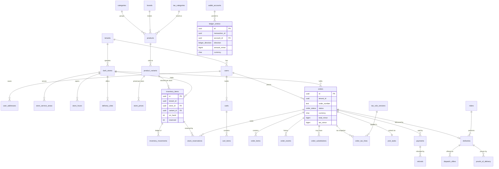

# 02. Data schemas (PostgreSQL 16 + PostGIS)

> **Status: blueprint.** Nothing in this document is implemented or tested in production. It is the target schema that the `migrations/` folder of the QuickCart monorepo will implement with `drizzle-kit` (structure) plus hand-written SQL migrations (RLS, triggers, functions, partitions). Names follow `00-CONTRACT.md`; where the contract is silent the decision is stated in a **Decision** callout and summarised in section 0.3.

Related documents:

| Topic | Owner document |
|---|---|
| Module boundaries, request flow, outbox relay, Redis usage | `01-ARCHITECTURE.md` |
| Feature flags, settings, tax engine, Money, translations (behaviour and code) | `03-CONFIG-FLAGS-TAX.md` |
| Drizzle schema file layout, repositories, transaction helper | `05-CODE-STRUCTURE.md` |
| Search/catalog filtering index strategy, Meilisearch sync, Docker, backups, `pg_partman` operations | `06-INSTALLER-DEPLOYMENT.md` |

---

## 0. Conventions

### 0.1 Rules applied to every table

| Rule | Implementation |
|---|---|
| Primary key | `id uuid PRIMARY KEY`, UUIDv7 generated by the application (`packages/ids`). Tables whose rows are mostly written by SQL functions or triggers (`inventory_movements`, `stock_reservations`, `order_events`, `ledger_entries`, `audit_logs`, `outbox_events`) also declare `DEFAULT app.uuid_v7()` as a safety net. |
| Tenant column | `tenant_id uuid NOT NULL` on every tenant table, always the first FK column of composite foreign keys. |
| Cross-tenant FK safety | Every tenant table that is referenced declares `UNIQUE (tenant_id, id)`; children reference `(tenant_id, <parent>_id)`. A row can therefore never point at another tenant's row, even through a bug that bypasses RLS. |
| Timestamps | `created_at timestamptz NOT NULL DEFAULT now()`, `updated_at timestamptz NOT NULL DEFAULT now()` maintained by trigger `app.touch_updated_at()`. Append-only tables have `created_at` only (they are never updated). |
| Soft delete | `deleted_at timestamptz` on master data (users, addresses, stores, brands, categories, products, variants, coupons, banners). Uniqueness constraints on these tables are partial (`WHERE deleted_at IS NULL`). |
| Money | `<name>_minor bigint` + `currency char(3) REFERENCES currencies(code)`. Never `numeric` or float for amounts. |
| Rates | Percentages are integers in **parts per million** (`rate_ppm`): 18% = `180000`, 2.5% = `25000`. Avoids floats and supports GST cess rates such as 0.25%. |
| Enums | PostgreSQL `ENUM` types for closed sets fixed by the contract (order status, substitution preference, flag scopes). `text` + `CHECK` for sets that tenants or modules extend (payment providers, notification channels). |
| Naming | snake_case, plural table names, FK columns `<singular>_id`, indexes `<table>_<cols>_idx`, uniques `<table>_<cols>_key`. |

### 0.2 Session contract with the application

Every request-scoped transaction run by the `app_user` role starts with:

```sql
SELECT set_config('app.tenant_id', '0192f0c8-6c1e-7a2b-9a51-3c2f9d7e8b10', true);  -- true = transaction-local (SET LOCAL)
SELECT set_config('app.actor_id',  '0192f0c8-7000-7d3e-8f00-111122223333', true);  -- used by audit triggers
```

`set_config(..., true)` is used instead of `SET LOCAL` because it accepts bind parameters. The value disappears at commit/rollback, so pooled connections never leak a tenant. If `app.tenant_id` is not set, `app.current_tenant()` returns `NULL` and every RLS policy evaluates to false: the database **fails closed**.

### 0.3 Decisions made in this document beyond the contract

| # | Decision |
|---|---|
| D1 | Reference data uses ISO natural keys instead of UUIDv7: `countries.code char(2)`, `currencies.code char(3)`, `languages.code text` (BCP 47). Registries keyed by a stable string also use it as PK: `feature_definitions.key`, `translation_keys.key`. Rationale: these keys appear in every money column, flag rule and translation, and are immutable. |
| D2 | **Mixed-scope tables** (`feature_flag_rules`, `settings`, `translations`, `tax_categories`, `tax_rules`, `tax_rule_versions`, `notification_templates`) have a *nullable* `tenant_id`: `NULL` = platform row visible to all tenants (read-only), non-null = tenant row. RLS policy differs (section 11). |
| D3 | `audit_logs.tenant_id` and `outbox_events.tenant_id` are nullable for platform-level events, but `NULL` rows are **not** visible to tenants (strict policy). |
| D4 | Composite FKs `(tenant_id, x_id)` everywhere inside a tenant (see 0.1). |
| D5 | Inventory is counted in integer sellable units. Loose produce is sold as fixed pack sizes (`product_variants.net_weight_g`); no fractional stock. |
| D6 | Stock is **reserved** at order placement (`pending_payment`), the reservation loses its expiry when payment succeeds, and is **committed** (on_hand decremented) when the order reaches `packed`. Unpicked remainder is released. |
| D7 | Catalog content (product names, descriptions, category names, banner titles) is stored inline as `jsonb` maps `{ "en": "...", "ar": "..." }`. The `translations` table is for UI strings and message templates only. |
| D8 | Customer, store staff and rider identities share the tenant `users` table; capabilities come from `user_roles` (store-scoped where needed) and the `riders` profile row. Platform staff live in `platform_users`. |
| D9 | User segments for flag targeting are stored as `users.segments text[]` (keys such as `beta`, `vip`, `employee`), assigned by admin or by jobs. |
| D10 | Config cache versioning: `installation.config_version` (global) and `tenants.config_version` are incremented in the same transaction as any flag, setting, translation or tax change. Redis keys embed both numbers (see `03-CONFIG-FLAGS-TAX.md`). |
| D11 | Two extra tables not listed in the contract: `config_change_requests` (two-person approval for financial config, section 4.6) and `audit_chain_heads` (serialises the audit hash chain, section 16). |
| D12 | Tax rules are platform rows shipped with region packs; tenants may add overriding rows (mixed scope). Place-of-supply uses `user_addresses.region_code` / `dark_stores.region_code` (ISO 3166-2). |
| D13 | Order status transitions are validated in the database by trigger (section 8.3) in addition to the application state machine. |
| D14 | `rider_location_pings` uses a natural composite key `(tenant_id, rider_id, recorded_at)` instead of a UUID (high volume, history only). |

---

## 1. Extensions, schemas, roles and helper functions

```sql
-- 1.1 Extensions ----------------------------------------------------------------
CREATE EXTENSION IF NOT EXISTS pgcrypto;     -- gen_random_bytes(), digest() for audit hash chain
CREATE EXTENSION IF NOT EXISTS citext;       -- case-insensitive emails, slugs, coupon codes, domains
CREATE EXTENSION IF NOT EXISTS ltree;        -- categories.path
CREATE EXTENSION IF NOT EXISTS postgis;      -- geometry, GiST, ST_Covers
CREATE EXTENSION IF NOT EXISTS btree_gist;   -- exclusion constraints mixing = and && (price and tax windows)

-- 1.2 Schemas -------------------------------------------------------------------
-- public: all tables.   app: helper functions, trigger functions, stored procedures.
CREATE SCHEMA IF NOT EXISTS app;

-- 1.3 Roles ---------------------------------------------------------------------
-- app_owner    : owns every object; used only by migrations (via SET ROLE from a migrator login).
-- app_user     : the API and worker connection for tenant-scoped work; RLS enforced.
-- app_platform : platform jobs (outbox relay, reservation sweeper, partition maintenance,
--                cross-tenant reports, super-admin API); BYPASSRLS.
-- Passwords are set by the installer (06-INSTALLER-DEPLOYMENT.md); never in migrations.
DO $$
BEGIN
  IF NOT EXISTS (SELECT 1 FROM pg_roles WHERE rolname = 'app_owner') THEN
    CREATE ROLE app_owner NOLOGIN;
  END IF;
  IF NOT EXISTS (SELECT 1 FROM pg_roles WHERE rolname = 'app_user') THEN
    CREATE ROLE app_user LOGIN NOSUPERUSER NOBYPASSRLS NOCREATEDB NOCREATEROLE;
  END IF;
  IF NOT EXISTS (SELECT 1 FROM pg_roles WHERE rolname = 'app_platform') THEN
    CREATE ROLE app_platform LOGIN NOSUPERUSER BYPASSRLS NOCREATEDB NOCREATEROLE;
  END IF;
END $$;

-- Migrations run as a migrator login that is a member of app_owner and executes SET ROLE app_owner,
-- so every table, function and schema below is owned by app_owner (required by the SECURITY DEFINER
-- trigger functions in sections 10.2 and 16).
ALTER SCHEMA app OWNER TO app_owner;
GRANT USAGE, CREATE ON SCHEMA public TO app_owner;

-- 1.4 Helper functions ------------------------------------------------------------
CREATE OR REPLACE FUNCTION app.current_tenant() RETURNS uuid
LANGUAGE sql STABLE PARALLEL SAFE AS $$
  -- nullif guards against the empty string left by RESET in some poolers
  SELECT nullif(current_setting('app.tenant_id', true), '')::uuid
$$;
COMMENT ON FUNCTION app.current_tenant() IS
  'Tenant of the current transaction (set via set_config(''app.tenant_id'', ..., true)). NULL = no tenant: RLS denies all.';

CREATE OR REPLACE FUNCTION app.current_actor() RETURNS uuid
LANGUAGE sql STABLE PARALLEL SAFE AS $$
  SELECT nullif(current_setting('app.actor_id', true), '')::uuid
$$;

-- UUIDv7 (RFC 9562) for rows generated inside SQL. PostgreSQL 16 has no native uuidv7().
CREATE OR REPLACE FUNCTION app.uuid_v7() RETURNS uuid
LANGUAGE plpgsql VOLATILE AS $$
DECLARE
  ts_ms bigint := floor(extract(epoch FROM clock_timestamp()) * 1000)::bigint;
  b     bytea  := gen_random_bytes(16);
BEGIN
  b := set_byte(b, 0, ((ts_ms >> 40) & 255)::int);
  b := set_byte(b, 1, ((ts_ms >> 32) & 255)::int);
  b := set_byte(b, 2, ((ts_ms >> 24) & 255)::int);
  b := set_byte(b, 3, ((ts_ms >> 16) & 255)::int);
  b := set_byte(b, 4, ((ts_ms >> 8)  & 255)::int);
  b := set_byte(b, 5, (ts_ms & 255)::int);
  b := set_byte(b, 6, (get_byte(b, 6) & 15) | 112);   -- version 7
  b := set_byte(b, 8, (get_byte(b, 8) & 63) | 128);   -- RFC 4122 variant
  RETURN encode(b, 'hex')::uuid;
END $$;

CREATE OR REPLACE FUNCTION app.touch_updated_at() RETURNS trigger
LANGUAGE plpgsql AS $$
BEGIN
  NEW.updated_at := now();
  RETURN NEW;
END $$;

-- Used by every append-only table (ledger, movements, order events, audit, tax snapshots).
CREATE OR REPLACE FUNCTION app.forbid_mutation() RETURNS trigger
LANGUAGE plpgsql AS $$
BEGIN
  RAISE EXCEPTION '% is append-only: % is not allowed', TG_TABLE_NAME, TG_OP
    USING ERRCODE = 'P0001', HINT = 'Write a compensating row instead.';
END $$;
```

---

## 2. Enum types

```sql
CREATE TYPE order_status AS ENUM (
  'pending_payment', 'placed', 'accepted', 'picking', 'packed', 'assigned',
  'picked_up', 'arriving', 'delivered',
  'cancelled', 'rejected', 'failed_delivery', 'returned'
);
CREATE TYPE substitution_preference AS ENUM ('none', 'best_match', 'specific');
CREATE TYPE fulfilment_type          AS ENUM ('delivery', 'pickup');
CREATE TYPE price_mode               AS ENUM ('inclusive', 'exclusive');
CREATE TYPE actor_type               AS ENUM ('customer', 'store_staff', 'rider', 'tenant_admin', 'platform_admin', 'system');
CREATE TYPE flag_scope_type          AS ENUM ('global', 'country', 'tenant', 'store', 'segment');
CREATE TYPE flag_value_type          AS ENUM ('boolean', 'variant', 'json', 'number');
CREATE TYPE setting_scope_type       AS ENUM ('global', 'country', 'tenant', 'store');
CREATE TYPE ledger_direction         AS ENUM ('debit', 'credit');
CREATE TYPE reservation_status       AS ENUM ('active', 'committed', 'released', 'expired');
CREATE TYPE inventory_movement_reason AS ENUM (
  'initial_load',          -- first stock count when a store goes live
  'purchase_receipt',      -- goods received from supplier / warehouse
  'transfer_in', 'transfer_out',
  'reservation',           -- reserved += n (on_hand unchanged)
  'reservation_release',   -- reserved -= n (order cancelled / unpicked remainder)
  'reservation_expire',    -- reserved -= n (TTL sweeper)
  'sale',                  -- committed at packed: on_hand -= n, reserved -= n
  'customer_return',       -- returned and restockable
  'damage', 'expiry_writeoff', 'pick_shortage',
  'cycle_count_adjustment'
);
CREATE TYPE tax_rounding_mode  AS ENUM ('half_up', 'half_even', 'half_down', 'up', 'down');
CREATE TYPE tax_rounding_level AS ENUM ('per_line', 'per_invoice');
```

---

## 3. Platform tables (no `tenant_id`)

```sql
-- Singleton row describing this installation. CHECK (singleton) enforces one row.
CREATE TABLE installation (
  singleton           boolean PRIMARY KEY DEFAULT true CHECK (singleton),
  install_id          uuid        NOT NULL,
  product_version     text        NOT NULL,            -- semver of the deployed release
  schema_version      text        NOT NULL,            -- last applied migration id
  default_locale      text        NOT NULL DEFAULT 'en',
  config_version      bigint      NOT NULL DEFAULT 1,   -- D10: bumped on any global config change
  installed_at        timestamptz NOT NULL DEFAULT now(),
  created_at          timestamptz NOT NULL DEFAULT now(),
  updated_at          timestamptz NOT NULL DEFAULT now()
);
COMMENT ON TABLE installation IS 'One row per deployment, written by apps/installer.';

CREATE TABLE licenses (
  id                  uuid PRIMARY KEY,
  license_key_hash    bytea       NOT NULL UNIQUE,       -- sha256 of the key; the key itself is never stored
  edition             text        NOT NULL CHECK (edition IN ('starter', 'growth', 'enterprise')),
  licensee_name       text        NOT NULL,
  max_tenants         integer     CHECK (max_tenants > 0),
  max_stores          integer     CHECK (max_stores > 0),
  entitlements        jsonb       NOT NULL DEFAULT '{}'::jsonb,  -- module keys enabled by the license
  signature           bytea       NOT NULL,              -- Ed25519 signature over the canonical payload
  valid_from          timestamptz NOT NULL,
  valid_until         timestamptz,
  status              text        NOT NULL DEFAULT 'active' CHECK (status IN ('active', 'expired', 'revoked')),
  created_at          timestamptz NOT NULL DEFAULT now(),
  updated_at          timestamptz NOT NULL DEFAULT now(),
  CHECK (valid_until IS NULL OR valid_until > valid_from)
);

CREATE TABLE platform_users (
  id                  uuid PRIMARY KEY,
  email               citext      NOT NULL UNIQUE,
  full_name           text        NOT NULL,
  password_hash       text        NOT NULL,              -- argon2id encoded string
  mfa_secret_enc      bytea,                             -- envelope-encrypted TOTP secret
  role                text        NOT NULL CHECK (role IN ('super_admin', 'support', 'finance', 'ops', 'read_only')),
  status              text        NOT NULL DEFAULT 'active' CHECK (status IN ('invited', 'active', 'suspended')),
  last_login_at       timestamptz,
  created_at          timestamptz NOT NULL DEFAULT now(),
  updated_at          timestamptz NOT NULL DEFAULT now()
);

CREATE TABLE currencies (
  code                char(3)     PRIMARY KEY CHECK (code ~ '^[A-Z]{3}$'),
  numeric_code        smallint    NOT NULL UNIQUE,
  minor_unit          smallint    NOT NULL CHECK (minor_unit BETWEEN 0 AND 4),  -- ISO 4217 exponent
  name                text        NOT NULL,
  symbol              text        NOT NULL,
  is_enabled          boolean     NOT NULL DEFAULT false,
  created_at          timestamptz NOT NULL DEFAULT now(),
  updated_at          timestamptz NOT NULL DEFAULT now()
);
COMMENT ON COLUMN currencies.minor_unit IS 'ISO 4217 exponent; seeded from the ISO list and mirrored in packages/money (03 section 7).';

CREATE TABLE languages (
  code                text        PRIMARY KEY CHECK (code ~ '^[a-z]{2,3}(-[A-Za-z0-9]{2,8})*$'),  -- BCP 47
  name                text        NOT NULL,              -- English name
  native_name         text        NOT NULL,
  direction           text        NOT NULL DEFAULT 'ltr' CHECK (direction IN ('ltr', 'rtl')),
  fallback_code       text        REFERENCES languages(code),   -- ar-AE -> ar -> (tenant default) -> en
  is_enabled          boolean     NOT NULL DEFAULT false,
  created_at          timestamptz NOT NULL DEFAULT now(),
  updated_at          timestamptz NOT NULL DEFAULT now(),
  CHECK (fallback_code IS NULL OR fallback_code <> code)
);

CREATE TABLE countries (
  code                char(2)     PRIMARY KEY CHECK (code ~ '^[A-Z]{2}$'),   -- ISO 3166-1 alpha-2
  name                text        NOT NULL,
  default_currency    char(3)     NOT NULL REFERENCES currencies(code),
  default_locale      text        NOT NULL REFERENCES languages(code),
  default_timezone    text        NOT NULL,              -- IANA, e.g. Asia/Kolkata
  phone_prefix        text        NOT NULL CHECK (phone_prefix ~ '^\+[0-9]{1,4}$'),
  address_format      jsonb       NOT NULL DEFAULT '{}'::jsonb,   -- field order/requiredness for address forms
  region_pack_version text,                              -- packages/region-packs version applied
  is_enabled          boolean     NOT NULL DEFAULT false,
  created_at          timestamptz NOT NULL DEFAULT now(),
  updated_at          timestamptz NOT NULL DEFAULT now()
);

-- Display-only FX (never used to settle money).
CREATE TABLE fx_rates (
  id                  uuid PRIMARY KEY,
  base_currency       char(3)     NOT NULL REFERENCES currencies(code),
  quote_currency      char(3)     NOT NULL REFERENCES currencies(code),
  rate                numeric(24, 12) NOT NULL CHECK (rate > 0),   -- 1 base = rate quote (a ratio, not money)
  source              text        NOT NULL,              -- 'ecb', 'openexchangerates', 'manual'
  as_of               timestamptz NOT NULL,
  created_at          timestamptz NOT NULL DEFAULT now(),
  updated_at          timestamptz NOT NULL DEFAULT now(),
  CHECK (base_currency <> quote_currency),
  CONSTRAINT fx_rates_pair_asof_key UNIQUE (base_currency, quote_currency, as_of)
);
CREATE INDEX fx_rates_latest_idx ON fx_rates (base_currency, quote_currency, as_of DESC);

CREATE TABLE tenants (
  id                  uuid PRIMARY KEY,
  slug                citext      NOT NULL UNIQUE CHECK (slug ~ '^[a-z0-9]([a-z0-9-]{0,38}[a-z0-9])?$'),
  name                text        NOT NULL,
  status              text        NOT NULL DEFAULT 'provisioning'
                        CHECK (status IN ('provisioning', 'active', 'suspended', 'offboarding', 'deleted')),
  home_country_code   char(2)     NOT NULL REFERENCES countries(code),
  default_currency    char(3)     NOT NULL REFERENCES currencies(code),
  default_locale      text        NOT NULL REFERENCES languages(code),
  license_id          uuid        REFERENCES licenses(id),
  plan                text        NOT NULL DEFAULT 'standard',
  config_version      bigint      NOT NULL DEFAULT 1,     -- D10
  branding            jsonb       NOT NULL DEFAULT '{}'::jsonb,   -- theme tokens reference (04-DESIGN-SYSTEM.md)
  created_at          timestamptz NOT NULL DEFAULT now(),
  updated_at          timestamptz NOT NULL DEFAULT now(),
  deleted_at          timestamptz
);
COMMENT ON TABLE tenants IS 'A brand operating dark stores. Has no tenant_id; RLS policy compares id to app.current_tenant().';

-- tenant_domains carries tenant_id and is RLS-protected like any tenant table.
-- Host -> tenant resolution runs with app_platform and is cached in Redis (01-ARCHITECTURE.md).
CREATE TABLE tenant_domains (
  id                  uuid PRIMARY KEY,
  tenant_id           uuid        NOT NULL REFERENCES tenants(id),
  domain              citext      NOT NULL CHECK (domain ~ '^[a-z0-9.-]+\.[a-z]{2,}$'),
  kind                text        NOT NULL CHECK (kind IN ('platform_subdomain', 'custom')),
  app                 text        NOT NULL DEFAULT 'customer' CHECK (app IN ('customer', 'admin', 'store')),
  is_primary          boolean     NOT NULL DEFAULT false,
  verification_token  text,
  verified_at         timestamptz,
  tls_status          text        NOT NULL DEFAULT 'pending' CHECK (tls_status IN ('pending', 'issued', 'failed', 'expired')),
  created_at          timestamptz NOT NULL DEFAULT now(),
  updated_at          timestamptz NOT NULL DEFAULT now(),
  CONSTRAINT tenant_domains_domain_key UNIQUE (domain)
);
CREATE UNIQUE INDEX tenant_domains_primary_key ON tenant_domains (tenant_id, app) WHERE is_primary;

-- UI string keys (platform registry). Values live in translations.
CREATE TABLE translation_keys (
  key                 text        PRIMARY KEY CHECK (key ~ '^[a-z][a-z0-9_]*(\.[a-z0-9_]+)+$'),
  namespace           text        GENERATED ALWAYS AS (split_part(key, '.', 1)) STORED,
  description         text        NOT NULL,              -- context for translators
  placeholders        text[]      NOT NULL DEFAULT '{}', -- ICU argument names that every translation must use
  max_length          integer     CHECK (max_length > 0),
  apps                text[]      NOT NULL DEFAULT '{customer}',  -- customer|store|rider|admin|api
  is_required         boolean     NOT NULL DEFAULT true,  -- CI completeness check (03 section 8.6)
  deprecated_at       timestamptz,
  created_at          timestamptz NOT NULL DEFAULT now(),
  updated_at          timestamptz NOT NULL DEFAULT now()
);
CREATE INDEX translation_keys_namespace_idx ON translation_keys (namespace);

-- Feature flag registry. Behaviour: 03-CONFIG-FLAGS-TAX.md section 2.
CREATE TABLE feature_definitions (
  key                 text        PRIMARY KEY CHECK (key ~ '^[a-z][a-z0-9_]*(\.[a-z][a-z0-9_]*)+$'),
  value_type          flag_value_type NOT NULL,
  default_value       jsonb       NOT NULL,
  off_value           jsonb       NOT NULL,               -- value served when killed or a dependency is off
  variants            text[],                             -- allowed values when value_type = 'variant'
  value_schema        jsonb,                              -- JSON Schema for admin UI when value_type = 'json'
  description         text        NOT NULL,
  owner_module        text        NOT NULL,               -- e.g. 'checkout', 'dispatch'
  dependencies        text[]      NOT NULL DEFAULT '{}',  -- flag keys that must evaluate truthy
  is_kill_switchable  boolean     NOT NULL DEFAULT true,
  is_client_visible   boolean     NOT NULL DEFAULT false, -- included in /config/bootstrap
  allowed_scopes      flag_scope_type[] NOT NULL DEFAULT '{global,country,tenant,store,segment}',
  lifecycle           text        NOT NULL DEFAULT 'active' CHECK (lifecycle IN ('active', 'deprecated', 'retired')),
  created_at          timestamptz NOT NULL DEFAULT now(),
  updated_at          timestamptz NOT NULL DEFAULT now(),
  CHECK (value_type <> 'variant' OR coalesce(cardinality(variants), 0) > 0),
  CHECK (NOT (key = ANY (dependencies))),
  CHECK (CASE value_type
           WHEN 'boolean' THEN jsonb_typeof(default_value) = 'boolean' AND jsonb_typeof(off_value) = 'boolean'
           WHEN 'number'  THEN jsonb_typeof(default_value) = 'number'  AND jsonb_typeof(off_value) = 'number'
           WHEN 'variant' THEN jsonb_typeof(default_value) = 'string'  AND jsonb_typeof(off_value) = 'string'
           ELSE true
         END)
);
```

---

## 4. Configuration tables

### 4.1 Feature flag rules

```sql
CREATE TABLE feature_flag_rules (
  id                  uuid PRIMARY KEY,
  flag_key            text        NOT NULL REFERENCES feature_definitions(key) ON UPDATE CASCADE,
  scope_type          flag_scope_type NOT NULL,
  scope_id            text,       -- NULL (global) | 'IN' (country) | tenant uuid | store uuid | segment key
  tenant_id           uuid        REFERENCES tenants(id),   -- D2: NULL for global/country rules
  value               jsonb,      -- NULL only for pure kill-switch rules
  rollout_percentage  numeric(5,2) NOT NULL DEFAULT 100 CHECK (rollout_percentage BETWEEN 0 AND 100),
  starts_at           timestamptz,
  ends_at             timestamptz,
  priority            integer     NOT NULL DEFAULT 0,       -- tie-break inside the same scope (higher wins)
  force_off           boolean     NOT NULL DEFAULT false,   -- kill switch for this scope and everything below it
  is_enabled          boolean     NOT NULL DEFAULT true,    -- parked rules are ignored by the resolver
  note                text,
  created_by          uuid,
  updated_by          uuid,
  created_at          timestamptz NOT NULL DEFAULT now(),
  updated_at          timestamptz NOT NULL DEFAULT now(),
  CHECK ((scope_type = 'global') = (scope_id IS NULL)),
  CHECK ((scope_type IN ('global', 'country')) = (tenant_id IS NULL)),
  CHECK (scope_type <> 'country' OR scope_id ~ '^[A-Z]{2}$'),
  CHECK (scope_type <> 'tenant'  OR scope_id = tenant_id::text),
  CHECK (scope_type <> 'store'   OR scope_id ~ '^[0-9a-f-]{36}$'),
  CHECK (scope_type <> 'segment' OR scope_id ~ '^[a-z][a-z0-9_]{0,62}$'),
  CHECK (force_off OR value IS NOT NULL),
  CHECK (ends_at IS NULL OR starts_at IS NULL OR ends_at > starts_at)
);
CREATE INDEX feature_flag_rules_lookup_idx ON feature_flag_rules (flag_key, scope_type, scope_id) WHERE is_enabled;
CREATE INDEX feature_flag_rules_tenant_idx ON feature_flag_rules (tenant_id) WHERE tenant_id IS NOT NULL;
COMMENT ON TABLE feature_flag_rules IS 'Overrides of feature_definitions per scope. Precedence: segment > store > tenant > country > global > default.';
```

### 4.2 Settings

```sql
CREATE TABLE settings (
  id                  uuid PRIMARY KEY,
  key                 text        NOT NULL CHECK (key ~ '^[a-z][a-z0-9_]*(\.[a-z][a-z0-9_]*)+$'),
  scope_type          setting_scope_type NOT NULL,
  scope_id            text,
  tenant_id           uuid        REFERENCES tenants(id),
  value               jsonb       NOT NULL,               -- validated by the Zod schema registered for key
  schema_version      integer     NOT NULL DEFAULT 1,     -- version of the registered schema used to validate
  version             integer     NOT NULL DEFAULT 1,     -- optimistic concurrency for admin edits
  updated_by          uuid,
  created_at          timestamptz NOT NULL DEFAULT now(),
  updated_at          timestamptz NOT NULL DEFAULT now(),
  CHECK ((scope_type = 'global') = (scope_id IS NULL)),
  CHECK ((scope_type IN ('global', 'country')) = (tenant_id IS NULL)),
  CHECK (scope_type <> 'country' OR scope_id ~ '^[A-Z]{2}$'),
  CHECK (scope_type <> 'tenant'  OR scope_id = tenant_id::text),
  CONSTRAINT settings_key_scope_key UNIQUE NULLS NOT DISTINCT (key, scope_type, scope_id)
);
CREATE INDEX settings_tenant_idx ON settings (tenant_id) WHERE tenant_id IS NOT NULL;
```

### 4.3 Translations

```sql
CREATE TABLE translations (
  id                  uuid PRIMARY KEY,
  tenant_id           uuid        REFERENCES tenants(id),        -- NULL = platform default
  translation_key     text        NOT NULL REFERENCES translation_keys(key) ON UPDATE CASCADE,
  locale              text        NOT NULL REFERENCES languages(code),
  value               text        NOT NULL,                      -- ICU MessageFormat
  status              text        NOT NULL DEFAULT 'approved' CHECK (status IN ('draft', 'approved')),
  source              text        NOT NULL DEFAULT 'manual' CHECK (source IN ('manual', 'import', 'machine', 'region_pack')),
  version             integer     NOT NULL DEFAULT 1,
  updated_by          uuid,
  created_at          timestamptz NOT NULL DEFAULT now(),
  updated_at          timestamptz NOT NULL DEFAULT now(),
  CONSTRAINT translations_scope_key UNIQUE NULLS NOT DISTINCT (tenant_id, translation_key, locale)
);
CREATE INDEX translations_bundle_idx ON translations (locale, tenant_id);
```

### 4.4 Tenant secrets

```sql
-- Envelope encryption: value encrypted with a random 256-bit DEK (AES-256-GCM) in the app;
-- the DEK is encrypted by a KEK held in KMS/Vault (or the installer-generated master key file).
CREATE TABLE tenant_secrets (
  id                  uuid PRIMARY KEY,
  tenant_id           uuid        NOT NULL REFERENCES tenants(id),
  country_code        char(2)     REFERENCES countries(code),     -- NULL = all countries of the tenant
  provider            text        NOT NULL CHECK (provider ~ '^[a-z][a-z0-9_]*$'),  -- 'stripe', 'razorpay', 'fcm', 'google_maps'
  name                text        NOT NULL CHECK (name ~ '^[a-z][a-z0-9_]*$'),      -- 'secret_key', 'webhook_secret'
  ciphertext          bytea       NOT NULL,
  nonce               bytea       NOT NULL CHECK (octet_length(nonce) = 12),
  auth_tag            bytea       NOT NULL CHECK (octet_length(auth_tag) = 16),
  encrypted_dek       bytea       NOT NULL,
  kek_id              text        NOT NULL,       -- KMS key id / version used to wrap the DEK
  algorithm           text        NOT NULL DEFAULT 'AES-256-GCM',
  fingerprint         text        NOT NULL,       -- last 4 chars, for admin display only
  rotated_at          timestamptz,
  created_by          uuid,
  created_at          timestamptz NOT NULL DEFAULT now(),
  updated_at          timestamptz NOT NULL DEFAULT now(),
  CONSTRAINT tenant_secrets_tenant_id_id_key UNIQUE (tenant_id, id),
  CONSTRAINT tenant_secrets_name_key UNIQUE NULLS NOT DISTINCT (tenant_id, country_code, provider, name)
);
COMMENT ON COLUMN tenant_secrets.ciphertext IS 'AAD = tenant_id || provider || name, so a ciphertext copied to another row fails to decrypt.';
```

### 4.5 Config change approvals (D11)

```sql
CREATE TABLE config_change_requests (
  id                  uuid PRIMARY KEY,
  tenant_id           uuid        REFERENCES tenants(id),      -- NULL = platform-level change
  target_type         text        NOT NULL CHECK (target_type IN ('feature_flag_rule', 'setting', 'tax_rule_version', 'commission_rule')),
  target_key          text        NOT NULL,                     -- flag key / setting key / rule id
  operation           text        NOT NULL CHECK (operation IN ('create', 'update', 'delete')),
  proposed            jsonb       NOT NULL,                     -- full new row (validated at request time)
  base_snapshot       jsonb,                                    -- row as seen by the requester (stale check)
  status              text        NOT NULL DEFAULT 'pending'
                        CHECK (status IN ('pending', 'approved', 'rejected', 'applied', 'expired', 'cancelled')),
  requested_by        uuid        NOT NULL,
  approved_by         uuid,
  decided_at          timestamptz,
  decision_note       text,
  expires_at          timestamptz NOT NULL,
  applied_at          timestamptz,
  created_at          timestamptz NOT NULL DEFAULT now(),
  updated_at          timestamptz NOT NULL DEFAULT now(),
  CHECK (approved_by IS NULL OR approved_by <> requested_by)  -- two-person rule
);
CREATE INDEX config_change_requests_pending_idx ON config_change_requests (tenant_id, status) WHERE status = 'pending';
```

---

## 5. Tax tables

Behaviour (resolution, rounding, worked examples): `03-CONFIG-FLAGS-TAX.md` section 6.

```sql
CREATE TABLE tax_jurisdictions (
  id                  uuid PRIMARY KEY,
  parent_id           uuid        REFERENCES tax_jurisdictions(id),
  country_code        char(2)     NOT NULL REFERENCES countries(code),
  level               text        NOT NULL CHECK (level IN ('country', 'state', 'county', 'city', 'district', 'special_zone')),
  code                text        NOT NULL UNIQUE,     -- 'IN', 'IN-KA', 'IN-DL', 'AE', 'GB', 'US-CA'
  name                text        NOT NULL,
  area                geometry(MultiPolygon, 4326),    -- optional; most lookups use region_code
  is_active           boolean     NOT NULL DEFAULT true,
  created_at          timestamptz NOT NULL DEFAULT now(),
  updated_at          timestamptz NOT NULL DEFAULT now(),
  CHECK (parent_id IS NULL OR parent_id <> id),
  CHECK (level = 'country' OR parent_id IS NOT NULL)
);
CREATE INDEX tax_jurisdictions_parent_idx ON tax_jurisdictions (parent_id);
CREATE INDEX tax_jurisdictions_area_gix   ON tax_jurisdictions USING gist (area) WHERE area IS NOT NULL;

CREATE TABLE tax_categories (
  id                  uuid PRIMARY KEY,
  tenant_id           uuid        REFERENCES tenants(id),       -- D2: NULL = platform category
  code                text        NOT NULL CHECK (code ~ '^[a-z][a-z0-9_]*$'),   -- 'standard', 'basic_food', 'zero_rated', 'exempt'
  name                text        NOT NULL,
  description         text,
  external_codes      jsonb       NOT NULL DEFAULT '{}'::jsonb,  -- {"IN":{"hsn":"0401"},"US":{"avalara":"PF050100"}}
  created_at          timestamptz NOT NULL DEFAULT now(),
  updated_at          timestamptz NOT NULL DEFAULT now(),
  CONSTRAINT tax_categories_code_key UNIQUE NULLS NOT DISTINCT (tenant_id, code)
);

CREATE TABLE tax_rules (
  id                  uuid PRIMARY KEY,
  tenant_id           uuid        REFERENCES tenants(id),       -- NULL = platform rule; tenant row overrides it
  jurisdiction_id     uuid        NOT NULL REFERENCES tax_jurisdictions(id),
  tax_category_id     uuid        NOT NULL REFERENCES tax_categories(id),
  name                text        NOT NULL,
  is_active           boolean     NOT NULL DEFAULT true,
  created_at          timestamptz NOT NULL DEFAULT now(),
  updated_at          timestamptz NOT NULL DEFAULT now(),
  CONSTRAINT tax_rules_scope_key UNIQUE NULLS NOT DISTINCT (tenant_id, jurisdiction_id, tax_category_id)
);

CREATE TABLE tax_rule_versions (
  id                  uuid PRIMARY KEY,
  tax_rule_id         uuid        NOT NULL REFERENCES tax_rules(id),
  tenant_id           uuid        REFERENCES tenants(id),       -- copy of tax_rules.tenant_id (RLS)
  version_no          integer     NOT NULL CHECK (version_no > 0),
  status              text        NOT NULL DEFAULT 'draft'
                        CHECK (status IN ('draft', 'scheduled', 'active', 'superseded', 'archived')),
  effective_from      timestamptz NOT NULL,
  effective_to        timestamptz,                              -- exclusive; NULL = open-ended
  components          jsonb       NOT NULL CHECK (jsonb_typeof(components) = 'array'),
  legal_reference     text,                                     -- notification / statute reference
  created_by          uuid,
  approved_by         uuid,
  approved_at         timestamptz,
  created_at          timestamptz NOT NULL DEFAULT now(),
  updated_at          timestamptz NOT NULL DEFAULT now(),
  CHECK (effective_to IS NULL OR effective_to > effective_from),
  CHECK (status = 'draft' OR approved_at IS NOT NULL),
  CONSTRAINT tax_rule_versions_no_key UNIQUE (tax_rule_id, version_no),
  -- Published windows of one rule never overlap; drafts may.
  CONSTRAINT tax_rule_versions_no_overlap EXCLUDE USING gist (
    tax_rule_id WITH =,
    tstzrange(effective_from, effective_to, '[)') WITH &&
  ) WHERE (status IN ('scheduled', 'active', 'superseded'))
);
COMMENT ON COLUMN tax_rule_versions.components IS
  'Array of {code, name, kind: percentage|per_unit, rate_ppm?, amount_minor?, currency?, compound, applies_to_supply: any|intra_state|inter_state, jurisdiction_code, reporting_code}';

-- Published versions cannot change; corrections are new versions.
CREATE OR REPLACE FUNCTION app.tax_rule_version_guard() RETURNS trigger
LANGUAGE plpgsql AS $$
BEGIN
  IF OLD.status <> 'draft' AND (
       NEW.components     IS DISTINCT FROM OLD.components OR
       NEW.effective_from IS DISTINCT FROM OLD.effective_from OR
       NEW.tax_rule_id    IS DISTINCT FROM OLD.tax_rule_id) THEN
    RAISE EXCEPTION 'tax.version_immutable' USING ERRCODE = 'P0001',
      DETAIL = 'Only status and effective_to may change after publication.';
  END IF;
  RETURN NEW;
END $$;
CREATE TRIGGER tax_rule_versions_guard BEFORE UPDATE ON tax_rule_versions
  FOR EACH ROW EXECUTE FUNCTION app.tax_rule_version_guard();
```

`order_tax_lines` references `orders` and is defined in section 8.5.

---

## 6. Identity

```sql
CREATE TABLE users (
  id                  uuid PRIMARY KEY,
  tenant_id           uuid        NOT NULL REFERENCES tenants(id),
  phone_e164          text        CHECK (phone_e164 ~ '^\+[1-9][0-9]{6,14}$'),
  phone_verified_at   timestamptz,
  email               citext,
  email_verified_at   timestamptz,
  full_name           text,
  password_hash       text,                       -- staff only; customers use OTP
  date_of_birth       date,                       -- age-restricted items (catalog.age_restricted_items)
  locale              text        REFERENCES languages(code),
  segments            text[]      NOT NULL DEFAULT '{}',   -- D9
  status              text        NOT NULL DEFAULT 'active' CHECK (status IN ('active', 'blocked', 'pending_deletion', 'anonymized')),
  marketing_opt_in    boolean     NOT NULL DEFAULT false,
  last_login_at       timestamptz,
  anonymized_at       timestamptz,
  created_at          timestamptz NOT NULL DEFAULT now(),
  updated_at          timestamptz NOT NULL DEFAULT now(),
  deleted_at          timestamptz,
  CHECK (phone_e164 IS NOT NULL OR email IS NOT NULL OR status = 'anonymized'),
  CONSTRAINT users_tenant_id_id_key UNIQUE (tenant_id, id)
);
CREATE UNIQUE INDEX users_phone_key ON users (tenant_id, phone_e164) WHERE deleted_at IS NULL AND phone_e164 IS NOT NULL;
CREATE UNIQUE INDEX users_email_key ON users (tenant_id, email)      WHERE deleted_at IS NULL AND email IS NOT NULL;
CREATE INDEX users_segments_gin ON users USING gin (segments);

CREATE TABLE user_addresses (
  id                  uuid PRIMARY KEY,
  tenant_id           uuid        NOT NULL,
  user_id             uuid        NOT NULL,
  label               text        NOT NULL DEFAULT 'home',
  contact_name        text,
  contact_phone_e164  text        CHECK (contact_phone_e164 ~ '^\+[1-9][0-9]{6,14}$'),
  line1               text        NOT NULL,
  line2               text,
  landmark            text,
  city                text        NOT NULL,
  region_code         text,                       -- ISO 3166-2, e.g. IN-KA (place of supply for tax)
  postal_code         text,
  country_code        char(2)     NOT NULL REFERENCES countries(code),
  location            geometry(Point, 4326) NOT NULL,
  delivery_instructions text,
  is_default          boolean     NOT NULL DEFAULT false,
  created_at          timestamptz NOT NULL DEFAULT now(),
  updated_at          timestamptz NOT NULL DEFAULT now(),
  deleted_at          timestamptz,
  CONSTRAINT user_addresses_tenant_id_id_key UNIQUE (tenant_id, id),
  FOREIGN KEY (tenant_id, user_id) REFERENCES users (tenant_id, id)
);
CREATE INDEX user_addresses_user_idx ON user_addresses (tenant_id, user_id) WHERE deleted_at IS NULL;
CREATE UNIQUE INDEX user_addresses_default_key ON user_addresses (tenant_id, user_id) WHERE is_default AND deleted_at IS NULL;

CREATE TABLE roles (
  id                  uuid PRIMARY KEY,
  tenant_id           uuid        NOT NULL REFERENCES tenants(id),
  key                 text        NOT NULL CHECK (key ~ '^[a-z][a-z0-9_]*$'),  -- 'tenant_admin', 'store_manager', 'picker', 'rider', 'customer'
  name                text        NOT NULL,
  is_system           boolean     NOT NULL DEFAULT false,  -- seeded roles cannot be deleted
  created_at          timestamptz NOT NULL DEFAULT now(),
  updated_at          timestamptz NOT NULL DEFAULT now(),
  CONSTRAINT roles_tenant_id_id_key UNIQUE (tenant_id, id),
  CONSTRAINT roles_key_key UNIQUE (tenant_id, key)
);

CREATE TABLE role_permissions (
  tenant_id           uuid        NOT NULL,
  role_id             uuid        NOT NULL,
  permission          text        NOT NULL CHECK (permission ~ '^[a-z_]+(\.[a-z_*]+)+$'),  -- 'orders.read', 'inventory.adjust'
  created_at          timestamptz NOT NULL DEFAULT now(),
  updated_at          timestamptz NOT NULL DEFAULT now(),
  PRIMARY KEY (tenant_id, role_id, permission),
  FOREIGN KEY (tenant_id, role_id) REFERENCES roles (tenant_id, id) ON DELETE CASCADE
);

CREATE TABLE user_roles (
  id                  uuid PRIMARY KEY,
  tenant_id           uuid        NOT NULL,
  user_id             uuid        NOT NULL,
  role_id             uuid        NOT NULL,
  store_id            uuid,                        -- NULL = tenant-wide; FK added after dark_stores (section 7)
  granted_by          uuid,
  created_at          timestamptz NOT NULL DEFAULT now(),
  updated_at          timestamptz NOT NULL DEFAULT now(),
  FOREIGN KEY (tenant_id, user_id) REFERENCES users (tenant_id, id) ON DELETE CASCADE,
  FOREIGN KEY (tenant_id, role_id) REFERENCES roles (tenant_id, id) ON DELETE CASCADE,
  CONSTRAINT user_roles_assignment_key UNIQUE NULLS NOT DISTINCT (tenant_id, user_id, role_id, store_id)
);

CREATE TABLE devices (
  id                  uuid PRIMARY KEY,
  tenant_id           uuid        NOT NULL,
  user_id             uuid        NOT NULL,
  app                 text        NOT NULL CHECK (app IN ('customer', 'store', 'rider', 'admin_web', 'store_web')),
  platform            text        NOT NULL CHECK (platform IN ('ios', 'android', 'web')),
  push_token          text,                        -- FCM registration token
  app_version         text,
  os_version          text,
  locale              text,
  last_seen_at        timestamptz,
  revoked_at          timestamptz,
  created_at          timestamptz NOT NULL DEFAULT now(),
  updated_at          timestamptz NOT NULL DEFAULT now(),
  CONSTRAINT devices_tenant_id_id_key UNIQUE (tenant_id, id),
  FOREIGN KEY (tenant_id, user_id) REFERENCES users (tenant_id, id) ON DELETE CASCADE
);
CREATE INDEX devices_user_idx ON devices (tenant_id, user_id) WHERE revoked_at IS NULL;
CREATE UNIQUE INDEX devices_push_token_key ON devices (tenant_id, push_token) WHERE push_token IS NOT NULL AND revoked_at IS NULL;

CREATE TABLE sessions (
  id                  uuid PRIMARY KEY,
  tenant_id           uuid        NOT NULL,
  user_id             uuid        NOT NULL,
  device_id           uuid,
  refresh_token_hash  bytea       NOT NULL,        -- sha256 of the opaque refresh token
  family_id           uuid        NOT NULL,        -- rotation family; reuse of a rotated token revokes the family
  ip                  inet,
  user_agent          text,
  expires_at          timestamptz NOT NULL,
  last_used_at        timestamptz,
  revoked_at          timestamptz,
  revoke_reason       text,
  created_at          timestamptz NOT NULL DEFAULT now(),
  updated_at          timestamptz NOT NULL DEFAULT now(),
  FOREIGN KEY (tenant_id, user_id)   REFERENCES users (tenant_id, id) ON DELETE CASCADE,
  FOREIGN KEY (tenant_id, device_id) REFERENCES devices (tenant_id, id),
  CONSTRAINT sessions_refresh_token_key UNIQUE (refresh_token_hash)
);
CREATE INDEX sessions_user_idx ON sessions (tenant_id, user_id) WHERE revoked_at IS NULL;
```

---

## 7. Stores and logistics (master data, shifts, location history)

Delivery execution tables (`dispatch_offers`, `deliveries`, `proofs_of_delivery`) reference orders and are in section 9.

```sql
CREATE TABLE dark_stores (
  id                  uuid PRIMARY KEY,
  tenant_id           uuid        NOT NULL REFERENCES tenants(id),
  code                text        NOT NULL CHECK (code ~ '^[A-Z0-9-]{2,20}$'),   -- 'BLR-KOR-01'
  name                text        NOT NULL,
  country_code        char(2)     NOT NULL REFERENCES countries(code),
  region_code         text        NOT NULL,                  -- ISO 3166-2, store's tax state
  currency            char(3)     NOT NULL REFERENCES currencies(code),
  timezone            text        NOT NULL,                  -- IANA
  address             jsonb       NOT NULL,
  location            geometry(Point, 4326) NOT NULL,
  phone_e164          text,
  tax_registration_no text,                                  -- GSTIN / TRN / VAT number
  status              text        NOT NULL DEFAULT 'draft' CHECK (status IN ('draft', 'active', 'paused', 'closed')),
  is_accepting_orders boolean     NOT NULL DEFAULT false,    -- instant toggle from store-web
  pause_reason        text,
  created_at          timestamptz NOT NULL DEFAULT now(),
  updated_at          timestamptz NOT NULL DEFAULT now(),
  deleted_at          timestamptz,
  CONSTRAINT dark_stores_tenant_id_id_key UNIQUE (tenant_id, id)
);
CREATE UNIQUE INDEX dark_stores_code_key ON dark_stores (tenant_id, code) WHERE deleted_at IS NULL;
CREATE INDEX dark_stores_location_gix ON dark_stores USING gist (location);

ALTER TABLE user_roles
  ADD CONSTRAINT user_roles_store_fk FOREIGN KEY (tenant_id, store_id) REFERENCES dark_stores (tenant_id, id);

CREATE TABLE store_service_areas (
  id                  uuid PRIMARY KEY,
  tenant_id           uuid        NOT NULL,
  store_id            uuid        NOT NULL,
  name                text        NOT NULL,
  area                geometry(MultiPolygon, 4326) NOT NULL,
  priority            integer     NOT NULL DEFAULT 0,        -- overlapping areas: higher wins
  eta_minutes         integer     NOT NULL CHECK (eta_minutes BETWEEN 1 AND 240),
  delivery_fee_rule   text,                                  -- optional override key into settings 'delivery.fee_rules'
  min_order_minor     bigint      CHECK (min_order_minor >= 0),   -- optional override, store currency
  is_active           boolean     NOT NULL DEFAULT true,
  valid_from          timestamptz,
  valid_to            timestamptz,
  created_at          timestamptz NOT NULL DEFAULT now(),
  updated_at          timestamptz NOT NULL DEFAULT now(),
  CHECK (ST_IsValid(area)),
  CHECK (ST_SRID(area) = 4326),
  CHECK (valid_to IS NULL OR valid_from IS NULL OR valid_to > valid_from),
  CONSTRAINT store_service_areas_tenant_id_id_key UNIQUE (tenant_id, id),
  FOREIGN KEY (tenant_id, store_id) REFERENCES dark_stores (tenant_id, id)
);
CREATE INDEX store_service_areas_area_gix ON store_service_areas USING gist (area);
CREATE INDEX store_service_areas_store_idx ON store_service_areas (tenant_id, store_id);

CREATE TABLE store_hours (
  id                  uuid PRIMARY KEY,
  tenant_id           uuid        NOT NULL,
  store_id            uuid        NOT NULL,
  day_of_week         smallint    CHECK (day_of_week BETWEEN 1 AND 7),  -- ISO: 1 = Monday
  special_date        date,                                  -- overrides day_of_week for that date
  opens_at            time        NOT NULL,
  closes_at           time        NOT NULL,                  -- closes_at <= opens_at means past midnight
  is_closed           boolean     NOT NULL DEFAULT false,    -- special_date closures
  created_at          timestamptz NOT NULL DEFAULT now(),
  updated_at          timestamptz NOT NULL DEFAULT now(),
  CHECK ((day_of_week IS NULL) <> (special_date IS NULL)),
  FOREIGN KEY (tenant_id, store_id) REFERENCES dark_stores (tenant_id, id) ON DELETE CASCADE
);
CREATE INDEX store_hours_store_idx ON store_hours (tenant_id, store_id);

CREATE TABLE delivery_slots (
  id                  uuid PRIMARY KEY,
  tenant_id           uuid        NOT NULL,
  store_id            uuid        NOT NULL,
  starts_at           timestamptz NOT NULL,
  ends_at             timestamptz NOT NULL,
  capacity            integer     NOT NULL CHECK (capacity >= 0),
  booked              integer     NOT NULL DEFAULT 0,
  status              text        NOT NULL DEFAULT 'open' CHECK (status IN ('open', 'closed', 'cancelled')),
  created_at          timestamptz NOT NULL DEFAULT now(),
  updated_at          timestamptz NOT NULL DEFAULT now(),
  CHECK (ends_at > starts_at),
  CHECK (booked BETWEEN 0 AND capacity),       -- booking uses UPDATE ... SET booked = booked + 1 WHERE booked < capacity
  CONSTRAINT delivery_slots_tenant_id_id_key UNIQUE (tenant_id, id),
  CONSTRAINT delivery_slots_window_key UNIQUE (tenant_id, store_id, starts_at),
  FOREIGN KEY (tenant_id, store_id) REFERENCES dark_stores (tenant_id, id)
);

CREATE TABLE riders (
  id                  uuid PRIMARY KEY,
  tenant_id           uuid        NOT NULL,
  user_id             uuid        NOT NULL,
  home_store_id       uuid,
  vehicle_type        text        NOT NULL CHECK (vehicle_type IN ('bicycle', 'e_bike', 'motorbike', 'scooter', 'car', 'on_foot')),
  vehicle_plate       text,
  govt_id_enc         bytea,                     -- envelope-encrypted licence / ID number
  status              text        NOT NULL DEFAULT 'offline'
                        CHECK (status IN ('offline', 'available', 'on_delivery', 'on_break', 'suspended')),
  max_concurrent_orders smallint  NOT NULL DEFAULT 1 CHECK (max_concurrent_orders BETWEEN 1 AND 5),
  rating_avg_x100     integer     CHECK (rating_avg_x100 BETWEEN 0 AND 500),
  created_at          timestamptz NOT NULL DEFAULT now(),
  updated_at          timestamptz NOT NULL DEFAULT now(),
  deleted_at          timestamptz,
  CONSTRAINT riders_tenant_id_id_key UNIQUE (tenant_id, id),
  CONSTRAINT riders_user_key UNIQUE (tenant_id, user_id),
  FOREIGN KEY (tenant_id, user_id)       REFERENCES users (tenant_id, id),
  FOREIGN KEY (tenant_id, home_store_id) REFERENCES dark_stores (tenant_id, id)
);
CREATE INDEX riders_store_status_idx ON riders (tenant_id, home_store_id, status);

CREATE TABLE rider_shifts (
  id                  uuid PRIMARY KEY,
  tenant_id           uuid        NOT NULL,
  rider_id            uuid        NOT NULL,
  store_id            uuid        NOT NULL,
  scheduled_start     timestamptz NOT NULL,
  scheduled_end       timestamptz NOT NULL,
  actual_start        timestamptz,
  actual_end          timestamptz,
  status              text        NOT NULL DEFAULT 'scheduled'
                        CHECK (status IN ('scheduled', 'active', 'completed', 'missed', 'cancelled')),
  created_at          timestamptz NOT NULL DEFAULT now(),
  updated_at          timestamptz NOT NULL DEFAULT now(),
  CHECK (scheduled_end > scheduled_start),
  CHECK (actual_end IS NULL OR actual_start IS NULL OR actual_end >= actual_start),
  FOREIGN KEY (tenant_id, rider_id) REFERENCES riders (tenant_id, id),
  FOREIGN KEY (tenant_id, store_id) REFERENCES dark_stores (tenant_id, id),
  -- A rider cannot have two overlapping non-cancelled shifts.
  CONSTRAINT rider_shifts_no_overlap EXCLUDE USING gist (
    tenant_id WITH =, rider_id WITH =,
    tstzrange(scheduled_start, scheduled_end, '[)') WITH &&
  ) WHERE (status <> 'cancelled')
);

-- History only. Live positions are in Redis (GEOADD per store; see 01-ARCHITECTURE.md).
-- Partitioned by day (section 17). D14: natural composite PK.
CREATE TABLE rider_location_pings (
  tenant_id           uuid        NOT NULL,
  rider_id            uuid        NOT NULL,
  recorded_at         timestamptz NOT NULL,      -- device time, clamped server-side to +/- 2 min of receipt
  delivery_id         uuid,                      -- no FK: history must survive delivery archival
  location            geometry(Point, 4326) NOT NULL,
  accuracy_m          real        CHECK (accuracy_m >= 0),
  speed_mps           real        CHECK (speed_mps >= 0),
  heading_deg         smallint    CHECK (heading_deg BETWEEN 0 AND 359),
  battery_pct         smallint    CHECK (battery_pct BETWEEN 0 AND 100),
  received_at         timestamptz NOT NULL DEFAULT now(),
  PRIMARY KEY (tenant_id, rider_id, recorded_at)
) PARTITION BY RANGE (recorded_at);
CREATE INDEX rider_location_pings_delivery_idx ON rider_location_pings (tenant_id, delivery_id, recorded_at)
  WHERE delivery_id IS NOT NULL;
```

---

## 8. Catalog and inventory

The search and catalog filtering index strategy (trigram, Meilisearch sync, covering indexes for listing pages) is owned by `06-INSTALLER-DEPLOYMENT.md`. Only PK/FK/unique and primary-lookup indexes are declared here.

### 8.1 Catalog

```sql
CREATE TABLE brands (
  id                  uuid PRIMARY KEY,
  tenant_id           uuid        NOT NULL REFERENCES tenants(id),
  slug                citext      NOT NULL,
  name                jsonb       NOT NULL,                 -- D7: {"en":"Amul","hi":"अमूल"}
  logo_key            text,                                 -- tenants/{tenantId}/brands/...
  created_at          timestamptz NOT NULL DEFAULT now(),
  updated_at          timestamptz NOT NULL DEFAULT now(),
  deleted_at          timestamptz,
  CONSTRAINT brands_tenant_id_id_key UNIQUE (tenant_id, id)
);
CREATE UNIQUE INDEX brands_slug_key ON brands (tenant_id, slug) WHERE deleted_at IS NULL;

CREATE TABLE categories (
  id                  uuid PRIMARY KEY,
  tenant_id           uuid        NOT NULL REFERENCES tenants(id),
  parent_id           uuid,
  slug                citext      NOT NULL CHECK (slug ~ '^[a-z0-9_]+$'),   -- ltree label compatible
  path                ltree       NOT NULL,                 -- 'dairy.milk.toned'; maintained by trigger
  name                jsonb       NOT NULL,
  image_key           text,
  sort_order          integer     NOT NULL DEFAULT 0,
  is_active           boolean     NOT NULL DEFAULT true,
  created_at          timestamptz NOT NULL DEFAULT now(),
  updated_at          timestamptz NOT NULL DEFAULT now(),
  deleted_at          timestamptz,
  CHECK (parent_id IS NULL OR parent_id <> id),
  CONSTRAINT categories_tenant_id_id_key UNIQUE (tenant_id, id),
  FOREIGN KEY (tenant_id, parent_id) REFERENCES categories (tenant_id, id)
);
CREATE UNIQUE INDEX categories_path_key ON categories (tenant_id, path) WHERE deleted_at IS NULL;
CREATE INDEX categories_path_gix ON categories USING gist (path);
CREATE INDEX categories_parent_idx ON categories (tenant_id, parent_id);

-- path = parent.path || slug. Moving a subtree rewrites descendants in the same statement.
CREATE OR REPLACE FUNCTION app.categories_set_path() RETURNS trigger
LANGUAGE plpgsql AS $$
DECLARE
  v_parent_path ltree;
  v_old_path    ltree;
BEGIN
  IF NEW.parent_id IS NULL THEN
    NEW.path := text2ltree(NEW.slug::text);
  ELSE
    SELECT path INTO STRICT v_parent_path
      FROM categories WHERE tenant_id = NEW.tenant_id AND id = NEW.parent_id;
    -- Moving a node under one of its own descendants would create a cycle.
    IF TG_OP = 'UPDATE' AND v_parent_path <@ OLD.path THEN
      RAISE EXCEPTION 'catalog.category_cycle' USING ERRCODE = 'P0001';
    END IF;
    NEW.path := v_parent_path || text2ltree(NEW.slug::text);
  END IF;
  IF TG_OP = 'UPDATE' AND NEW.path IS DISTINCT FROM OLD.path THEN
    v_old_path := OLD.path;
    UPDATE categories
       SET path = NEW.path || subpath(path, nlevel(v_old_path))
     WHERE tenant_id = NEW.tenant_id AND path <@ v_old_path AND id <> NEW.id;
  END IF;
  RETURN NEW;
END $$;
CREATE TRIGGER categories_path BEFORE INSERT OR UPDATE OF parent_id, slug ON categories
  FOR EACH ROW EXECUTE FUNCTION app.categories_set_path();

CREATE TABLE products (
  id                  uuid PRIMARY KEY,
  tenant_id           uuid        NOT NULL REFERENCES tenants(id),
  brand_id            uuid,
  category_id         uuid        NOT NULL,
  tax_category_id     uuid        NOT NULL REFERENCES tax_categories(id),
  slug                citext      NOT NULL,
  name                jsonb       NOT NULL,
  description         jsonb       NOT NULL DEFAULT '{}'::jsonb,
  attributes          jsonb       NOT NULL DEFAULT '{}'::jsonb,   -- {"veg":true,"organic":false,"allergens":[...]}
  is_age_restricted   boolean     NOT NULL DEFAULT false,
  min_age             smallint    CHECK (min_age BETWEEN 0 AND 25),
  status              text        NOT NULL DEFAULT 'draft' CHECK (status IN ('draft', 'active', 'archived')),
  created_at          timestamptz NOT NULL DEFAULT now(),
  updated_at          timestamptz NOT NULL DEFAULT now(),
  deleted_at          timestamptz,
  CHECK (NOT is_age_restricted OR min_age IS NOT NULL),
  CONSTRAINT products_tenant_id_id_key UNIQUE (tenant_id, id),
  FOREIGN KEY (tenant_id, brand_id)    REFERENCES brands (tenant_id, id),
  FOREIGN KEY (tenant_id, category_id) REFERENCES categories (tenant_id, id)
);
CREATE UNIQUE INDEX products_slug_key ON products (tenant_id, slug) WHERE deleted_at IS NULL;
CREATE INDEX products_category_idx ON products (tenant_id, category_id) WHERE deleted_at IS NULL;

CREATE TABLE product_variants (
  id                  uuid PRIMARY KEY,
  tenant_id           uuid        NOT NULL,
  product_id          uuid        NOT NULL,
  sku                 text        NOT NULL CHECK (sku ~ '^[A-Za-z0-9._-]{1,64}$'),
  barcodes            text[]      NOT NULL DEFAULT '{}',     -- EAN-13 / UPC-A
  label               jsonb       NOT NULL,                  -- {"en":"500 ml"}
  net_weight_g        integer     CHECK (net_weight_g > 0),
  net_volume_ml       integer     CHECK (net_volume_ml > 0),
  unit_count          integer     NOT NULL DEFAULT 1 CHECK (unit_count > 0),
  max_per_order       smallint    CHECK (max_per_order > 0),
  is_active           boolean     NOT NULL DEFAULT true,
  sort_order          integer     NOT NULL DEFAULT 0,
  created_at          timestamptz NOT NULL DEFAULT now(),
  updated_at          timestamptz NOT NULL DEFAULT now(),
  deleted_at          timestamptz,
  CONSTRAINT product_variants_tenant_id_id_key UNIQUE (tenant_id, id),
  FOREIGN KEY (tenant_id, product_id) REFERENCES products (tenant_id, id)
);
CREATE UNIQUE INDEX product_variants_sku_key ON product_variants (tenant_id, sku) WHERE deleted_at IS NULL;
CREATE INDEX product_variants_product_idx ON product_variants (tenant_id, product_id);
CREATE INDEX product_variants_barcodes_gin ON product_variants USING gin (barcodes);   -- picker scan lookup

CREATE TABLE product_media (
  id                  uuid PRIMARY KEY,
  tenant_id           uuid        NOT NULL,
  product_id          uuid        NOT NULL,
  variant_id          uuid,                                  -- NULL = applies to all variants
  kind                text        NOT NULL DEFAULT 'image' CHECK (kind IN ('image', 'video')),
  object_key          text        NOT NULL CHECK (object_key LIKE 'tenants/%'),
  alt                 jsonb       NOT NULL DEFAULT '{}'::jsonb,
  width_px            integer,
  height_px           integer,
  sort_order          integer     NOT NULL DEFAULT 0,
  created_at          timestamptz NOT NULL DEFAULT now(),
  updated_at          timestamptz NOT NULL DEFAULT now(),
  FOREIGN KEY (tenant_id, product_id) REFERENCES products (tenant_id, id) ON DELETE CASCADE,
  FOREIGN KEY (tenant_id, variant_id) REFERENCES product_variants (tenant_id, id) ON DELETE CASCADE
);
CREATE INDEX product_media_product_idx ON product_media (tenant_id, product_id, sort_order);

CREATE TABLE product_substitutes (
  tenant_id           uuid        NOT NULL,
  variant_id          uuid        NOT NULL,
  substitute_variant_id uuid      NOT NULL,
  rank                smallint    NOT NULL DEFAULT 1 CHECK (rank > 0),
  source              text        NOT NULL DEFAULT 'manual' CHECK (source IN ('manual', 'rule', 'ml')),
  created_at          timestamptz NOT NULL DEFAULT now(),
  updated_at          timestamptz NOT NULL DEFAULT now(),
  PRIMARY KEY (tenant_id, variant_id, substitute_variant_id),
  CHECK (variant_id <> substitute_variant_id),
  FOREIGN KEY (tenant_id, variant_id)            REFERENCES product_variants (tenant_id, id) ON DELETE CASCADE,
  FOREIGN KEY (tenant_id, substitute_variant_id) REFERENCES product_variants (tenant_id, id) ON DELETE CASCADE
);
CREATE INDEX product_substitutes_rank_idx ON product_substitutes (tenant_id, variant_id, rank);

CREATE TABLE store_prices (
  id                  uuid PRIMARY KEY,
  tenant_id           uuid        NOT NULL,
  store_id            uuid        NOT NULL,
  variant_id          uuid        NOT NULL,
  currency            char(3)     NOT NULL REFERENCES currencies(code),
  price_minor         bigint      NOT NULL CHECK (price_minor >= 0),   -- selling price, in the store's price_mode
  compare_at_minor    bigint      CHECK (compare_at_minor >= 0),       -- MRP / strike-through price
  valid_from          timestamptz NOT NULL DEFAULT now(),
  valid_to            timestamptz,
  created_by          uuid,
  created_at          timestamptz NOT NULL DEFAULT now(),
  updated_at          timestamptz NOT NULL DEFAULT now(),
  CHECK (valid_to IS NULL OR valid_to > valid_from),
  CHECK (compare_at_minor IS NULL OR compare_at_minor >= price_minor),
  FOREIGN KEY (tenant_id, store_id)   REFERENCES dark_stores (tenant_id, id),
  FOREIGN KEY (tenant_id, variant_id) REFERENCES product_variants (tenant_id, id),
  CONSTRAINT store_prices_no_overlap EXCLUDE USING gist (
    tenant_id WITH =, store_id WITH =, variant_id WITH =,
    tstzrange(valid_from, valid_to, '[)') WITH &&
  )
);
CREATE INDEX store_prices_lookup_idx ON store_prices (tenant_id, store_id, variant_id, valid_from DESC);
```

Price currency must equal the store currency. This is checked by the pricing service and by the trigger below (a CHECK cannot read another table):

```sql
CREATE OR REPLACE FUNCTION app.store_prices_currency_guard() RETURNS trigger
LANGUAGE plpgsql AS $$
BEGIN
  IF NOT EXISTS (SELECT 1 FROM dark_stores
                  WHERE tenant_id = NEW.tenant_id AND id = NEW.store_id AND currency = NEW.currency) THEN
    RAISE EXCEPTION 'pricing.currency_mismatch' USING ERRCODE = 'P0001';
  END IF;
  RETURN NEW;
END $$;
CREATE TRIGGER store_prices_currency BEFORE INSERT OR UPDATE OF currency, store_id ON store_prices
  FOR EACH ROW EXECUTE FUNCTION app.store_prices_currency_guard();
```

### 8.2 Inventory

```sql
CREATE TABLE inventory_items (
  id                  uuid PRIMARY KEY,
  tenant_id           uuid        NOT NULL,
  store_id            uuid        NOT NULL,
  variant_id          uuid        NOT NULL,
  on_hand             integer     NOT NULL DEFAULT 0,
  reserved            integer     NOT NULL DEFAULT 0,
  low_stock_threshold integer     CHECK (low_stock_threshold >= 0),  -- NULL = setting inventory.low_stock_default_threshold
  is_active           boolean     NOT NULL DEFAULT true,             -- false = delisted at this store
  bin_location        text,                                          -- 'A-03-2' (picking path)
  last_counted_at     timestamptz,
  created_at          timestamptz NOT NULL DEFAULT now(),
  updated_at          timestamptz NOT NULL DEFAULT now(),
  CONSTRAINT inventory_items_on_hand_nonneg CHECK (on_hand >= 0),
  CONSTRAINT inventory_items_reserved_bounds CHECK (reserved >= 0 AND reserved <= on_hand),
  CONSTRAINT inventory_items_tenant_id_id_key UNIQUE (tenant_id, id),
  CONSTRAINT inventory_items_store_variant_key UNIQUE (tenant_id, store_id, variant_id),
  FOREIGN KEY (tenant_id, store_id)   REFERENCES dark_stores (tenant_id, id),
  FOREIGN KEY (tenant_id, variant_id) REFERENCES product_variants (tenant_id, id)
);
COMMENT ON COLUMN inventory_items.reserved IS 'Units promised to open orders. Sellable = on_hand - reserved.';
-- Low-stock dashboard: available below threshold (06 adds the catalog-facing indexes).
CREATE INDEX inventory_items_low_stock_idx ON inventory_items (tenant_id, store_id)
  WHERE is_active AND low_stock_threshold IS NOT NULL AND on_hand - reserved <= low_stock_threshold;

CREATE TABLE inventory_movements (
  id                  uuid PRIMARY KEY DEFAULT app.uuid_v7(),
  tenant_id           uuid        NOT NULL,
  store_id            uuid        NOT NULL,
  inventory_item_id   uuid        NOT NULL,
  variant_id          uuid        NOT NULL,
  reason              inventory_movement_reason NOT NULL,
  delta_on_hand       integer     NOT NULL,
  delta_reserved      integer     NOT NULL,
  on_hand_after       integer     NOT NULL CHECK (on_hand_after >= 0),
  reserved_after      integer     NOT NULL CHECK (reserved_after >= 0),
  reference_type      text,       -- 'order', 'stock_reservation', 'purchase_receipt', 'cycle_count'
  reference_id        uuid,
  actor_type          actor_type  NOT NULL DEFAULT 'system',
  actor_id            uuid,
  note                text,
  created_at          timestamptz NOT NULL DEFAULT now(),
  CHECK (delta_on_hand <> 0 OR delta_reserved <> 0),
  FOREIGN KEY (tenant_id, inventory_item_id) REFERENCES inventory_items (tenant_id, id)
);
CREATE INDEX inventory_movements_item_idx ON inventory_movements (tenant_id, inventory_item_id, created_at);
CREATE INDEX inventory_movements_ref_idx  ON inventory_movements (tenant_id, reference_type, reference_id);
CREATE TRIGGER inventory_movements_append_only BEFORE UPDATE OR DELETE ON inventory_movements
  FOR EACH ROW EXECUTE FUNCTION app.forbid_mutation();
CREATE TRIGGER inventory_movements_no_truncate BEFORE TRUNCATE ON inventory_movements
  FOR EACH STATEMENT EXECUTE FUNCTION app.forbid_mutation();

CREATE TABLE stock_reservations (
  id                  uuid PRIMARY KEY DEFAULT app.uuid_v7(),
  tenant_id           uuid        NOT NULL,
  store_id            uuid        NOT NULL,
  inventory_item_id   uuid        NOT NULL,
  variant_id          uuid        NOT NULL,
  order_id            uuid        NOT NULL,      -- FK added after orders (section 8.3)
  quantity            integer     NOT NULL CHECK (quantity > 0),
  committed_quantity  integer     NOT NULL DEFAULT 0 CHECK (committed_quantity >= 0),
  status              reservation_status NOT NULL DEFAULT 'active',
  expires_at          timestamptz,               -- NULL once payment succeeded (held until packed)
  created_at          timestamptz NOT NULL DEFAULT now(),
  updated_at          timestamptz NOT NULL DEFAULT now(),
  CHECK (committed_quantity <= quantity),
  CHECK (status <> 'committed' OR committed_quantity > 0),
  CONSTRAINT stock_reservations_tenant_id_id_key UNIQUE (tenant_id, id),
  FOREIGN KEY (tenant_id, inventory_item_id) REFERENCES inventory_items (tenant_id, id)
);
CREATE UNIQUE INDEX stock_reservations_active_key ON stock_reservations (tenant_id, order_id, variant_id) WHERE status = 'active';
CREATE INDEX stock_reservations_expiry_idx ON stock_reservations (expires_at) WHERE status = 'active' AND expires_at IS NOT NULL;
CREATE INDEX stock_reservations_order_idx ON stock_reservations (tenant_id, order_id);
```

### 8.3 Commerce: carts and orders

```sql
CREATE TABLE carts (
  id                  uuid PRIMARY KEY,
  tenant_id           uuid        NOT NULL,
  user_id             uuid        NOT NULL,
  store_id            uuid        NOT NULL,
  currency            char(3)     NOT NULL REFERENCES currencies(code),
  status              text        NOT NULL DEFAULT 'active' CHECK (status IN ('active', 'converted', 'abandoned', 'merged')),
  coupon_code         citext,
  delivery_slot_id    uuid,
  address_id          uuid,
  tip_minor           bigint      NOT NULL DEFAULT 0 CHECK (tip_minor >= 0),
  converted_order_id  uuid,
  expires_at          timestamptz,
  created_at          timestamptz NOT NULL DEFAULT now(),
  updated_at          timestamptz NOT NULL DEFAULT now(),
  CONSTRAINT carts_tenant_id_id_key UNIQUE (tenant_id, id),
  FOREIGN KEY (tenant_id, user_id)          REFERENCES users (tenant_id, id),
  FOREIGN KEY (tenant_id, store_id)         REFERENCES dark_stores (tenant_id, id),
  FOREIGN KEY (tenant_id, delivery_slot_id) REFERENCES delivery_slots (tenant_id, id),
  FOREIGN KEY (tenant_id, address_id)       REFERENCES user_addresses (tenant_id, id)
);
CREATE UNIQUE INDEX carts_active_key ON carts (tenant_id, user_id, store_id) WHERE status = 'active';

CREATE TABLE cart_items (
  id                  uuid PRIMARY KEY,
  tenant_id           uuid        NOT NULL,
  cart_id             uuid        NOT NULL,
  variant_id          uuid        NOT NULL,
  quantity            integer     NOT NULL CHECK (quantity BETWEEN 1 AND 999),
  substitution_preference substitution_preference NOT NULL DEFAULT 'best_match',
  substitute_variant_id uuid,
  note                text,
  created_at          timestamptz NOT NULL DEFAULT now(),
  updated_at          timestamptz NOT NULL DEFAULT now(),
  CHECK ((substitution_preference = 'specific') = (substitute_variant_id IS NOT NULL)),
  CHECK (substitute_variant_id IS NULL OR substitute_variant_id <> variant_id),
  CONSTRAINT cart_items_variant_key UNIQUE (tenant_id, cart_id, variant_id),
  FOREIGN KEY (tenant_id, cart_id)               REFERENCES carts (tenant_id, id) ON DELETE CASCADE,
  FOREIGN KEY (tenant_id, variant_id)            REFERENCES product_variants (tenant_id, id),
  FOREIGN KEY (tenant_id, substitute_variant_id) REFERENCES product_variants (tenant_id, id)
);

CREATE TABLE coupons (
  id                  uuid PRIMARY KEY,
  tenant_id           uuid        NOT NULL REFERENCES tenants(id),
  code                citext      NOT NULL CHECK (code ~ '^[A-Za-z0-9_-]{3,32}$'),
  kind                text        NOT NULL CHECK (kind IN ('percentage', 'fixed_amount', 'free_delivery')),
  percent_ppm         integer     CHECK (percent_ppm BETWEEN 1 AND 1000000),
  amount_minor        bigint      CHECK (amount_minor > 0),
  currency            char(3)     REFERENCES currencies(code),
  min_order_minor     bigint      NOT NULL DEFAULT 0 CHECK (min_order_minor >= 0),
  max_discount_minor  bigint      CHECK (max_discount_minor > 0),
  applies_to          jsonb       NOT NULL DEFAULT '{}'::jsonb,   -- {"store_ids":[],"category_paths":[],"first_order_only":true}
  usage_limit_total   integer     CHECK (usage_limit_total > 0),
  usage_limit_per_user integer    CHECK (usage_limit_per_user > 0),
  redeemed_count      integer     NOT NULL DEFAULT 0,
  starts_at           timestamptz NOT NULL,
  ends_at             timestamptz,
  status              text        NOT NULL DEFAULT 'active' CHECK (status IN ('draft', 'active', 'paused', 'expired')),
  created_at          timestamptz NOT NULL DEFAULT now(),
  updated_at          timestamptz NOT NULL DEFAULT now(),
  deleted_at          timestamptz,
  CHECK ((kind = 'percentage')   = (percent_ppm IS NOT NULL)),
  CHECK ((kind = 'fixed_amount') = (amount_minor IS NOT NULL)),
  CHECK ((amount_minor IS NULL AND max_discount_minor IS NULL AND min_order_minor = 0) OR currency IS NOT NULL),
  CHECK (usage_limit_total IS NULL OR redeemed_count <= usage_limit_total),
  CHECK (ends_at IS NULL OR ends_at > starts_at),
  CONSTRAINT coupons_tenant_id_id_key UNIQUE (tenant_id, id)
);
CREATE UNIQUE INDEX coupons_code_key ON coupons (tenant_id, code) WHERE deleted_at IS NULL;

CREATE TABLE orders (
  id                  uuid PRIMARY KEY,
  tenant_id           uuid        NOT NULL,
  order_number        text        NOT NULL,       -- human-readable, e.g. 'BLR-241011-000123'
  store_id            uuid        NOT NULL,
  user_id             uuid        NOT NULL,
  cart_id             uuid,
  status              order_status NOT NULL DEFAULT 'pending_payment',
  fulfilment          fulfilment_type NOT NULL DEFAULT 'delivery',
  delivery_slot_id    uuid,                       -- NULL = instant delivery
  -- Snapshots (PII): address text and point at placement time; later address edits do not change the order.
  delivery_address    jsonb,
  delivery_location   geometry(Point, 4326),
  delivery_region_code text,                      -- place of supply (tax)
  currency            char(3)     NOT NULL REFERENCES currencies(code),
  price_mode          price_mode  NOT NULL,       -- snapshot of tax.price_mode
  subtotal_minor      bigint      NOT NULL CHECK (subtotal_minor >= 0),       -- sum of order_items.line_subtotal_minor
  discount_minor      bigint      NOT NULL DEFAULT 0 CHECK (discount_minor >= 0),
  delivery_fee_minor  bigint      NOT NULL DEFAULT 0 CHECK (delivery_fee_minor >= 0),
  service_fee_minor   bigint      NOT NULL DEFAULT 0 CHECK (service_fee_minor >= 0),   -- small-cart / handling fee
  tip_minor           bigint      NOT NULL DEFAULT 0 CHECK (tip_minor >= 0),
  tax_minor           bigint      NOT NULL DEFAULT 0 CHECK (tax_minor >= 0),          -- sum of order_tax_lines
  cash_rounding_minor bigint      NOT NULL DEFAULT 0,                                -- COD cash rounding, signed
  total_minor         bigint      NOT NULL CHECK (total_minor >= 0),
  coupon_id           uuid,
  payment_method      text        NOT NULL CHECK (payment_method ~ '^[a-z][a-z0-9_]*$'),   -- 'card','upi','wallet','cod'
  payment_status      text        NOT NULL DEFAULT 'pending'
                        CHECK (payment_status IN ('pending', 'authorized', 'paid', 'partially_refunded', 'refunded', 'failed', 'cod_due', 'cod_collected')),
  idempotency_key     text        NOT NULL,
  customer_note       text,
  cancel_reason_code  text,
  cancelled_by        actor_type,
  placed_at           timestamptz,
  accepted_at         timestamptz,
  packed_at           timestamptz,
  delivered_at        timestamptz,
  promised_by         timestamptz,                -- SLA shown to the customer
  version             integer     NOT NULL DEFAULT 1,   -- optimistic locking for concurrent transitions
  created_at          timestamptz NOT NULL DEFAULT now(),
  updated_at          timestamptz NOT NULL DEFAULT now(),
  CONSTRAINT orders_totals_consistent CHECK (
    total_minor = subtotal_minor - discount_minor + delivery_fee_minor + service_fee_minor + tip_minor
                  + CASE WHEN price_mode = 'exclusive' THEN tax_minor ELSE 0 END
                  + cash_rounding_minor),
  CHECK (fulfilment = 'pickup' OR delivery_location IS NOT NULL),
  CHECK (status NOT IN ('cancelled', 'rejected') OR cancel_reason_code IS NOT NULL),
  CONSTRAINT orders_tenant_id_id_key UNIQUE (tenant_id, id),
  CONSTRAINT orders_number_key UNIQUE (tenant_id, order_number),
  CONSTRAINT orders_idempotency_key UNIQUE (tenant_id, user_id, idempotency_key),
  FOREIGN KEY (tenant_id, store_id)         REFERENCES dark_stores (tenant_id, id),
  FOREIGN KEY (tenant_id, user_id)          REFERENCES users (tenant_id, id),
  FOREIGN KEY (tenant_id, cart_id)          REFERENCES carts (tenant_id, id),
  FOREIGN KEY (tenant_id, delivery_slot_id) REFERENCES delivery_slots (tenant_id, id),
  FOREIGN KEY (tenant_id, coupon_id)        REFERENCES coupons (tenant_id, id)
);
CREATE INDEX orders_user_idx ON orders (tenant_id, user_id, created_at DESC);
-- Store queue: only open orders (the partial index stays small).
CREATE INDEX orders_store_open_idx ON orders (tenant_id, store_id, status, created_at)
  WHERE status IN ('placed', 'accepted', 'picking', 'packed', 'assigned', 'picked_up', 'arriving');
CREATE INDEX orders_pending_payment_idx ON orders (created_at) WHERE status = 'pending_payment';

ALTER TABLE stock_reservations
  ADD CONSTRAINT stock_reservations_order_fk FOREIGN KEY (tenant_id, order_id) REFERENCES orders (tenant_id, id);
ALTER TABLE carts
  ADD CONSTRAINT carts_converted_order_fk FOREIGN KEY (tenant_id, converted_order_id) REFERENCES orders (tenant_id, id);

CREATE TABLE order_items (
  id                  uuid PRIMARY KEY,
  tenant_id           uuid        NOT NULL,
  order_id            uuid        NOT NULL,
  variant_id          uuid        NOT NULL,
  product_id          uuid        NOT NULL,
  -- Snapshots: the order must render identically even if the catalog changes or is deleted.
  sku                 text        NOT NULL,
  name                text        NOT NULL,       -- in the order locale
  variant_label       text,
  image_key           text,
  tax_category_code   text        NOT NULL,
  currency            char(3)     NOT NULL REFERENCES currencies(code),
  unit_price_minor    bigint      NOT NULL CHECK (unit_price_minor >= 0),
  unit_compare_at_minor bigint    CHECK (unit_compare_at_minor >= 0),
  quantity            integer     NOT NULL CHECK (quantity > 0),
  picked_quantity     integer     CHECK (picked_quantity >= 0),
  line_subtotal_minor bigint      NOT NULL CHECK (line_subtotal_minor >= 0),   -- unit_price * quantity
  line_discount_minor bigint      NOT NULL DEFAULT 0 CHECK (line_discount_minor >= 0),
  line_tax_minor      bigint      NOT NULL DEFAULT 0 CHECK (line_tax_minor >= 0),
  line_total_minor    bigint      NOT NULL CHECK (line_total_minor >= 0),
  substitution_preference substitution_preference NOT NULL,
  preferred_substitute_variant_id uuid,
  is_substitute       boolean     NOT NULL DEFAULT false,
  substitutes_item_id uuid,                       -- original item this line replaces
  status              text        NOT NULL DEFAULT 'pending'
                        CHECK (status IN ('pending', 'picked', 'partially_picked', 'unavailable', 'substituted', 'removed', 'returned')),
  created_at          timestamptz NOT NULL DEFAULT now(),
  updated_at          timestamptz NOT NULL DEFAULT now(),
  CHECK (line_subtotal_minor = unit_price_minor * quantity),
  CHECK (picked_quantity IS NULL OR picked_quantity <= quantity),
  CHECK (is_substitute = (substitutes_item_id IS NOT NULL)),
  CONSTRAINT order_items_tenant_id_id_key UNIQUE (tenant_id, id),
  FOREIGN KEY (tenant_id, order_id)   REFERENCES orders (tenant_id, id),
  FOREIGN KEY (tenant_id, variant_id) REFERENCES product_variants (tenant_id, id),
  FOREIGN KEY (tenant_id, substitutes_item_id) REFERENCES order_items (tenant_id, id)
);
CREATE INDEX order_items_order_idx ON order_items (tenant_id, order_id);
CREATE INDEX order_items_variant_idx ON order_items (tenant_id, variant_id);

CREATE TABLE order_substitutions (
  id                  uuid PRIMARY KEY,
  tenant_id           uuid        NOT NULL,
  order_id            uuid        NOT NULL,
  original_item_id    uuid        NOT NULL,
  substitute_variant_id uuid      NOT NULL,
  substitute_item_id  uuid,                       -- order_items row created when applied
  quantity            integer     NOT NULL CHECK (quantity > 0),
  currency            char(3)     NOT NULL REFERENCES currencies(code),
  price_difference_minor bigint   NOT NULL,       -- signed: substitute total - original total
  status              text        NOT NULL DEFAULT 'proposed'
                        CHECK (status IN ('proposed', 'approved', 'rejected', 'auto_applied', 'expired')),
  proposed_by         uuid        NOT NULL,       -- picker user id
  decided_by_type     actor_type,
  decided_by          uuid,
  decided_at          timestamptz,
  expires_at          timestamptz NOT NULL,       -- setting cart.substitution_approval_timeout_seconds
  created_at          timestamptz NOT NULL DEFAULT now(),
  updated_at          timestamptz NOT NULL DEFAULT now(),
  FOREIGN KEY (tenant_id, order_id)              REFERENCES orders (tenant_id, id),
  FOREIGN KEY (tenant_id, original_item_id)      REFERENCES order_items (tenant_id, id),
  FOREIGN KEY (tenant_id, substitute_variant_id) REFERENCES product_variants (tenant_id, id),
  FOREIGN KEY (tenant_id, substitute_item_id)    REFERENCES order_items (tenant_id, id)
);
CREATE INDEX order_substitutions_order_idx ON order_substitutions (tenant_id, order_id);
CREATE INDEX order_substitutions_pending_idx ON order_substitutions (expires_at) WHERE status = 'proposed';

-- Append-only status history, partitioned by month (section 17).
CREATE TABLE order_events (
  id                  uuid        NOT NULL DEFAULT app.uuid_v7(),
  tenant_id           uuid        NOT NULL,
  order_id            uuid        NOT NULL,
  event_type          text        NOT NULL,       -- 'status_changed', 'item_substituted', 'rider_assigned', 'note_added'
  from_status         order_status,
  to_status           order_status,
  actor_type          actor_type  NOT NULL,
  actor_id            uuid,
  reason_code         text,                       -- translation key, e.g. 'order.cancel.out_of_stock'
  payload             jsonb       NOT NULL DEFAULT '{}'::jsonb,
  created_at          timestamptz NOT NULL DEFAULT now(),
  PRIMARY KEY (id, created_at),
  CHECK (event_type <> 'status_changed' OR to_status IS NOT NULL),
  FOREIGN KEY (tenant_id, order_id) REFERENCES orders (tenant_id, id)
) PARTITION BY RANGE (created_at);
CREATE INDEX order_events_order_idx ON order_events (tenant_id, order_id, created_at);
CREATE TRIGGER order_events_append_only BEFORE UPDATE OR DELETE ON order_events
  FOR EACH ROW EXECUTE FUNCTION app.forbid_mutation();

CREATE TABLE pick_tasks (
  id                  uuid PRIMARY KEY,
  tenant_id           uuid        NOT NULL,
  order_id            uuid        NOT NULL,
  store_id            uuid        NOT NULL,
  picker_user_id      uuid,
  status              text        NOT NULL DEFAULT 'queued'
                        CHECK (status IN ('queued', 'assigned', 'picking', 'completed', 'cancelled')),
  priority            smallint    NOT NULL DEFAULT 0,
  tote_code           text,
  sla_due_at          timestamptz NOT NULL,
  assigned_at         timestamptz,
  started_at          timestamptz,
  completed_at        timestamptz,
  created_at          timestamptz NOT NULL DEFAULT now(),
  updated_at          timestamptz NOT NULL DEFAULT now(),
  CHECK (status NOT IN ('assigned', 'picking', 'completed') OR picker_user_id IS NOT NULL),
  CONSTRAINT pick_tasks_order_key UNIQUE (tenant_id, order_id),
  FOREIGN KEY (tenant_id, order_id)       REFERENCES orders (tenant_id, id),
  FOREIGN KEY (tenant_id, store_id)       REFERENCES dark_stores (tenant_id, id),
  FOREIGN KEY (tenant_id, picker_user_id) REFERENCES users (tenant_id, id)
);
CREATE INDEX pick_tasks_queue_idx ON pick_tasks (tenant_id, store_id, priority DESC, sla_due_at)
  WHERE status IN ('queued', 'assigned', 'picking');

CREATE TABLE coupon_redemptions (
  id                  uuid PRIMARY KEY,
  tenant_id           uuid        NOT NULL,
  coupon_id           uuid        NOT NULL,
  order_id            uuid        NOT NULL,
  user_id             uuid        NOT NULL,
  currency            char(3)     NOT NULL REFERENCES currencies(code),
  discount_minor      bigint      NOT NULL CHECK (discount_minor >= 0),
  status              text        NOT NULL DEFAULT 'applied' CHECK (status IN ('applied', 'reversed')),
  created_at          timestamptz NOT NULL DEFAULT now(),
  updated_at          timestamptz NOT NULL DEFAULT now(),
  CONSTRAINT coupon_redemptions_order_key UNIQUE (tenant_id, coupon_id, order_id),
  FOREIGN KEY (tenant_id, coupon_id) REFERENCES coupons (tenant_id, id),
  FOREIGN KEY (tenant_id, order_id)  REFERENCES orders (tenant_id, id),
  FOREIGN KEY (tenant_id, user_id)   REFERENCES users (tenant_id, id)
);
CREATE INDEX coupon_redemptions_user_idx ON coupon_redemptions (tenant_id, coupon_id, user_id) WHERE status = 'applied';

CREATE TABLE promotions (
  id                  uuid PRIMARY KEY,
  tenant_id           uuid        NOT NULL REFERENCES tenants(id),
  name                text        NOT NULL,
  kind                text        NOT NULL CHECK (kind IN ('buy_x_get_y', 'bundle_price', 'category_percent_off', 'cart_threshold_gift', 'free_delivery_threshold')),
  rules               jsonb       NOT NULL,       -- validated by a Zod schema per kind (promotions module)
  store_ids           uuid[],                     -- NULL = all stores
  segments            text[],                     -- NULL = all users
  priority            integer     NOT NULL DEFAULT 0,
  is_stackable        boolean     NOT NULL DEFAULT false,
  starts_at           timestamptz NOT NULL,
  ends_at             timestamptz,
  status              text        NOT NULL DEFAULT 'draft' CHECK (status IN ('draft', 'scheduled', 'active', 'paused', 'ended')),
  created_at          timestamptz NOT NULL DEFAULT now(),
  updated_at          timestamptz NOT NULL DEFAULT now(),
  CHECK (ends_at IS NULL OR ends_at > starts_at),
  CONSTRAINT promotions_tenant_id_id_key UNIQUE (tenant_id, id)
);
CREATE INDEX promotions_active_idx ON promotions (tenant_id, starts_at, ends_at) WHERE status IN ('scheduled', 'active');

CREATE TABLE home_layouts (
  id                  uuid PRIMARY KEY,
  tenant_id           uuid        NOT NULL REFERENCES tenants(id),
  name                text        NOT NULL,
  app                 text        NOT NULL DEFAULT 'customer' CHECK (app IN ('customer')),
  store_id            uuid,                       -- NULL = tenant default
  segment             text,                       -- NULL = everyone
  status              text        NOT NULL DEFAULT 'draft' CHECK (status IN ('draft', 'published', 'archived')),
  version             integer     NOT NULL DEFAULT 1,
  published_at        timestamptz,
  created_at          timestamptz NOT NULL DEFAULT now(),
  updated_at          timestamptz NOT NULL DEFAULT now(),
  CONSTRAINT home_layouts_tenant_id_id_key UNIQUE (tenant_id, id),
  FOREIGN KEY (tenant_id, store_id) REFERENCES dark_stores (tenant_id, id)
);
CREATE UNIQUE INDEX home_layouts_published_key ON home_layouts (tenant_id, app, store_id, segment) NULLS NOT DISTINCT
  WHERE status = 'published';

CREATE TABLE layout_sections (
  id                  uuid PRIMARY KEY,
  tenant_id           uuid        NOT NULL,
  layout_id           uuid        NOT NULL,
  kind                text        NOT NULL CHECK (kind IN ('banner_carousel', 'category_grid', 'product_rail', 'brand_rail', 'recommendations', 'reorder', 'html_block')),
  title               jsonb       NOT NULL DEFAULT '{}'::jsonb,
  config              jsonb       NOT NULL DEFAULT '{}'::jsonb,   -- {"category_path":"dairy","limit":12}
  required_flag       text        REFERENCES feature_definitions(key),   -- e.g. 'home.recommendations'
  sort_order          integer     NOT NULL,
  is_visible          boolean     NOT NULL DEFAULT true,
  created_at          timestamptz NOT NULL DEFAULT now(),
  updated_at          timestamptz NOT NULL DEFAULT now(),
  FOREIGN KEY (tenant_id, layout_id) REFERENCES home_layouts (tenant_id, id) ON DELETE CASCADE
);
CREATE INDEX layout_sections_layout_idx ON layout_sections (tenant_id, layout_id, sort_order);

CREATE TABLE banners (
  id                  uuid PRIMARY KEY,
  tenant_id           uuid        NOT NULL REFERENCES tenants(id),
  title               jsonb       NOT NULL,
  image_keys          jsonb       NOT NULL,      -- per locale: {"en":"tenants/.../en.webp","ar":"..."}
  deep_link           text,                      -- 'app://category/dairy'
  store_ids           uuid[],
  segments            text[],
  priority            integer     NOT NULL DEFAULT 0,
  starts_at           timestamptz NOT NULL,
  ends_at             timestamptz,
  status              text        NOT NULL DEFAULT 'draft' CHECK (status IN ('draft', 'active', 'paused', 'ended')),
  created_at          timestamptz NOT NULL DEFAULT now(),
  updated_at          timestamptz NOT NULL DEFAULT now(),
  deleted_at          timestamptz,
  CHECK (ends_at IS NULL OR ends_at > starts_at)
);
CREATE INDEX banners_active_idx ON banners (tenant_id, starts_at) WHERE status = 'active' AND deleted_at IS NULL;
```

#### 8.3.1 Order status transition guard (D13)

```sql
CREATE OR REPLACE FUNCTION app.order_transition_allowed(p_from order_status, p_to order_status, p_fulfilment fulfilment_type)
RETURNS boolean LANGUAGE sql IMMUTABLE PARALLEL SAFE AS $$
  SELECT (p_from::text || '>' || p_to::text) = ANY (ARRAY[
    'pending_payment>placed', 'pending_payment>cancelled',
    'placed>accepted', 'placed>rejected', 'placed>cancelled',
    'accepted>picking', 'accepted>cancelled',
    'picking>packed', 'picking>cancelled',
    'packed>assigned', 'packed>cancelled',
    'assigned>picked_up', 'assigned>packed', 'assigned>cancelled',   -- assigned>packed: rider unassigned
    'picked_up>arriving', 'picked_up>failed_delivery',
    'arriving>delivered', 'arriving>failed_delivery',
    'failed_delivery>returned', 'delivered>returned'
  ])
  OR (p_fulfilment = 'pickup' AND p_from = 'packed' AND p_to = 'delivered')   -- collected at store
$$;

CREATE OR REPLACE FUNCTION app.orders_status_guard() RETURNS trigger
LANGUAGE plpgsql AS $$
BEGIN
  IF NEW.status IS DISTINCT FROM OLD.status THEN
    IF NOT app.order_transition_allowed(OLD.status, NEW.status, NEW.fulfilment) THEN
      RAISE EXCEPTION 'order.invalid_transition'
        USING ERRCODE = 'P0001', DETAIL = format('%s -> %s', OLD.status, NEW.status);
    END IF;
    NEW.version := OLD.version + 1;
  END IF;
  RETURN NEW;
END $$;
CREATE TRIGGER orders_status_guard BEFORE UPDATE OF status ON orders
  FOR EACH ROW EXECUTE FUNCTION app.orders_status_guard();
```

A transition in the application is always one transaction (contract section 4):

```sql
-- $1 order id, $2 expected version, $3 new status, $4 actor type, $5 actor id
BEGIN;
SELECT set_config('app.tenant_id', '0192f0c8-6c1e-7a2b-9a51-3c2f9d7e8b10', true);
WITH o AS (
  UPDATE orders SET status = $3::order_status, accepted_at = CASE WHEN $3 = 'accepted' THEN now() ELSE accepted_at END
   WHERE tenant_id = app.current_tenant() AND id = $1 AND version = $2
  RETURNING id, tenant_id, status
), e AS (
  INSERT INTO order_events (tenant_id, order_id, event_type, from_status, to_status, actor_type, actor_id)
  SELECT tenant_id, id, 'status_changed', NULL, status, $4::actor_type, $5 FROM o
  RETURNING order_id
)
INSERT INTO outbox_events (tenant_id, aggregate_type, aggregate_id, event_type, payload)
SELECT tenant_id, 'order', id, 'order.status_changed', jsonb_build_object('order_id', id, 'status', status) FROM o;
COMMIT;
```

In practice the repository reads the current status first (`SELECT ... FOR UPDATE`) so `from_status` is filled in; zero affected rows means a concurrent transition won (version mismatch) and the use case returns `order.concurrent_modification`.

### 8.4 Inventory operations (exact SQL)

**Core primitive.** One conditional `UPDATE` both checks and reserves. Under `READ COMMITTED`, a concurrent update of the same row makes PostgreSQL re-evaluate the `WHERE` clause against the newest committed version (EvalPlanQual), so two buyers can never both take the last unit; the loser updates zero rows. The `CHECK (reserved <= on_hand)` constraint is the last line of defence.

```sql
-- $1 store_id, $2 variant_id, $3 quantity
UPDATE inventory_items
   SET reserved = reserved + $3, updated_at = now()
 WHERE tenant_id = app.current_tenant()
   AND store_id = $1 AND variant_id = $2
   AND is_active
   AND on_hand - reserved >= $3
RETURNING id, on_hand, reserved;      -- zero rows = inventory.insufficient_stock
```

**Multi-line reservation** for an order, all-or-nothing, with deterministic lock order (sorted by `variant_id`) to prevent deadlocks between two carts containing the same SKUs:

```sql
CREATE OR REPLACE FUNCTION app.reserve_stock(
  p_store_id uuid,
  p_order_id uuid,
  p_lines    jsonb,          -- [{"variant_id":"...","quantity":2}, ...]
  p_ttl      interval        -- setting inventory.reservation_ttl_seconds
) RETURNS SETOF stock_reservations
LANGUAGE plpgsql AS $$
DECLARE
  v_tenant uuid := app.current_tenant();
  v_line   record;
  v_item   inventory_items%ROWTYPE;
  v_res    stock_reservations%ROWTYPE;
BEGIN
  IF v_tenant IS NULL THEN
    RAISE EXCEPTION 'tenant.context_missing' USING ERRCODE = 'P0001';
  END IF;

  FOR v_line IN
    SELECT (l ->> 'variant_id')::uuid AS variant_id, sum((l ->> 'quantity')::int)::int AS qty
      FROM jsonb_array_elements(p_lines) AS l
     GROUP BY 1
     ORDER BY 1
  LOOP
    IF v_line.qty <= 0 THEN
      RAISE EXCEPTION 'inventory.invalid_quantity' USING ERRCODE = 'P0001';
    END IF;

    UPDATE inventory_items ii
       SET reserved = ii.reserved + v_line.qty, updated_at = now()
     WHERE ii.tenant_id = v_tenant AND ii.store_id = p_store_id AND ii.variant_id = v_line.variant_id
       AND ii.is_active AND ii.on_hand - ii.reserved >= v_line.qty
    RETURNING ii.* INTO v_item;

    IF NOT FOUND THEN
      -- Raising aborts the whole transaction: earlier lines are rolled back too.
      RAISE EXCEPTION 'inventory.insufficient_stock' USING ERRCODE = 'P0001',
        DETAIL = json_build_object('variant_id', v_line.variant_id, 'requested', v_line.qty)::text;
    END IF;

    INSERT INTO stock_reservations (tenant_id, store_id, inventory_item_id, variant_id, order_id, quantity, expires_at)
    VALUES (v_tenant, p_store_id, v_item.id, v_line.variant_id, p_order_id, v_line.qty, now() + p_ttl)
    RETURNING * INTO v_res;

    INSERT INTO inventory_movements (tenant_id, store_id, inventory_item_id, variant_id, reason,
                                     delta_on_hand, delta_reserved, on_hand_after, reserved_after,
                                     reference_type, reference_id, actor_id)
    VALUES (v_tenant, p_store_id, v_item.id, v_line.variant_id, 'reservation',
            0, v_line.qty, v_item.on_hand, v_item.reserved,
            'order', p_order_id, app.current_actor());

    RETURN NEXT v_res;
  END LOOP;
END $$;
```

Caller (inside the order placement transaction, after inserting the `orders` row):

```sql
SELECT * FROM app.reserve_stock(
  '0192f0c8-8a00-7c11-9c00-aaaaaaaaaaaa'::uuid,
  '0192f0c8-9b00-7d22-8d00-bbbbbbbbbbbb'::uuid,
  '[{"variant_id":"0192f0c8-a000-7e33-9e00-cccccccccccc","quantity":2}]'::jsonb,
  interval '600 seconds');
```

**Payment succeeded**: hold the reservation until packing.

```sql
UPDATE stock_reservations SET expires_at = NULL, updated_at = now()
 WHERE tenant_id = app.current_tenant() AND order_id = $1 AND status = 'active';
```

**Release** (order cancelled or rejected). Reservations are aggregated per inventory item before the `UPDATE ... FROM`, because `UPDATE ... FROM` applies only one matching source row per target row.

```sql
CREATE OR REPLACE FUNCTION app.release_stock(p_order_id uuid, p_reason inventory_movement_reason DEFAULT 'reservation_release')
RETURNS integer      -- number of reservations released
LANGUAGE plpgsql AS $$
DECLARE
  v_count integer;
BEGIN
  IF p_reason NOT IN ('reservation_release', 'reservation_expire') THEN
    RAISE EXCEPTION 'inventory.invalid_release_reason' USING ERRCODE = 'P0001';
  END IF;

  WITH rel AS (
    UPDATE stock_reservations
       SET status = CASE WHEN p_reason = 'reservation_expire' THEN 'expired'::reservation_status
                         ELSE 'released'::reservation_status END,
           updated_at = now()
     WHERE tenant_id = app.current_tenant() AND order_id = p_order_id AND status = 'active'
    RETURNING tenant_id, inventory_item_id, quantity
  ), agg AS (
    SELECT tenant_id, inventory_item_id, sum(quantity)::int AS qty, count(*) AS n FROM rel GROUP BY 1, 2
  ), inv AS (
    UPDATE inventory_items ii
       SET reserved = ii.reserved - agg.qty, updated_at = now()
      FROM agg
     WHERE ii.tenant_id = agg.tenant_id AND ii.id = agg.inventory_item_id
    RETURNING ii.tenant_id, ii.store_id, ii.id, ii.variant_id, ii.on_hand, ii.reserved, agg.qty, agg.n
  ), mv AS (
    INSERT INTO inventory_movements (tenant_id, store_id, inventory_item_id, variant_id, reason,
                                     delta_on_hand, delta_reserved, on_hand_after, reserved_after,
                                     reference_type, reference_id, actor_id)
    SELECT tenant_id, store_id, id, variant_id, p_reason, 0, -qty, on_hand, reserved,
           'order', p_order_id, app.current_actor()
      FROM inv
    RETURNING 1
  )
  SELECT coalesce(sum(n), 0)::int INTO v_count FROM inv;
  RETURN v_count;
END $$;
```

**Commit** at `packed`: consume what was actually picked and release the remainder in the same statement.

```sql
CREATE OR REPLACE FUNCTION app.commit_stock(p_order_id uuid, p_picked jsonb)   -- [{"variant_id":"...","quantity":1}]
RETURNS void
LANGUAGE plpgsql AS $$
DECLARE
  r record;
BEGIN
  FOR r IN
    SELECT sr.id AS reservation_id, sr.inventory_item_id, sr.variant_id, sr.quantity AS reserved_qty,
           LEAST(sr.quantity, coalesce(p.qty, 0)) AS picked_qty
      FROM stock_reservations sr
      LEFT JOIN (SELECT (x ->> 'variant_id')::uuid AS variant_id, sum((x ->> 'quantity')::int)::int AS qty
                   FROM jsonb_array_elements(p_picked) x GROUP BY 1) p ON p.variant_id = sr.variant_id
     WHERE sr.tenant_id = app.current_tenant() AND sr.order_id = p_order_id AND sr.status = 'active'
     ORDER BY sr.variant_id
     FOR UPDATE OF sr
  LOOP
    UPDATE stock_reservations
       SET status = CASE WHEN r.picked_qty > 0 THEN 'committed'::reservation_status ELSE 'released'::reservation_status END,
           committed_quantity = r.picked_qty, expires_at = NULL, updated_at = now()
     WHERE id = r.reservation_id;

    WITH ii AS (
      UPDATE inventory_items
         SET on_hand = on_hand - r.picked_qty, reserved = reserved - r.reserved_qty, updated_at = now()
       WHERE tenant_id = app.current_tenant() AND id = r.inventory_item_id
      RETURNING tenant_id, store_id, id, variant_id, on_hand, reserved
    )
    INSERT INTO inventory_movements (tenant_id, store_id, inventory_item_id, variant_id, reason,
                                     delta_on_hand, delta_reserved, on_hand_after, reserved_after,
                                     reference_type, reference_id, actor_id)
    SELECT tenant_id, store_id, id, variant_id,
           CASE WHEN r.picked_qty > 0 THEN 'sale'::inventory_movement_reason ELSE 'reservation_release'::inventory_movement_reason END,
           -r.picked_qty, -r.reserved_qty, on_hand, reserved, 'order', p_order_id, app.current_actor()
      FROM ii;
  END LOOP;
END $$;
```

If the picker reports the shelf empty, the store app additionally records a `pick_shortage` movement (`delta_on_hand = -n`) that corrects `on_hand`, and a cycle-count task is raised. Substitutes picked in place of the original are reserved with `app.reserve_stock` for the substitute variant at approval time and committed with the same call.

**Expiry sweeper** (BullMQ repeatable job, runs as `app_platform`, every 30 s). `SKIP LOCKED` lets several workers run safely; deadlock (`40P01`) is retried.

```sql
WITH due AS (
  SELECT id FROM stock_reservations
   WHERE status = 'active' AND expires_at < now()
   ORDER BY expires_at
   LIMIT 500
   FOR UPDATE SKIP LOCKED
), rel AS (
  UPDATE stock_reservations sr SET status = 'expired', updated_at = now()
    FROM due WHERE sr.id = due.id
  RETURNING sr.tenant_id, sr.inventory_item_id, sr.order_id, sr.quantity
), agg AS (
  SELECT tenant_id, inventory_item_id, sum(quantity)::int AS qty FROM rel GROUP BY 1, 2
), inv AS (
  UPDATE inventory_items ii SET reserved = ii.reserved - agg.qty, updated_at = now()
    FROM agg WHERE ii.tenant_id = agg.tenant_id AND ii.id = agg.inventory_item_id
  RETURNING ii.tenant_id, ii.store_id, ii.id, ii.variant_id, ii.on_hand, ii.reserved, agg.qty
)
INSERT INTO inventory_movements (tenant_id, store_id, inventory_item_id, variant_id, reason,
                                 delta_on_hand, delta_reserved, on_hand_after, reserved_after, reference_type)
SELECT tenant_id, store_id, id, variant_id, 'reservation_expire', 0, -qty, on_hand, reserved, 'stock_reservation'
  FROM inv;
```

The job then cancels the affected `pending_payment` orders (with `order_events` + `outbox_events`) through the normal order use case.

**Reconciliation** (nightly): the ledger must explain the current counters.

```sql
SELECT ii.id, ii.on_hand, ii.reserved, m.sum_on_hand, m.sum_reserved
  FROM inventory_items ii
  JOIN LATERAL (
    SELECT coalesce(sum(delta_on_hand), 0) AS sum_on_hand, coalesce(sum(delta_reserved), 0) AS sum_reserved
      FROM inventory_movements mv WHERE mv.tenant_id = ii.tenant_id AND mv.inventory_item_id = ii.id
  ) m ON true
 WHERE ii.on_hand <> m.sum_on_hand OR ii.reserved <> m.sum_reserved;
```

### 8.5 Tax snapshot lines

```sql
CREATE TABLE order_tax_lines (
  id                  uuid PRIMARY KEY,
  tenant_id           uuid        NOT NULL,
  order_id            uuid        NOT NULL,
  order_item_id       uuid,                        -- NULL for fee lines
  line_kind           text        NOT NULL CHECK (line_kind IN ('item', 'delivery_fee', 'service_fee', 'packaging_fee', 'tip')),
  provider            text        NOT NULL DEFAULT 'internal',     -- 'internal' or external adapter key ('avalara')
  tax_rule_version_id uuid        REFERENCES tax_rule_versions(id),  -- NULL only for external providers
  jurisdiction_code   text        NOT NULL,        -- 'IN-KA'
  component_code      text        NOT NULL,        -- 'CGST', 'SGST', 'IGST', 'VAT', 'CESS'
  rate_ppm            integer     NOT NULL CHECK (rate_ppm BETWEEN 0 AND 1000000),
  per_unit_minor      bigint,                      -- for per-unit components
  is_compound         boolean     NOT NULL DEFAULT false,
  price_mode          price_mode  NOT NULL,
  rounding_mode       tax_rounding_mode  NOT NULL,
  rounding_level      tax_rounding_level NOT NULL,
  currency            char(3)     NOT NULL REFERENCES currencies(code),
  taxable_amount_minor bigint     NOT NULL CHECK (taxable_amount_minor >= 0),
  tax_amount_minor    bigint      NOT NULL CHECK (tax_amount_minor >= 0),
  created_at          timestamptz NOT NULL DEFAULT now(),
  CHECK (provider <> 'internal' OR tax_rule_version_id IS NOT NULL),
  CHECK ((line_kind = 'item') = (order_item_id IS NOT NULL)),
  FOREIGN KEY (tenant_id, order_id)      REFERENCES orders (tenant_id, id),
  FOREIGN KEY (tenant_id, order_item_id) REFERENCES order_items (tenant_id, id)
);
CREATE INDEX order_tax_lines_order_idx ON order_tax_lines (tenant_id, order_id);
CREATE INDEX order_tax_lines_report_idx ON order_tax_lines (tenant_id, jurisdiction_code, component_code, created_at);
CREATE TRIGGER order_tax_lines_append_only BEFORE UPDATE OR DELETE ON order_tax_lines
  FOR EACH ROW EXECUTE FUNCTION app.forbid_mutation();
COMMENT ON TABLE order_tax_lines IS 'Immutable tax snapshot. Invoices and tax reports read this; tax is never recomputed for a placed order. Adjustments (returns) are written as credit-note lines by the invoicing module.';
```

---

## 9. Delivery execution

```sql
CREATE TABLE deliveries (
  id                  uuid PRIMARY KEY,
  tenant_id           uuid        NOT NULL,
  order_id            uuid        NOT NULL,
  store_id            uuid        NOT NULL,
  rider_id            uuid,
  batch_id            uuid,                        -- dispatch.batching: deliveries sharing one trip
  batch_sequence      smallint,
  status              text        NOT NULL DEFAULT 'pending'
                        CHECK (status IN ('pending', 'offering', 'assigned', 'at_store', 'picked_up', 'arriving',
                                          'delivered', 'failed', 'returned', 'cancelled')),
  pickup_location     geometry(Point, 4326) NOT NULL,
  dropoff_location    geometry(Point, 4326) NOT NULL,
  route_distance_m    integer     CHECK (route_distance_m >= 0),
  eta_at              timestamptz,
  otp_hash            bytea,                       -- delivery.otp_pod: sha256(otp || delivery id)
  pod_required        text[]      NOT NULL DEFAULT '{}',   -- subset of {otp, signature, photo}
  failure_reason_code text,
  assigned_at         timestamptz,
  picked_up_at        timestamptz,
  delivered_at        timestamptz,
  created_at          timestamptz NOT NULL DEFAULT now(),
  updated_at          timestamptz NOT NULL DEFAULT now(),
  CHECK (pod_required <@ ARRAY['otp', 'signature', 'photo']),
  CHECK (status NOT IN ('assigned', 'at_store', 'picked_up', 'arriving', 'delivered') OR rider_id IS NOT NULL),
  CONSTRAINT deliveries_tenant_id_id_key UNIQUE (tenant_id, id),
  CONSTRAINT deliveries_order_key UNIQUE (tenant_id, order_id),
  FOREIGN KEY (tenant_id, order_id) REFERENCES orders (tenant_id, id),
  FOREIGN KEY (tenant_id, store_id) REFERENCES dark_stores (tenant_id, id),
  FOREIGN KEY (tenant_id, rider_id) REFERENCES riders (tenant_id, id)
);
CREATE INDEX deliveries_rider_active_idx ON deliveries (tenant_id, rider_id)
  WHERE status IN ('assigned', 'at_store', 'picked_up', 'arriving');
CREATE INDEX deliveries_store_pending_idx ON deliveries (tenant_id, store_id, created_at) WHERE status IN ('pending', 'offering');

CREATE TABLE dispatch_offers (
  id                  uuid PRIMARY KEY,
  tenant_id           uuid        NOT NULL,
  delivery_id         uuid        NOT NULL,
  rider_id            uuid        NOT NULL,
  status              text        NOT NULL DEFAULT 'offered'
                        CHECK (status IN ('offered', 'accepted', 'declined', 'expired', 'withdrawn')),
  score               integer,                     -- dispatcher ranking score x1000
  distance_m          integer,
  offered_at          timestamptz NOT NULL DEFAULT now(),
  expires_at          timestamptz NOT NULL,        -- setting dispatch.offer_timeout_seconds
  responded_at        timestamptz,
  decline_reason      text,
  created_at          timestamptz NOT NULL DEFAULT now(),
  updated_at          timestamptz NOT NULL DEFAULT now(),
  CHECK (expires_at > offered_at),
  FOREIGN KEY (tenant_id, delivery_id) REFERENCES deliveries (tenant_id, id),
  FOREIGN KEY (tenant_id, rider_id)    REFERENCES riders (tenant_id, id)
);
-- At most one accepted offer per delivery and one open offer per rider at a time.
CREATE UNIQUE INDEX dispatch_offers_accepted_key ON dispatch_offers (tenant_id, delivery_id) WHERE status = 'accepted';
CREATE UNIQUE INDEX dispatch_offers_open_rider_key ON dispatch_offers (tenant_id, rider_id) WHERE status = 'offered';
CREATE INDEX dispatch_offers_expiry_idx ON dispatch_offers (expires_at) WHERE status = 'offered';

CREATE TABLE proofs_of_delivery (
  id                  uuid PRIMARY KEY,
  tenant_id           uuid        NOT NULL,
  delivery_id         uuid        NOT NULL,
  kind                text        NOT NULL CHECK (kind IN ('otp', 'signature', 'photo')),
  object_key          text        CHECK (object_key LIKE 'tenants/%'),   -- signature/photo image
  otp_verified_at     timestamptz,
  recipient_name      text,
  location            geometry(Point, 4326),
  captured_at         timestamptz NOT NULL,
  created_at          timestamptz NOT NULL DEFAULT now(),
  updated_at          timestamptz NOT NULL DEFAULT now(),
  CHECK (kind = 'otp' OR object_key IS NOT NULL),
  CHECK (kind <> 'otp' OR otp_verified_at IS NOT NULL),
  CONSTRAINT proofs_of_delivery_kind_key UNIQUE (tenant_id, delivery_id, kind),
  FOREIGN KEY (tenant_id, delivery_id) REFERENCES deliveries (tenant_id, id)
);
```

---

## 10. Money

### 10.1 Payments, refunds, commissions, settlements, payouts

```sql
CREATE TABLE payments (
  id                  uuid PRIMARY KEY,
  tenant_id           uuid        NOT NULL,
  order_id            uuid,                        -- NULL for wallet top-ups
  user_id             uuid        NOT NULL,
  purpose             text        NOT NULL DEFAULT 'order' CHECK (purpose IN ('order', 'wallet_topup', 'tip_after_delivery')),
  provider            text        NOT NULL CHECK (provider ~ '^[a-z][a-z0-9_]*$'),   -- 'stripe','razorpay','wallet','cod'
  method              text        NOT NULL,         -- 'card','upi','apple_pay','wallet','cash'
  provider_payment_id text,                         -- PaymentIntent / Razorpay payment id
  status              text        NOT NULL DEFAULT 'created'
                        CHECK (status IN ('created', 'requires_action', 'authorized', 'captured', 'failed', 'cancelled',
                                          'partially_refunded', 'refunded')),
  currency            char(3)     NOT NULL REFERENCES currencies(code),
  amount_minor        bigint      NOT NULL CHECK (amount_minor > 0),
  captured_minor      bigint      NOT NULL DEFAULT 0 CHECK (captured_minor >= 0),
  refunded_minor      bigint      NOT NULL DEFAULT 0 CHECK (refunded_minor >= 0),
  idempotency_key     text        NOT NULL,
  failure_code        text,
  provider_payload    jsonb       NOT NULL DEFAULT '{}'::jsonb,   -- redacted provider response
  created_at          timestamptz NOT NULL DEFAULT now(),
  updated_at          timestamptz NOT NULL DEFAULT now(),
  CHECK (captured_minor <= amount_minor),
  CHECK (refunded_minor <= captured_minor),
  CHECK (purpose <> 'order' OR order_id IS NOT NULL),
  CONSTRAINT payments_tenant_id_id_key UNIQUE (tenant_id, id),
  CONSTRAINT payments_idempotency_key UNIQUE (tenant_id, idempotency_key),
  FOREIGN KEY (tenant_id, order_id) REFERENCES orders (tenant_id, id),
  FOREIGN KEY (tenant_id, user_id)  REFERENCES users (tenant_id, id)
);
CREATE UNIQUE INDEX payments_provider_ref_key ON payments (tenant_id, provider, provider_payment_id) WHERE provider_payment_id IS NOT NULL;
CREATE INDEX payments_order_idx ON payments (tenant_id, order_id);

CREATE TABLE refunds (
  id                  uuid PRIMARY KEY,
  tenant_id           uuid        NOT NULL,
  payment_id          uuid        NOT NULL,
  order_id            uuid,
  currency            char(3)     NOT NULL REFERENCES currencies(code),
  amount_minor        bigint      NOT NULL CHECK (amount_minor > 0),
  destination         text        NOT NULL DEFAULT 'original' CHECK (destination IN ('original', 'wallet')),
  reason_code         text        NOT NULL,         -- 'item_unavailable', 'substitution_rejected', 'order_cancelled', 'goodwill'
  status              text        NOT NULL DEFAULT 'pending' CHECK (status IN ('pending', 'processing', 'succeeded', 'failed')),
  provider_refund_id  text,
  idempotency_key     text        NOT NULL,
  requested_by_type   actor_type  NOT NULL,
  requested_by        uuid,
  created_at          timestamptz NOT NULL DEFAULT now(),
  updated_at          timestamptz NOT NULL DEFAULT now(),
  CONSTRAINT refunds_idempotency_key UNIQUE (tenant_id, idempotency_key),
  FOREIGN KEY (tenant_id, payment_id) REFERENCES payments (tenant_id, id),
  FOREIGN KEY (tenant_id, order_id)   REFERENCES orders (tenant_id, id)
);
CREATE INDEX refunds_payment_idx ON refunds (tenant_id, payment_id);

CREATE TABLE commission_rules (
  id                  uuid PRIMARY KEY,
  tenant_id           uuid        NOT NULL REFERENCES tenants(id),
  applies_to          text        NOT NULL CHECK (applies_to IN ('store', 'rider')),   -- franchise stores / gig riders
  store_id            uuid,
  category_id         uuid,
  rate_ppm            integer     NOT NULL DEFAULT 0 CHECK (rate_ppm BETWEEN 0 AND 1000000),
  fixed_minor         bigint      NOT NULL DEFAULT 0 CHECK (fixed_minor >= 0),
  currency            char(3)     NOT NULL REFERENCES currencies(code),
  effective_from      timestamptz NOT NULL,
  effective_to        timestamptz,
  created_at          timestamptz NOT NULL DEFAULT now(),
  updated_at          timestamptz NOT NULL DEFAULT now(),
  CHECK (effective_to IS NULL OR effective_to > effective_from),
  FOREIGN KEY (tenant_id, store_id)    REFERENCES dark_stores (tenant_id, id),
  FOREIGN KEY (tenant_id, category_id) REFERENCES categories (tenant_id, id)
);
CREATE INDEX commission_rules_lookup_idx ON commission_rules (tenant_id, applies_to, store_id, effective_from DESC);

CREATE TABLE settlements (
  id                  uuid PRIMARY KEY,
  tenant_id           uuid        NOT NULL,
  party_type          text        NOT NULL CHECK (party_type IN ('store', 'rider')),
  party_id            uuid        NOT NULL,
  period_start        timestamptz NOT NULL,
  period_end          timestamptz NOT NULL,
  currency            char(3)     NOT NULL REFERENCES currencies(code),
  gross_minor         bigint      NOT NULL,
  commission_minor    bigint      NOT NULL DEFAULT 0,
  tax_minor           bigint      NOT NULL DEFAULT 0,
  adjustments_minor   bigint      NOT NULL DEFAULT 0,      -- signed
  net_minor           bigint      NOT NULL,
  ledger_transaction_id uuid,                              -- ledger posting that moved the balance
  status              text        NOT NULL DEFAULT 'draft' CHECK (status IN ('draft', 'approved', 'paid', 'void')),
  approved_by         uuid,
  created_at          timestamptz NOT NULL DEFAULT now(),
  updated_at          timestamptz NOT NULL DEFAULT now(),
  CHECK (period_end > period_start),
  CHECK (net_minor = gross_minor - commission_minor - tax_minor + adjustments_minor),
  CONSTRAINT settlements_tenant_id_id_key UNIQUE (tenant_id, id),
  CONSTRAINT settlements_period_key UNIQUE (tenant_id, party_type, party_id, period_start, currency)
);

CREATE TABLE payouts (
  id                  uuid PRIMARY KEY,
  tenant_id           uuid        NOT NULL,
  settlement_id       uuid        NOT NULL,
  party_type          text        NOT NULL CHECK (party_type IN ('store', 'rider')),
  party_id            uuid        NOT NULL,
  currency            char(3)     NOT NULL REFERENCES currencies(code),
  amount_minor        bigint      NOT NULL CHECK (amount_minor > 0),
  method              text        NOT NULL CHECK (method IN ('bank_transfer', 'provider_payout', 'manual')),
  provider_payout_id  text,
  status              text        NOT NULL DEFAULT 'pending' CHECK (status IN ('pending', 'processing', 'paid', 'failed', 'cancelled')),
  idempotency_key     text        NOT NULL,
  paid_at             timestamptz,
  created_at          timestamptz NOT NULL DEFAULT now(),
  updated_at          timestamptz NOT NULL DEFAULT now(),
  CONSTRAINT payouts_idempotency_key UNIQUE (tenant_id, idempotency_key),
  FOREIGN KEY (tenant_id, settlement_id) REFERENCES settlements (tenant_id, id)
);
```

### 10.2 Double-entry ledger

Every money movement (capture, refund, wallet top-up, wallet spend, COD collection, commission, settlement, payout) is a **ledger transaction**: two or more `ledger_entries` rows sharing a `transaction_id` whose debits equal credits per currency. `wallet_accounts` holds the chart of accounts per tenant, including the customer wallet accounts. Balances are a cache maintained by trigger; the ledger is the truth.

```sql
CREATE TABLE wallet_accounts (
  id                  uuid PRIMARY KEY,
  tenant_id           uuid        NOT NULL REFERENCES tenants(id),
  owner_type          text        NOT NULL CHECK (owner_type IN ('customer', 'store', 'rider', 'tenant')),
  owner_id            uuid,                       -- user / store / rider id; NULL for tenant system accounts
  purpose             text        NOT NULL CHECK (purpose ~ '^[a-z][a-z0-9_]*$'),
  -- purpose examples: customer_wallet, gateway_clearing, cod_cash_in_transit, sales_revenue, delivery_fee_revenue,
  -- tips_payable, tax_payable, refunds_payable, promotions_expense, store_payable, rider_payable, bank
  account_class       text        NOT NULL CHECK (account_class IN ('asset', 'liability', 'equity', 'revenue', 'expense')),
  normal_balance      ledger_direction NOT NULL,
  currency            char(3)     NOT NULL REFERENCES currencies(code),
  balance_minor       bigint      NOT NULL DEFAULT 0,   -- in the account's normal direction; maintained by trigger only
  allow_negative      boolean     NOT NULL DEFAULT false,
  status              text        NOT NULL DEFAULT 'active' CHECK (status IN ('active', 'frozen', 'closed')),
  created_at          timestamptz NOT NULL DEFAULT now(),
  updated_at          timestamptz NOT NULL DEFAULT now(),
  CHECK (normal_balance = CASE WHEN account_class IN ('asset', 'expense') THEN 'debit'::ledger_direction
                               ELSE 'credit'::ledger_direction END),
  CHECK ((owner_type = 'tenant') = (owner_id IS NULL)),
  CONSTRAINT wallet_accounts_nonnegative CHECK (allow_negative OR balance_minor >= 0),
  CONSTRAINT wallet_accounts_tenant_id_id_key UNIQUE (tenant_id, id),
  CONSTRAINT wallet_accounts_owner_key UNIQUE NULLS NOT DISTINCT (tenant_id, owner_type, owner_id, purpose, currency)
);

CREATE TABLE ledger_entries (
  id                  uuid PRIMARY KEY DEFAULT app.uuid_v7(),
  tenant_id           uuid        NOT NULL,
  transaction_id      uuid        NOT NULL,
  entry_no            smallint    NOT NULL CHECK (entry_no >= 1),
  account_id          uuid        NOT NULL,
  direction           ledger_direction NOT NULL,
  amount_minor        bigint      NOT NULL CHECK (amount_minor > 0),
  currency            char(3)     NOT NULL REFERENCES currencies(code),
  transaction_type    text        NOT NULL CHECK (transaction_type ~ '^[a-z][a-z0-9_]*$'),
  -- 'payment_captured','refund_issued','wallet_topup','wallet_spend','cod_collected','cod_deposited',
  -- 'commission_charged','settlement_posted','payout_sent','adjustment'
  reference_type      text        NOT NULL,      -- 'payment', 'refund', 'order', 'settlement', 'payout'
  reference_id        uuid        NOT NULL,
  idempotency_key     text        NOT NULL,      -- same for all entries of one transaction
  description         text,
  posted_at           timestamptz NOT NULL DEFAULT now(),
  created_at          timestamptz NOT NULL DEFAULT now(),
  CONSTRAINT ledger_entries_txn_entry_key UNIQUE (tenant_id, transaction_id, entry_no),
  CONSTRAINT ledger_entries_idem_key UNIQUE (tenant_id, idempotency_key, entry_no),
  FOREIGN KEY (tenant_id, account_id) REFERENCES wallet_accounts (tenant_id, id)
);
CREATE INDEX ledger_entries_account_idx ON ledger_entries (tenant_id, account_id, posted_at);
CREATE INDEX ledger_entries_txn_idx ON ledger_entries (tenant_id, transaction_id);
CREATE INDEX ledger_entries_ref_idx ON ledger_entries (tenant_id, reference_type, reference_id);

-- (a) Before each entry: currency must match the account, account must be active; apply to the cached balance.
--     SECURITY DEFINER because app_user has no UPDATE privilege on wallet_accounts.balance_minor.
CREATE OR REPLACE FUNCTION app.ledger_entries_apply() RETURNS trigger
LANGUAGE plpgsql SECURITY DEFINER SET search_path = pg_catalog, public AS $$
DECLARE
  v_currency char(3);
  v_status   text;
BEGIN
  UPDATE wallet_accounts wa
     SET balance_minor = wa.balance_minor
                         + CASE WHEN wa.normal_balance = NEW.direction THEN NEW.amount_minor ELSE -NEW.amount_minor END,
         updated_at = now()
   WHERE wa.tenant_id = NEW.tenant_id AND wa.id = NEW.account_id
  RETURNING wa.currency, wa.status INTO v_currency, v_status;

  IF NOT FOUND THEN
    RAISE EXCEPTION 'ledger.account_not_found' USING ERRCODE = 'P0001';
  ELSIF v_currency <> NEW.currency THEN
    RAISE EXCEPTION 'ledger.currency_mismatch' USING ERRCODE = 'P0001',
      DETAIL = format('account %s is %s, entry is %s', NEW.account_id, v_currency, NEW.currency);
  ELSIF v_status <> 'active' THEN
    RAISE EXCEPTION 'ledger.account_not_active' USING ERRCODE = 'P0001';
  END IF;
  RETURN NEW;
END $$;
ALTER FUNCTION app.ledger_entries_apply() OWNER TO app_owner;
CREATE TRIGGER ledger_entries_apply BEFORE INSERT ON ledger_entries
  FOR EACH ROW EXECUTE FUNCTION app.ledger_entries_apply();

-- (b) At COMMIT: every transaction touched must balance per currency and have at least two entries.
CREATE OR REPLACE FUNCTION app.ledger_assert_balanced() RETURNS trigger
LANGUAGE plpgsql AS $$
DECLARE
  r record;
BEGIN
  FOR r IN
    SELECT currency,
           sum(CASE direction WHEN 'debit' THEN amount_minor ELSE -amount_minor END) AS net,
           count(*) AS n
      FROM ledger_entries
     WHERE tenant_id = NEW.tenant_id AND transaction_id = NEW.transaction_id
     GROUP BY currency
  LOOP
    IF r.net <> 0 OR r.n < 2 THEN
      RAISE EXCEPTION 'ledger.unbalanced_transaction' USING ERRCODE = '23514',
        DETAIL = format('transaction %s currency %s net %s entries %s', NEW.transaction_id, r.currency, r.net, r.n);
    END IF;
  END LOOP;
  RETURN NULL;
END $$;
CREATE CONSTRAINT TRIGGER ledger_entries_balanced
  AFTER INSERT ON ledger_entries
  DEFERRABLE INITIALLY DEFERRED
  FOR EACH ROW EXECUTE FUNCTION app.ledger_assert_balanced();

-- (c) Immutability: corrections are reversing transactions.
CREATE TRIGGER ledger_entries_append_only BEFORE UPDATE OR DELETE ON ledger_entries
  FOR EACH ROW EXECUTE FUNCTION app.forbid_mutation();
CREATE TRIGGER ledger_entries_no_truncate BEFORE TRUNCATE ON ledger_entries
  FOR EACH STATEMENT EXECUTE FUNCTION app.forbid_mutation();
```

The deferred check runs once per inserted row at commit (typically 2 to 6 rows per transaction), which is acceptable; a statement-level variant with transition tables is an optimisation for bulk settlement postings. Because `wallet_accounts_nonnegative` is checked immediately on each balance update, entries that drain an account must be inserted after entries that fund it within the same transaction.

Example posting: card payment of INR 450.00 captured for an order (tax-inclusive prices; INR 21.43 of it is GST, INR 25.00 delivery fee).

```sql
-- txn 0192f0d0-0000-7000-8000-000000000001, accounts looked up by (tenant, purpose, currency)
INSERT INTO ledger_entries (tenant_id, transaction_id, entry_no, account_id, direction, amount_minor, currency,
                            transaction_type, reference_type, reference_id, idempotency_key)
VALUES
 (:tenant, :txn, 1, :gateway_clearing,     'debit',  45000, 'INR', 'payment_captured', 'payment', :payment_id, :idem),
 (:tenant, :txn, 2, :sales_revenue,        'credit', 40357, 'INR', 'payment_captured', 'payment', :payment_id, :idem),
 (:tenant, :txn, 3, :tax_payable,          'credit',  2143, 'INR', 'payment_captured', 'payment', :payment_id, :idem),
 (:tenant, :txn, 4, :delivery_fee_revenue, 'credit',  2500, 'INR', 'payment_captured', 'payment', :payment_id, :idem);
-- 45000 = 40357 + 2143 + 2500
```

(`:name` placeholders denote bind parameters in this example.)

---

## 11. Ops tables

```sql
CREATE TABLE notification_templates (
  id                  uuid PRIMARY KEY,
  tenant_id           uuid        REFERENCES tenants(id),   -- D2: NULL = platform default
  key                 text        NOT NULL CHECK (key ~ '^[a-z][a-z0-9_]*(\.[a-z0-9_]+)+$'),   -- 'order.out_for_delivery'
  channel             text        NOT NULL CHECK (channel IN ('push', 'sms', 'email', 'in_app', 'whatsapp')),
  locale              text        NOT NULL REFERENCES languages(code),
  subject             text,                                -- ICU MessageFormat
  body                text        NOT NULL,                -- ICU MessageFormat
  provider_template_id text,                               -- e.g. DLT template id (India SMS), WhatsApp template name
  version             integer     NOT NULL DEFAULT 1,
  is_active           boolean     NOT NULL DEFAULT true,
  created_at          timestamptz NOT NULL DEFAULT now(),
  updated_at          timestamptz NOT NULL DEFAULT now(),
  CHECK (channel <> 'email' OR subject IS NOT NULL),
  CONSTRAINT notification_templates_scope_key UNIQUE NULLS NOT DISTINCT (tenant_id, key, channel, locale)
);

CREATE TABLE notifications (
  id                  uuid PRIMARY KEY,
  tenant_id           uuid        NOT NULL,
  user_id             uuid        NOT NULL,
  template_key        text        NOT NULL,
  channel             text        NOT NULL CHECK (channel IN ('push', 'sms', 'email', 'in_app', 'whatsapp')),
  locale              text        NOT NULL,
  payload             jsonb       NOT NULL DEFAULT '{}'::jsonb,   -- ICU arguments
  rendered_title      text,
  rendered_body       text,
  status              text        NOT NULL DEFAULT 'queued' CHECK (status IN ('queued', 'sent', 'delivered', 'failed', 'suppressed')),
  provider_message_id text,
  error_code          text,
  attempts            smallint    NOT NULL DEFAULT 0,
  sent_at             timestamptz,
  read_at             timestamptz,
  created_at          timestamptz NOT NULL DEFAULT now(),
  updated_at          timestamptz NOT NULL DEFAULT now(),
  FOREIGN KEY (tenant_id, user_id) REFERENCES users (tenant_id, id)
);
CREATE INDEX notifications_inbox_idx ON notifications (tenant_id, user_id, created_at DESC) WHERE channel = 'in_app';
CREATE INDEX notifications_queue_idx ON notifications (created_at) WHERE status = 'queued';

-- Transactional outbox: written in the same transaction as the state change, relayed by apps/worker.
CREATE TABLE outbox_events (
  id                  uuid PRIMARY KEY DEFAULT app.uuid_v7(),
  tenant_id           uuid        REFERENCES tenants(id),   -- D3: NULL = platform event (not visible to tenants)
  aggregate_type      text        NOT NULL,                 -- 'order', 'inventory_item', 'payment'
  aggregate_id        uuid        NOT NULL,
  event_type          text        NOT NULL,                 -- 'order.status_changed', 'inventory.low_stock'
  event_version       smallint    NOT NULL DEFAULT 1,
  payload             jsonb       NOT NULL,
  headers             jsonb       NOT NULL DEFAULT '{}'::jsonb,   -- trace context, request id
  occurred_at         timestamptz NOT NULL DEFAULT now(),
  available_at        timestamptz NOT NULL DEFAULT now(),       -- backoff for retries
  published_at        timestamptz,
  attempts            integer     NOT NULL DEFAULT 0,
  last_error          text,
  created_at          timestamptz NOT NULL DEFAULT now()
);
CREATE INDEX outbox_events_unpublished_idx ON outbox_events (available_at, id) WHERE published_at IS NULL;
CREATE INDEX outbox_events_aggregate_idx ON outbox_events (aggregate_type, aggregate_id, occurred_at);
COMMENT ON TABLE outbox_events IS 'Published rows are deleted by the relay after outbox.retention_hours; this table is NOT append-only.';
```

Relay query (worker, `app_platform`, per-aggregate ordering is preserved because rows are claimed in `id` order, and UUIDv7 is time-ordered):

```sql
WITH batch AS (
  SELECT id FROM outbox_events
   WHERE published_at IS NULL AND available_at <= now()
   ORDER BY available_at, id
   LIMIT 200
   FOR UPDATE SKIP LOCKED
)
SELECT o.* FROM outbox_events o JOIN batch b USING (id) ORDER BY o.id;
-- after publishing to Redis Streams / BullMQ / webhooks:
-- UPDATE outbox_events SET published_at = now() WHERE id = ANY($1);
-- on failure: UPDATE ... SET attempts = attempts + 1, last_error = $2,
--             available_at = now() + least(interval '1 hour', interval '2 seconds' * power(2, attempts))
```

`audit_logs` is defined in section 16.

---

## 12. Row-Level Security

### 12.1 Policy patterns

| Table class | Tables | `app_user` policy |
|---|---|---|
| Strict tenant table | Every table with `tenant_id NOT NULL` | `USING (tenant_id = app.current_tenant()) WITH CHECK (same)` for ALL commands |
| Mixed scope (D2) | `feature_flag_rules`, `settings`, `translations`, `tax_categories`, `tax_rules`, `tax_rule_versions`, `notification_templates` | SELECT: `tenant_id IS NULL OR tenant_id = app.current_tenant()`; INSERT/UPDATE/DELETE: `tenant_id = app.current_tenant()` (platform rows are read-only for tenants) |
| Platform-private nullable (D3) | `audit_logs`, `outbox_events`, `config_change_requests` | Strict policy: `tenant_id = app.current_tenant()` (NULL rows invisible) |
| `tenants` | `tenants` | SELECT only, `id = app.current_tenant()` |
| Reference data | `countries`, `currencies`, `languages`, `fx_rates`, `translation_keys`, `feature_definitions`, `tax_jurisdictions` | No RLS; `GRANT SELECT` only |
| Platform internal | `installation`, `licenses`, `platform_users`, `audit_chain_heads` | No grant to `app_user` |

`FORCE ROW LEVEL SECURITY` makes policies apply to the table owner too, so a migration accidentally run as `app_owner` cannot read across tenants. Superusers always bypass RLS: the application never connects as a superuser.

### 12.2 Generic application (run after every migration that adds tables)

Policies name both `app_user` and `app_owner`. `app_owner` matters for the two `SECURITY DEFINER` trigger functions (ledger balance update, audit chain), which run as the owner: with `FORCE ROW LEVEL SECURITY` they still see only the current tenant's rows. Consequently, ledger postings always run with `app.tenant_id` set, also when started by a platform job (the job loops over tenants and sets the context per transaction).

```sql
-- updated_at maintenance for every table that has the column.
DO $$
DECLARE
  r record;
BEGIN
  FOR r IN
    SELECT c.relname
      FROM pg_class c
      JOIN pg_namespace n ON n.oid = c.relnamespace AND n.nspname = 'public'
      JOIN pg_attribute a ON a.attrelid = c.oid AND a.attname = 'updated_at' AND NOT a.attisdropped
     WHERE c.relkind IN ('r', 'p') AND NOT c.relispartition
  LOOP
    EXECUTE format('DROP TRIGGER IF EXISTS %I ON public.%I', r.relname || '_touch', r.relname);
    EXECUTE format('CREATE TRIGGER %I BEFORE UPDATE ON public.%I FOR EACH ROW EXECUTE FUNCTION app.touch_updated_at()',
                   r.relname || '_touch', r.relname);
  END LOOP;
END $$;

DO $$
DECLARE
  r record;
  platform_private constant text[] := ARRAY['audit_logs', 'outbox_events', 'config_change_requests'];
BEGIN
  FOR r IN
    SELECT c.relname, a.attnotnull
      FROM pg_class c
      JOIN pg_namespace n ON n.oid = c.relnamespace AND n.nspname = 'public'
      JOIN pg_attribute a ON a.attrelid = c.oid AND a.attname = 'tenant_id' AND NOT a.attisdropped
     WHERE c.relkind IN ('r', 'p')          -- ordinary and partitioned tables
       AND NOT c.relispartition             -- partitions inherit access through the parent
  LOOP
    EXECUTE format('ALTER TABLE public.%I ENABLE ROW LEVEL SECURITY', r.relname);
    EXECUTE format('ALTER TABLE public.%I FORCE ROW LEVEL SECURITY', r.relname);

    EXECUTE format('DROP POLICY IF EXISTS tenant_isolation ON public.%I', r.relname);
    EXECUTE format('DROP POLICY IF EXISTS tenant_read ON public.%I', r.relname);
    EXECUTE format('DROP POLICY IF EXISTS tenant_insert ON public.%I', r.relname);
    EXECUTE format('DROP POLICY IF EXISTS tenant_update ON public.%I', r.relname);
    EXECUTE format('DROP POLICY IF EXISTS tenant_delete ON public.%I', r.relname);

    IF r.attnotnull OR r.relname = ANY (platform_private) THEN
      EXECUTE format(
        'CREATE POLICY tenant_isolation ON public.%I AS PERMISSIVE FOR ALL TO app_user, app_owner '
        'USING (tenant_id = app.current_tenant()) WITH CHECK (tenant_id = app.current_tenant())', r.relname);
    ELSE
      EXECUTE format(
        'CREATE POLICY tenant_read ON public.%I FOR SELECT TO app_user, app_owner '
        'USING (tenant_id IS NULL OR tenant_id = app.current_tenant())', r.relname);
      EXECUTE format(
        'CREATE POLICY tenant_insert ON public.%I FOR INSERT TO app_user, app_owner '
        'WITH CHECK (tenant_id = app.current_tenant())', r.relname);
      EXECUTE format(
        'CREATE POLICY tenant_update ON public.%I FOR UPDATE TO app_user, app_owner '
        'USING (tenant_id = app.current_tenant()) WITH CHECK (tenant_id = app.current_tenant())', r.relname);
      EXECUTE format(
        'CREATE POLICY tenant_delete ON public.%I FOR DELETE TO app_user, app_owner '
        'USING (tenant_id = app.current_tenant())', r.relname);
    END IF;
  END LOOP;
END $$;

-- tenants: a tenant session sees only its own row.
ALTER TABLE tenants ENABLE ROW LEVEL SECURITY;
ALTER TABLE tenants FORCE ROW LEVEL SECURITY;
DROP POLICY IF EXISTS tenant_self ON tenants;
CREATE POLICY tenant_self ON tenants FOR SELECT TO app_user, app_owner USING (id = app.current_tenant());
```

`app_platform` has `BYPASSRLS`, so no policy is needed for it. Platform code paths that use `app_platform` are confined to `apps/worker` jobs and the super-admin module (`05-CODE-STRUCTURE.md`), and every such query that targets one tenant still filters by `tenant_id` explicitly.

### 12.3 Grants

```sql
GRANT USAGE ON SCHEMA public, app TO app_user, app_platform;
GRANT EXECUTE ON ALL FUNCTIONS IN SCHEMA app TO app_user, app_platform;

-- Reference data: read-only.
GRANT SELECT ON countries, currencies, languages, fx_rates, translation_keys, feature_definitions, tax_jurisdictions
  TO app_user;
GRANT SELECT ON tenants TO app_user;

-- Tenant and mixed tables: full DML, except append-only tables (SELECT, INSERT) and wallet balances.
DO $$
DECLARE
  r record;
  append_only constant text[] := ARRAY['ledger_entries', 'inventory_movements', 'order_events', 'audit_logs', 'order_tax_lines'];
BEGIN
  FOR r IN
    SELECT c.relname
      FROM pg_class c
      JOIN pg_namespace n ON n.oid = c.relnamespace AND n.nspname = 'public'
      JOIN pg_attribute a ON a.attrelid = c.oid AND a.attname = 'tenant_id' AND NOT a.attisdropped
     WHERE c.relkind IN ('r', 'p') AND NOT c.relispartition
  LOOP
    IF r.relname = ANY (append_only) THEN
      EXECUTE format('GRANT SELECT, INSERT ON public.%I TO app_user', r.relname);
    ELSIF r.relname = 'wallet_accounts' THEN
      EXECUTE 'GRANT SELECT, INSERT ON public.wallet_accounts TO app_user';
      EXECUTE 'GRANT UPDATE (status, allow_negative, updated_at) ON public.wallet_accounts TO app_user';
    ELSE
      EXECUTE format('GRANT SELECT, INSERT, UPDATE, DELETE ON public.%I TO app_user', r.relname);
    END IF;
  END LOOP;
END $$;

-- Platform role: everything, still subject to append-only triggers.
GRANT SELECT, INSERT, UPDATE, DELETE ON ALL TABLES IN SCHEMA public TO app_platform;
```

### 12.4 Isolation test (part of the CI suite)

```sql
SET ROLE app_user;
SELECT set_config('app.tenant_id', '00000000-0000-7000-8000-00000000000a', false);
SELECT count(*) FROM orders;                           -- only tenant A rows
INSERT INTO brands (id, tenant_id, slug, name)
VALUES (app.uuid_v7(), '00000000-0000-7000-8000-00000000000b', 'x', '{"en":"x"}');
-- ERROR: new row violates row-level security policy for table "brands"
SELECT set_config('app.tenant_id', '', false);
SELECT count(*) FROM orders;                           -- 0: fails closed
RESET ROLE;
```

---

## 13. Geofencing

`store_service_areas.area` is `geometry(MultiPolygon, 4326)` with a GiST index. Polygons are drawn in admin-web and validated (`ST_IsValid`, `ST_MakeValid` suggestion in the UI). `ST_Covers` is used instead of `ST_Contains` so a point exactly on the boundary counts as inside.

**Serviceability query** (`GET /api/v1/serviceability?lat=..&lng=..`): returns the best store that covers the point, is active and accepting orders, and is open now in its own time zone.

```sql
-- $1 latitude, $2 longitude
WITH pt AS (SELECT ST_SetSRID(ST_MakePoint($2, $1), 4326) AS g)
SELECT ds.id               AS store_id,
       ds.currency,
       ds.timezone,
       sa.id               AS service_area_id,
       sa.eta_minutes,
       sa.min_order_minor,
       round(ST_Distance(ds.location::geography, pt.g::geography))::int AS distance_m
  FROM pt
  JOIN store_service_areas sa
    ON sa.tenant_id = app.current_tenant()
   AND sa.is_active
   AND (sa.valid_from IS NULL OR sa.valid_from <= now())
   AND (sa.valid_to   IS NULL OR sa.valid_to   >  now())
   AND ST_Covers(sa.area, pt.g)                       -- uses store_service_areas_area_gix
  JOIN dark_stores ds
    ON ds.tenant_id = sa.tenant_id AND ds.id = sa.store_id
   AND ds.status = 'active' AND ds.is_accepting_orders AND ds.deleted_at IS NULL
 WHERE EXISTS (
         SELECT 1 FROM store_hours h
          WHERE h.tenant_id = ds.tenant_id AND h.store_id = ds.id AND NOT h.is_closed
            AND (   (h.special_date = (now() AT TIME ZONE ds.timezone)::date)
                 OR (h.special_date IS NULL
                     AND h.day_of_week = extract(isodow FROM now() AT TIME ZONE ds.timezone)
                     AND NOT EXISTS (SELECT 1 FROM store_hours s
                                      WHERE s.tenant_id = ds.tenant_id AND s.store_id = ds.id
                                        AND s.special_date = (now() AT TIME ZONE ds.timezone)::date)))
            AND CASE WHEN h.closes_at > h.opens_at
                     THEN (now() AT TIME ZONE ds.timezone)::time >= h.opens_at
                      AND (now() AT TIME ZONE ds.timezone)::time <  h.closes_at
                     ELSE (now() AT TIME ZONE ds.timezone)::time >= h.opens_at        -- past midnight
                       OR (now() AT TIME ZONE ds.timezone)::time <  h.closes_at
                END)
 ORDER BY sa.priority DESC, distance_m
 LIMIT 1;
```

(The past-midnight branch checks only the opening day's row; a window that started yesterday is covered by the `closes_at` part of today's row, which the store manager configures as two rows when needed. This is a documented admin rule.)

The result is cached in Redis per geohash-7 cell and tenant for 60 s (`01-ARCHITECTURE.md`). Admin-web runs an overlap report with `ST_Intersection` to show areas served by multiple stores.

---

## 14. Core commerce ER overview



---

## 15. PII, encryption and retention

### 15.1 PII inventory

| Table.column | PII class | Protection | Erasure on account deletion |
|---|---|---|---|
| `users.phone_e164`, `users.email`, `users.full_name` | Direct identifier | Disk encryption + RLS; logs redact (`pino` redact paths) | Replaced by `anonymized-<id>` / NULL; `status = 'anonymized'` |
| `users.date_of_birth` | Sensitive (age) | As above; returned only to age-check service | NULL |
| `user_addresses.*` (text + `location`) | Location | As above | Rows hard-deleted |
| `orders.delivery_address`, `orders.delivery_location` | Location snapshot | As above | Address JSON reduced to `{city, region_code, postal_code}`; point snapped to 3 decimals (about 110 m) after `retention.order_address_days` |
| `devices.push_token`, `sessions.ip`, `sessions.user_agent` | Online identifier | As above | Rows deleted |
| `rider_location_pings.location` | Precise location of a worker | Partition retention | Partitions dropped after `retention.rider_location_pings_days` |
| `riders.govt_id_enc`, `platform_users.mfa_secret_enc` | Sensitive identifier / credential | **App-level envelope encryption** (AES-256-GCM, DEK per row, KEK in KMS) | Deleted on offboarding |
| `tenant_secrets.ciphertext` | Credential | **App-level envelope encryption**; plaintext only in memory of the payments/push adapters; never logged, never returned by any API (only `fingerprint`) | Deleted with tenant |
| `proofs_of_delivery.object_key` (photo/signature in S3) | Image of person / signature | S3 SSE-KMS, private bucket, signed URLs (5 min) | Object deleted after `retention.pod_media_days` |
| `notifications.rendered_body` | May contain name/address | As above | Rendered text nulled after `retention.notifications_days` |
| `audit_logs.before/after`, `actor_ip` | May contain PII | Writers pass redacted snapshots (`packages/audit` redaction list) | Not erased (legal record); PII never written in the first place |

Envelope encryption flow for `tenant_secrets` (implemented in `packages/config/secrets`): generate DEK (32 random bytes) → encrypt plaintext with AES-256-GCM, 12-byte nonce, AAD = `tenant_id|provider|name` → wrap DEK with KMS `Encrypt(kek_id)` (or local master key from the installer, `06-INSTALLER-DEPLOYMENT.md`) → store `ciphertext, nonce, auth_tag, encrypted_dek, kek_id`. KEK rotation re-wraps DEKs only; plaintext is never re-encrypted in bulk. Decrypted DEKs are cached in process memory for 5 minutes.

### 15.2 Retention settings (keys in `settings`, scope global/country/tenant)

| Setting key | Default (example value) | Mechanism |
|---|---|---|
| `retention.rider_location_pings_days` | 30 | `pg_partman` retention drops daily partitions |
| `retention.order_events_months` | 24 | Monthly partitions detached, exported to object storage (Parquet), dropped |
| `retention.audit_logs_months` | 84 (7 years) | Detached partitions archived with their chain heads; never deleted before the legal minimum of the country |
| `retention.order_address_days` | 180 | Nightly job minimises `orders.delivery_address` |
| `retention.sessions_days_after_expiry` | 30 | Nightly delete |
| `retention.notifications_days` | 90 | Nightly null of rendered text; delete after 365 |
| `retention.pod_media_days` | 90 | S3 lifecycle rule per tenant prefix |
| `retention.outbox_published_hours` | 72 | Relay deletes published rows |
| `retention.deleted_account_grace_days` | 30 | `pending_deletion` → anonymization job |
| `retention.financial_records_years` | 8 | Orders, order_items, order_tax_lines, payments, refunds, ledger: never anonymized below this (statutory) |

Country region packs override defaults (for example, India GST record keeping and UK VAT record keeping requirements); the effective value is resolved like any setting (`03-CONFIG-FLAGS-TAX.md` section 4).

---

## 16. Audit log hash chain

Each audit row stores `prev_hash` and `hash = sha256(prev_hash || canonical_json(row))`. Chains are per tenant (`chain_key = tenant id`) plus one platform chain (`chain_key = 'platform'`). `audit_chain_heads` holds the last sequence and hash of each chain; locking that row serialises writers of one chain without locking a partitioned table. Tampering with any row breaks every later hash; deleting the tail is detected by comparing with the head row (which is also exported daily to WORM object storage).

```sql
CREATE TABLE audit_chain_heads (
  chain_key           text        PRIMARY KEY,           -- tenant uuid text or 'platform'
  last_seq            bigint      NOT NULL,
  last_hash           bytea       NOT NULL,
  updated_at          timestamptz NOT NULL DEFAULT now()
);

CREATE TABLE audit_logs (
  id                  uuid        NOT NULL DEFAULT app.uuid_v7(),
  tenant_id           uuid,                                -- D3
  chain_key           text        NOT NULL,                -- set by trigger
  seq                 bigint      NOT NULL,                -- set by trigger
  occurred_at         timestamptz NOT NULL DEFAULT now(),
  actor_type          actor_type  NOT NULL,
  actor_id            uuid,
  actor_ip            inet,
  request_id          text,
  action              text        NOT NULL CHECK (action ~ '^[a-z][a-z0-9_]*(\.[a-z0-9_]+)+$'),  -- 'feature_flag_rule.updated'
  entity_type         text        NOT NULL,
  entity_id           text,
  before              jsonb,
  after               jsonb,
  metadata            jsonb       NOT NULL DEFAULT '{}'::jsonb,
  prev_hash           bytea       NOT NULL,
  hash                bytea       NOT NULL,
  PRIMARY KEY (id, occurred_at)
) PARTITION BY RANGE (occurred_at);
CREATE INDEX audit_logs_chain_idx  ON audit_logs (chain_key, seq);
CREATE INDEX audit_logs_entity_idx ON audit_logs (tenant_id, entity_type, entity_id, occurred_at);

-- Canonical form (hash version 1). Input is to_jsonb(row): this works for the parent row type and for
-- every partition row type (a trigger on a partitioned table receives the partition's row type).
-- The key list is fixed, so adding columns to audit_logs later does not change old hashes.
-- jsonb text output is deterministic (keys sorted); callers run with TimeZone = UTC so timestamps
-- always render as '...+00:00'.
CREATE OR REPLACE FUNCTION app.audit_canonical(j jsonb) RETURNS text
LANGUAGE sql IMMUTABLE AS $$
  SELECT jsonb_build_object(
    'v',           1,
    'chain_key',   j -> 'chain_key',
    'seq',         j -> 'seq',
    'id',          j -> 'id',
    'tenant_id',   j -> 'tenant_id',
    'occurred_at', j -> 'occurred_at',
    'actor_type',  j -> 'actor_type',
    'actor_id',    j -> 'actor_id',
    'actor_ip',    j -> 'actor_ip',
    'request_id',  j -> 'request_id',
    'action',      j -> 'action',
    'entity_type', j -> 'entity_type',
    'entity_id',   j -> 'entity_id',
    'before',      j -> 'before',
    'after',       j -> 'after',
    'metadata',    j -> 'metadata'
  )::text
$$;

CREATE OR REPLACE FUNCTION app.audit_logs_chain() RETURNS trigger
LANGUAGE plpgsql SECURITY DEFINER
SET search_path = pg_catalog, public
SET "TimeZone" = 'UTC' AS $$
DECLARE
  v_seq  bigint;
  v_prev bytea;
BEGIN
  NEW.chain_key := coalesce(NEW.tenant_id::text, 'platform');

  INSERT INTO audit_chain_heads (chain_key, last_seq, last_hash)
  VALUES (NEW.chain_key, 0, decode(repeat('00', 32), 'hex'))       -- genesis
  ON CONFLICT (chain_key) DO NOTHING;

  SELECT last_seq, last_hash INTO v_seq, v_prev
    FROM audit_chain_heads WHERE chain_key = NEW.chain_key
     FOR UPDATE;                                                    -- serialises this chain until commit

  NEW.seq       := v_seq + 1;
  NEW.prev_hash := v_prev;
  NEW.hash      := digest(v_prev || convert_to(app.audit_canonical(to_jsonb(NEW)), 'UTF8'), 'sha256');

  UPDATE audit_chain_heads
     SET last_seq = NEW.seq, last_hash = NEW.hash, updated_at = now()
   WHERE chain_key = NEW.chain_key;
  RETURN NEW;
END $$;
ALTER FUNCTION app.audit_logs_chain() OWNER TO app_owner;

CREATE TRIGGER audit_logs_chain BEFORE INSERT ON audit_logs
  FOR EACH ROW EXECUTE FUNCTION app.audit_logs_chain();
CREATE TRIGGER audit_logs_append_only BEFORE UPDATE OR DELETE ON audit_logs
  FOR EACH ROW EXECUTE FUNCTION app.forbid_mutation();
```

Verification (run nightly by `app_platform`, and on demand from the super-admin console):

```sql
-- Returns the first broken link of a chain, or no rows when the chain is intact
-- (including the tail: the last row must match audit_chain_heads).
CREATE OR REPLACE FUNCTION app.audit_verify_chain(p_chain_key text)
RETURNS TABLE (seq bigint, id uuid, hash_ok boolean, link_ok boolean, seq_ok boolean, head_ok boolean)
LANGUAGE sql STABLE
SET "TimeZone" = 'UTC' AS $$
  WITH v AS (
    SELECT a.seq, a.id, a.hash,
           a.hash = digest(a.prev_hash || convert_to(app.audit_canonical(to_jsonb(a)), 'UTF8'), 'sha256') AS hash_ok,
           a.prev_hash = coalesce(lag(a.hash) OVER w, decode(repeat('00', 32), 'hex'))             AS link_ok,
           a.seq = coalesce(lag(a.seq) OVER w, 0) + 1                                               AS seq_ok,
           lead(a.seq) OVER w IS NOT NULL
             OR EXISTS (SELECT 1 FROM audit_chain_heads h
                         WHERE h.chain_key = p_chain_key AND h.last_seq = a.seq AND h.last_hash = a.hash) AS head_ok
      FROM audit_logs a
     WHERE a.chain_key = p_chain_key
    WINDOW w AS (ORDER BY a.seq)
  )
  SELECT v.seq, v.id, v.hash_ok, v.link_ok, v.seq_ok, v.head_ok
    FROM v
   WHERE NOT (v.hash_ok AND v.link_ok AND v.seq_ok AND v.head_ok)
   ORDER BY v.seq
   LIMIT 1
$$;

SELECT * FROM app.audit_verify_chain('platform');
```

Trade-off: one audit writer at a time per tenant. Audit rows are written for administrative actions (config, prices, refunds, role changes), not for every customer request, so contention is low. Archived (dropped) partitions keep verifiability because the archive file contains the boundary `prev_hash`.

---

## 17. Partitioning

Native declarative range partitioning; `pg_partman` 5.x (recommended, installed by the Docker image in `06-INSTALLER-DEPLOYMENT.md`) premakes future partitions and applies retention. Without `pg_partman`, the worker's `partition-maintenance` job runs the native DDL shown below.

| Table | Key | Interval | Premake | Retention |
|---|---|---|---|---|
| `rider_location_pings` | `recorded_at` | 1 day | 7 | `retention.rider_location_pings_days` |
| `order_events` | `created_at` | 1 month | 3 | `retention.order_events_months` (archive then drop) |
| `audit_logs` | `occurred_at` | 1 month | 3 | `retention.audit_logs_months` (archive then drop) |

Native partitions (bootstrap example, run by the installer for the current period):

```sql
CREATE TABLE rider_location_pings_p20261011 PARTITION OF rider_location_pings
  FOR VALUES FROM ('2026-10-11 00:00:00+00') TO ('2026-10-12 00:00:00+00');
CREATE TABLE rider_location_pings_default PARTITION OF rider_location_pings DEFAULT;

CREATE TABLE order_events_p202610 PARTITION OF order_events
  FOR VALUES FROM ('2026-10-01 00:00:00+00') TO ('2026-11-01 00:00:00+00');
CREATE TABLE order_events_default PARTITION OF order_events DEFAULT;

CREATE TABLE audit_logs_p202610 PARTITION OF audit_logs
  FOR VALUES FROM ('2026-10-01 00:00:00+00') TO ('2026-11-01 00:00:00+00');
CREATE TABLE audit_logs_default PARTITION OF audit_logs DEFAULT;

-- Retention without pg_partman (worker job, app_owner):
-- ALTER TABLE rider_location_pings DETACH PARTITION rider_location_pings_p20260910 CONCURRENTLY;
-- DROP TABLE rider_location_pings_p20260910;
```

With `pg_partman` 5.x:

```sql
CREATE SCHEMA IF NOT EXISTS partman;
CREATE EXTENSION IF NOT EXISTS pg_partman SCHEMA partman;

SELECT partman.create_parent(p_parent_table := 'public.rider_location_pings', p_control := 'recorded_at',
                             p_interval := '1 day',   p_premake := 7);
SELECT partman.create_parent(p_parent_table := 'public.order_events',         p_control := 'created_at',
                             p_interval := '1 month', p_premake := 3);
SELECT partman.create_parent(p_parent_table := 'public.audit_logs',           p_control := 'occurred_at',
                             p_interval := '1 month', p_premake := 3);

UPDATE partman.part_config SET retention = '30 days', retention_keep_table = false
 WHERE parent_table = 'public.rider_location_pings';
UPDATE partman.part_config SET retention = '24 months', retention_keep_table = true   -- detached, archived by worker, then dropped
 WHERE parent_table = 'public.order_events';
UPDATE partman.part_config SET retention = '84 months', retention_keep_table = true
 WHERE parent_table = 'public.audit_logs';
-- Scheduled: SELECT partman.run_maintenance();   (pg_partman_bgw or the worker, hourly)
```

The retention values written into `part_config` are synchronised from the `retention.*` settings by the worker whenever those settings change. Notes:

- Indexes, row triggers (append-only, audit chain) and RLS are declared on the parent and apply to every partition. `app_user` is granted privileges on parents only; partitions are reachable only through the parent, so RLS on the parent always applies.
- Primary keys of partitioned tables include the partition key (`(id, created_at)`), as PostgreSQL requires.
- Dropping a partition bypasses row triggers by design; only `app_owner` (migrations / maintenance) can do it.

---

## 18. Drizzle mapping examples

Drizzle schema files live in `packages/db/src/schema/*.ts` (layout in `05-CODE-STRUCTURE.md`). RLS policies, triggers and functions are maintained in hand-written SQL migrations; Drizzle models only tables, so `drizzle-kit generate` must not drop them (the custom migrations are tagged in `migrations/meta`).

```ts
// packages/db/src/schema/_shared.ts
import { customType, pgEnum, timestamp, uuid } from 'drizzle-orm/pg-core';

export const orderStatus = pgEnum('order_status', [
  'pending_payment', 'placed', 'accepted', 'picking', 'packed', 'assigned',
  'picked_up', 'arriving', 'delivered',
  'cancelled', 'rejected', 'failed_delivery', 'returned',
]);
export const fulfilmentType = pgEnum('fulfilment_type', ['delivery', 'pickup']);
export const priceMode = pgEnum('price_mode', ['inclusive', 'exclusive']);
export const actorType = pgEnum('actor_type', [
  'customer', 'store_staff', 'rider', 'tenant_admin', 'platform_admin', 'system',
]);

/** char(3) ISO 4217 code. */
export const currencyCode = customType<{ data: string; driverData: string }>({
  dataType: () => 'char(3)',
});

export const tenantId = () => uuid('tenant_id').notNull();
export const timestamps = {
  createdAt: timestamp('created_at', { withTimezone: true }).notNull().defaultNow(),
  updatedAt: timestamp('updated_at', { withTimezone: true }).notNull().defaultNow(),
};
```

```ts
// packages/db/src/schema/inventory.ts
import { sql } from 'drizzle-orm';
import {
  boolean, check, foreignKey, index, integer, pgTable, text, timestamp, unique, uuid,
} from 'drizzle-orm/pg-core';
import { tenantId, timestamps } from './_shared';
import { darkStores } from './stores';
import { productVariants } from './catalog';

export const inventoryItems = pgTable(
  'inventory_items',
  {
    id: uuid('id').primaryKey(),                       // UUIDv7 from packages/ids
    tenantId: tenantId(),
    storeId: uuid('store_id').notNull(),
    variantId: uuid('variant_id').notNull(),
    onHand: integer('on_hand').notNull().default(0),
    reserved: integer('reserved').notNull().default(0),
    lowStockThreshold: integer('low_stock_threshold'),
    isActive: boolean('is_active').notNull().default(true),
    binLocation: text('bin_location'),
    lastCountedAt: timestamp('last_counted_at', { withTimezone: true }),
    ...timestamps,
  },
  (t) => [
    check('inventory_items_on_hand_nonneg', sql`${t.onHand} >= 0`),
    check('inventory_items_reserved_bounds', sql`${t.reserved} >= 0 AND ${t.reserved} <= ${t.onHand}`),
    unique('inventory_items_tenant_id_id_key').on(t.tenantId, t.id),
    unique('inventory_items_store_variant_key').on(t.tenantId, t.storeId, t.variantId),
    foreignKey({ columns: [t.tenantId, t.storeId], foreignColumns: [darkStores.tenantId, darkStores.id] }),
    foreignKey({ columns: [t.tenantId, t.variantId], foreignColumns: [productVariants.tenantId, productVariants.id] }),
    index('inventory_items_low_stock_idx')
      .on(t.tenantId, t.storeId)
      .where(sql`${t.isActive} AND ${t.lowStockThreshold} IS NOT NULL AND ${t.onHand} - ${t.reserved} <= ${t.lowStockThreshold}`),
  ],
);

export type InventoryItem = typeof inventoryItems.$inferSelect;
export type NewInventoryItem = typeof inventoryItems.$inferInsert;
```

```ts
// packages/db/src/schema/orders.ts
import { sql } from 'drizzle-orm';
import {
  bigint, check, foreignKey, geometry, index, integer, jsonb, pgTable, text, timestamp, unique, uuid,
} from 'drizzle-orm/pg-core';
import { actorType, currencyCode, fulfilmentType, orderStatus, priceMode, tenantId, timestamps } from './_shared';
import { darkStores } from './stores';
import { users } from './identity';

const money = (name: string) => bigint(name, { mode: 'bigint' }); // never 'number'

export const orders = pgTable(
  'orders',
  {
    id: uuid('id').primaryKey(),
    tenantId: tenantId(),
    orderNumber: text('order_number').notNull(),
    storeId: uuid('store_id').notNull(),
    userId: uuid('user_id').notNull(),
    cartId: uuid('cart_id'),
    status: orderStatus('status').notNull().default('pending_payment'),
    fulfilment: fulfilmentType('fulfilment').notNull().default('delivery'),
    deliverySlotId: uuid('delivery_slot_id'),
    deliveryAddress: jsonb('delivery_address').$type<OrderAddressSnapshot>(),
    deliveryLocation: geometry('delivery_location', { type: 'point', mode: 'xy', srid: 4326 }),
    deliveryRegionCode: text('delivery_region_code'),
    currency: currencyCode('currency').notNull(),
    priceMode: priceMode('price_mode').notNull(),
    subtotalMinor: money('subtotal_minor').notNull(),
    discountMinor: money('discount_minor').notNull().default(0n),
    deliveryFeeMinor: money('delivery_fee_minor').notNull().default(0n),
    serviceFeeMinor: money('service_fee_minor').notNull().default(0n),
    tipMinor: money('tip_minor').notNull().default(0n),
    taxMinor: money('tax_minor').notNull().default(0n),
    cashRoundingMinor: money('cash_rounding_minor').notNull().default(0n),
    totalMinor: money('total_minor').notNull(),
    couponId: uuid('coupon_id'),
    paymentMethod: text('payment_method').notNull(),
    paymentStatus: text('payment_status').notNull().default('pending'),
    idempotencyKey: text('idempotency_key').notNull(),
    customerNote: text('customer_note'),
    cancelReasonCode: text('cancel_reason_code'),
    cancelledBy: actorType('cancelled_by'),
    placedAt: timestamp('placed_at', { withTimezone: true }),
    acceptedAt: timestamp('accepted_at', { withTimezone: true }),
    packedAt: timestamp('packed_at', { withTimezone: true }),
    deliveredAt: timestamp('delivered_at', { withTimezone: true }),
    promisedBy: timestamp('promised_by', { withTimezone: true }),
    version: integer('version').notNull().default(1),
    ...timestamps,
  },
  (t) => [
    check(
      'orders_totals_consistent',
      sql`${t.totalMinor} = ${t.subtotalMinor} - ${t.discountMinor} + ${t.deliveryFeeMinor} + ${t.serviceFeeMinor}
          + ${t.tipMinor} + CASE WHEN ${t.priceMode} = 'exclusive' THEN ${t.taxMinor} ELSE 0 END + ${t.cashRoundingMinor}`,
    ),
    unique('orders_tenant_id_id_key').on(t.tenantId, t.id),
    unique('orders_number_key').on(t.tenantId, t.orderNumber),
    unique('orders_idempotency_key').on(t.tenantId, t.userId, t.idempotencyKey),
    foreignKey({ columns: [t.tenantId, t.storeId], foreignColumns: [darkStores.tenantId, darkStores.id] }),
    foreignKey({ columns: [t.tenantId, t.userId], foreignColumns: [users.tenantId, users.id] }),
    index('orders_user_idx').on(t.tenantId, t.userId, t.createdAt.desc()),
    index('orders_store_open_idx')
      .on(t.tenantId, t.storeId, t.status, t.createdAt)
      .where(sql`${t.status} IN ('placed','accepted','picking','packed','assigned','picked_up','arriving')`),
  ],
);

export interface OrderAddressSnapshot {
  line1: string;
  line2?: string;
  landmark?: string;
  city: string;
  regionCode?: string;
  postalCode?: string;
  countryCode: string;
  contactName?: string;
  contactPhoneE164?: string;
}

export type Order = typeof orders.$inferSelect;
```

Tenant-scoped transaction helper (full version in `05-CODE-STRUCTURE.md`):

```ts
import { sql } from 'drizzle-orm';
import type { NodePgDatabase } from 'drizzle-orm/node-postgres';

export async function withTenant<T>(
  db: NodePgDatabase,
  tenantId: string,
  actorId: string | null,
  fn: (tx: Parameters<Parameters<NodePgDatabase['transaction']>[0]>[0]) => Promise<T>,
): Promise<T> {
  return db.transaction(async (tx) => {
    await tx.execute(sql`SELECT set_config('app.tenant_id', ${tenantId}, true)`);
    await tx.execute(sql`SELECT set_config('app.actor_id', ${actorId ?? ''}, true)`);
    return fn(tx);
  });
}

// Reservation through the SQL function from section 8.4:
export async function reserveStock(
  tx: Parameters<Parameters<NodePgDatabase['transaction']>[0]>[0],
  storeId: string,
  orderId: string,
  lines: ReadonlyArray<{ variantId: string; quantity: number }>,
  ttlSeconds: number,
): Promise<void> {
  const payload = JSON.stringify(lines.map((l) => ({ variant_id: l.variantId, quantity: l.quantity })));
  await tx.execute(
    sql`SELECT 1 FROM app.reserve_stock(${storeId}::uuid, ${orderId}::uuid, ${payload}::jsonb,
                                        make_interval(secs => ${ttlSeconds}))`,
  );
  // A P0001 error with message 'inventory.insufficient_stock' is mapped by the error handler to
  // { error: { code: 'inventory.insufficient_stock', details: <DETAIL json> } } (HTTP 409).
}
```

---

## 19. Table checklist (contract section 3)

| Domain | Tables (section) |
|---|---|
| Platform | `installation`, `licenses`, `platform_users`, `tenants`, `tenant_domains`, `countries`, `currencies`, `fx_rates`, `languages`, `translation_keys`, `feature_definitions` (3) |
| Configuration | `feature_flag_rules`, `settings`, `translations`, `tenant_secrets` (4), plus `config_change_requests` (4.5, D11) |
| Tax | `tax_jurisdictions`, `tax_categories`, `tax_rules`, `tax_rule_versions` (5), `order_tax_lines` (8.5) |
| Identity | `users`, `user_addresses`, `roles`, `role_permissions`, `user_roles`, `devices`, `sessions` (6) |
| Stores and logistics | `dark_stores`, `store_service_areas`, `store_hours`, `delivery_slots`, `riders`, `rider_shifts`, `rider_location_pings` (7), `dispatch_offers`, `deliveries`, `proofs_of_delivery` (9) |
| Catalog and inventory | `brands`, `categories`, `products`, `product_variants`, `product_media`, `product_substitutes`, `store_prices`, `inventory_items`, `inventory_movements`, `stock_reservations` (8.1, 8.2) |
| Commerce | `carts`, `cart_items`, `orders`, `order_items`, `order_substitutions`, `order_events`, `pick_tasks`, `coupons`, `coupon_redemptions`, `promotions`, `home_layouts`, `layout_sections`, `banners` (8.3) |
| Money | `payments`, `refunds`, `commission_rules`, `settlements`, `payouts` (10.1), `wallet_accounts`, `ledger_entries` (10.2) |
| Ops | `notifications`, `notification_templates`, `outbox_events` (11), `audit_logs` + `audit_chain_heads` (16) |

Migration order follows the section order above (the two `ALTER TABLE ... ADD CONSTRAINT` statements resolve the only forward references), then section 16 (audit), 17 (partitions), 12 (RLS and grants, applied last and re-applied after every migration).
